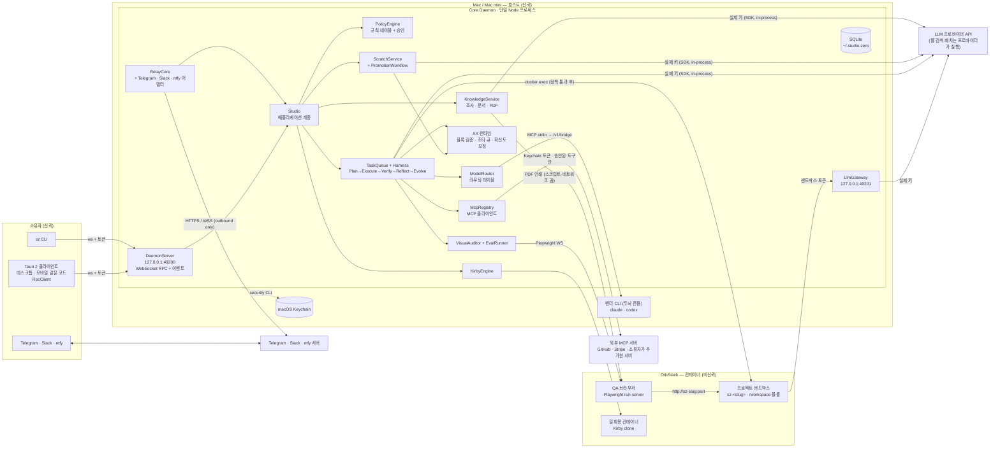
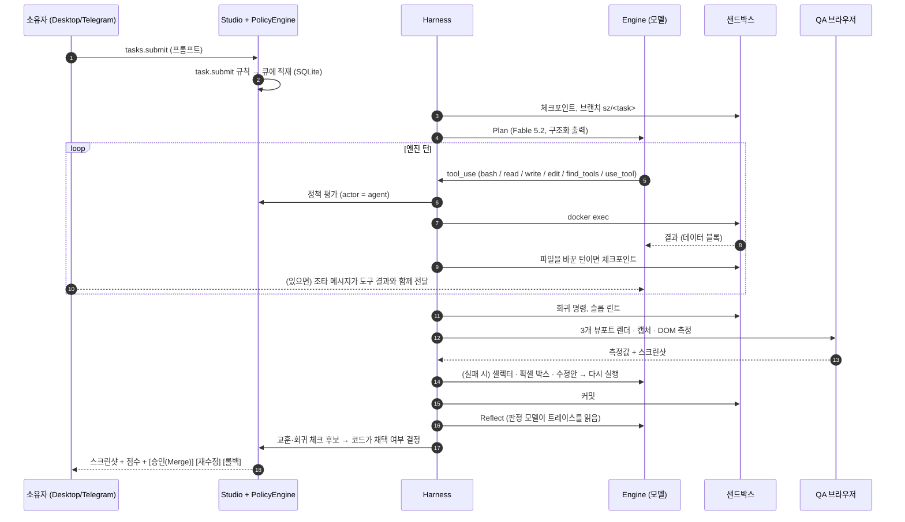

# Studio Zero 아키텍처

Studio Zero는 생각을 정리하고, 조사하고, 문서를 쓰고, 앱을 만들고, **스스로 검증한 뒤** 결과를 폰으로 보내 승인받는 스튜디오다.
이 문서는 저장소에 실제로 있는 코드를 기준으로 쓴 설계서다. 구현되지 않은 것과 검증되지 않은 것은 §17, §18에 따로 적었다.

- 코드: `packages/protocol` (계약), `packages/design` (디자인 계약·테마·UI 린트·문장 린트), `packages/ax` (AX 키트: 블록 어휘·이벤트 스트림·렌더러·텔레메트리), `packages/daemon` (코어 데몬), `apps/desktop` (Tauri 2 클라이언트)
- 규모: 소스 111개 파일 약 17,000줄, 테스트 62개
- 런타임: Node.js 24 (개발은 TypeScript를 그대로 실행, 상시 가동은 `pnpm build`의 esbuild 번들), SQLite(`node:sqlite`), Fastify 5

## 1. 컨테이너 다이어그램 (C4 Level 2)



신뢰 경계는 세 개다.

1. **호스트 ↔ 컨테이너.** 샌드박스·QA 브라우저·일회용 컨테이너 안의 모든 것(에이전트가 쓴 코드, 렌더링된 페이지, 남의 저장소)은 비신뢰다. 여기서 나온 데이터는 스키마 검증을 거쳐 "데이터 블록"으로만 모델에 들어간다.
2. **소유자 ↔ 그 외.** 소유자는 전송 계층이 정한다: 토큰으로 인증된 제어 소켓, 허용 목록에 있는 Telegram·Slack 사용자 ID, ntfy의 경우 데몬이 HMAC으로 서명해 보낸 원탭 명령. 메시지 내용으로는 누구도 소유자가 될 수 없다.
3. **데몬 ↔ 바깥 서비스.** 웹 검색 결과, 읽어 온 페이지, 외부 MCP 서버가 말하는 도구 설명과 호출 결과는 전부 비신뢰 데이터다. 바깥으로 나가는 호출(외부 도구)은 소유자가 도구 단위로 허용한 것만 나간다.

## 2. 세 가지 불변식이 강제되는 위치

| 원칙 | 코드에서 강제되는 방식 | 파일 | 검증하는 테스트 |
|---|---|---|---|
| **Policy lives in the server** | 모든 부수효과는 타입이 있는 `Action`(22종)이다. 19개 규칙의 순서 있는 테이블이 `allow / deny / require_approval`을 결정하고, 일치하는 규칙이 없으면 거부한다. 규칙은 모델을 호출하지 않는다. 승인은 액션의 SHA-256 해시에 묶이고 1회용이며 만료된다. 승인 문구도 액션 필드에서 코드가 만든다. | `policy/actions.ts`, `policy/PolicyEngine.ts` | `vault-policy.test.ts` |
| **토큰 예산** | 모델 요청 전에 항상 `llm.request` 규칙(태스크 예산, 프로젝트 24시간 예산)을 평가한다. 데몬 자체 호출, 게이트웨이 경유 호출, CLI 브릿지 호출 모두 같은 규칙을 탄다. | `llm/ClaudeClient.ts`, `llm/LlmGateway.ts` | `vault-policy.test.ts`, `relay-gateway.test.ts` |
| **Untrusted by default** | 비신뢰 텍스트는 `untrusted()`로 감싼다(블록마다 96비트 난수 ID, 내용은 자기 블록을 닫을 수 없음). 시스템 프롬프트는 전부 상수이며 동적 내용을 이어 붙이는 코드 경로가 없다. | `trust/dataBlock.ts`, `harness/prompts.ts` | `vault-policy.test.ts`, `e2e.test.ts` |
| **Keys stay out of the sandbox** | 컨테이너 환경변수는 `OrbStackManager`가 타입 있는 입력으로만 조립한다. 샌드박스에는 프로바이더 키 대신 샌드박스 전용 토큰과 게이트웨이 주소가 들어간다. 게이트웨이가 호스트에서 토큰을 실제 키로 바꾼다. DB에는 토큰의 해시만 있다. 외부 도구 서버의 토큰도 같다: 호출은 데몬이 호스트에서 하고, 토큰은 Keychain에서 그 서버로 가는 요청 헤더로만 나간다. | `sandbox/OrbStackManager.ts`, `llm/LlmGateway.ts`, `vault/KeychainVault.ts`, `mcp/McpRegistry.ts` | `sandbox.test.ts`, `relay-gateway.test.ts`, `mcp.test.ts`, `engine.integration.test.ts` |

데이터 블록은 모델이 주입된 문장을 따를 확률을 낮출 뿐이다. 안전은 정책이 보장한다: 주입에 완전히 조종당한 에이전트도 `agent` 행위자가 가진 권한(샌드박스 안에서의 실행, `/workspace` 쓰기, 소유자가 이미 허용한 외부 도구 호출)만 쓸 수 있다.

## 3. 데이터 흐름

### 3.1 태스크 한 건



검증 단계의 주체는 데몬이다. 엔진이 "끝났다"고 말하는 것은 통과 조건이 아니다.

### 3.2 승인

에이전트 행위가 `require_approval`을 받으면 `PolicyEngine.authorize()`가 그 자리에서 기다린다. `approval.requested` 이벤트가 나가고(데스크톱 구독, Telegram 인라인 버튼), 소유자 채널에서 `resolveApproval`이 호출되면 기다리던 호출이 재개된다. 승인 건은 `pending → approved → consumed` 순서로 정확히 한 번만 쓰인다. 다른 액션(해시가 다름)에는 쓸 수 없다. 데몬이 승인과 실행 사이에 재시작해도 같은 액션에 대한 미사용 승인은 다시 쓸 수 있다.

### 3.3 키 경로

| 호출자 | 자격 증명이 있는 곳 | 경로 |
|---|---|---|
| 데몬 자체 (Plan, 비전 감사, Reflect, Kirby, 네이티브 코딩 루프) | Keychain → 데몬 프로세스 메모리 | Anthropic SDK, in-process |
| 샌드박스 안의 코드 (만들어진 앱이 LLM을 부를 때) | 샌드박스 전용 토큰 | `ANTHROPIC_BASE_URL` → LlmGateway → 실제 키로 교체 → 프로바이더 |
| 구독 세션 브릿지 (Claude Code, Codex) | 벤더 CLI가 자체 보관 (데몬은 읽지 않음) | CLI는 호스트에서 "두뇌"로만 실행, 도구는 MCP shim → `/v1/bridge` → Toolbox |
| 외부 도구 호출 (GitHub, Stripe 등) | Keychain `mcp/<서버>/token` → 데몬 프로세스 메모리 | 에이전트는 `use_tool`로 요청만 한다. 데몬의 MCP 클라이언트가 등록된 주소로 호출하고, 리다이렉트는 같은 출처 안에서만 따른다. |

## 4. 코어 데몬 모듈

조립은 `app/compose.ts` 한 곳에서 한다. 전역 상태와 서비스 로케이터는 없다.

| 모듈 | 파일 | 책임 |
|---|---|---|
| `DaemonServer` | `server/DaemonServer.ts`, `server/handlers.ts` | 루프백 Fastify. WebSocket RPC, 이벤트 재생 후 실시간 전환, 아티팩트, 브릿지 엔드포인트. 토큰(상수 시간 비교) + Host 허용 목록(DNS 리바인딩 차단) + Origin 허용 목록. 느린 구독자는 끊는다. |
| `Studio` | `app/Studio.ts` | 소유자가 할 수 있는 모든 동작. RPC와 메신저 릴레이는 이 클래스의 얇은 어댑터라서 채널이 달라도 동작과 정책 검사가 같다. |
| `PolicyEngine` | `policy/` | §2. 모든 평가를 `policy_decisions`에 기록한다. |
| `OrbStackManager` | `sandbox/OrbStackManager.ts`, `sandbox/scripts.ts` | `docker --context orbstack`. 프로젝트당 컨테이너 1 + 볼륨 1 + 네트워크 1. 비루트, `--cap-drop ALL`, `no-new-privileges`, CPU/메모리/PID 제한, 호스트 마운트 없음. 체크포인트와 롤백, 브랜치, 병합, QA 브라우저, 일회용 컨테이너. 프로젝트별 뮤텍스. |
| `KeychainVault` | `vault/KeychainVault.ts` | `/usr/bin/security`. 비밀은 argv에 나타나지 않는다(`security -i`에 stdin으로, 16진수로). 저장 형식은 `sz1:<base64>`. 쓰기 후 다시 읽어 확인한다. |
| 릴레이 | `relay/RelayCore.ts`, `TelegramRelay.ts`, `SlackRelay.ts`, `NtfyRelay.ts` | 명령 해석과 알림은 채널과 무관한 `RelayCore`에 있고 어댑터는 전송만 한다. Telegram: long polling, 허용된 사용자 ID의 1:1 대화만, 오프셋을 처리 전에 저장(at-most-once: 유료 태스크가 두 번 시작되지 않음), 음성 메모는 받아쓰기 후 같은 경로. Slack: Socket Mode(인바운드 포트 없음). ntfy: 알림과, 데몬이 HMAC으로 서명한 원탭 명령만 받는다. |
| `LlmGateway` | `llm/LlmGateway.ts` | 샌드박스용 리버스 프록시. 엔드포인트 허용 목록, 예산 게이트, 키 교체, 스트림을 건드리지 않는 사용량 계측. |
| `ModelRouter` | `llm/ModelRouter.ts`, `config.ts` | 태스크 종류별 후보 테이블에서 사용 가능한 첫 엔진을 고른다. 모델에게 묻지 않는다. 고려한 후보와 이유가 이벤트로 남는다. |
| 엔진 | `harness/engines/` | `NativeClaudeEngine`(Messages API 수동 루프), `CliBridgeEngine`(Claude Code, Codex). 둘 다 같은 `Toolbox`만 쓰고, 같은 조타 큐를 읽는다. |
| `Toolbox` | `harness/Toolbox.ts` | 도구 6개: 샌드박스용 `bash`, `read_file`, `write_file`, `edit_file`과 외부 도구용 `find_tools`, `use_tool`. 스키마 검증 → 정책 → 샌드박스 또는 MCP 클라이언트 → 결과를 데이터 블록으로. 파일을 바꾼 턴마다 체크포인트를 남긴다. |
| `WorkspaceProvisioner` | `harness/bootstrap.ts`, `harness/axKit.ts` | 샌드박스를 띄우고 프로젝트 고유 테마, 런타임 설명 파일, AX 키트(§12)를 첫 커밋으로 넣는다. 이미 있으면 덮어쓰지 않는다. |
| `Harness`, `TaskQueue` | `harness/Harness.ts`, `queue/TaskQueue.ts` | §8. 큐는 SQLite 위에 있고 재시작 후 중단된 태스크를 한 번 다시 넣는다. 프로젝트당 동시 1건. |
| `VisualAuditor`, `EvalRunner` | `qa/`, `harness/EvalRunner.ts` | §7. |
| `LessonBook`, `ReflectionAgent` | `harness/` | §8. |
| `KirbyEngine` | `kirby/` | §9. |
| `ScratchService`, `PromotionWorkflow` | `scratch/` | §10. |
| `KnowledgeService` | `knowledge/` | §11. `ResearchPipeline`, `DocumentCompiler`, PDF 내보내기. |
| AX 런타임 | `ax/`, `packages/ax` | §12. 블록 어휘와 검증, `SteeringQueue`, `ConfidenceCalibration`. |
| `McpRegistry` | `mcp/McpRegistry.ts` | §13. |

기본 라우팅(`config.ts`, 설정으로 바꿀 수 있음):

| 태스크 | 1순위 | 대안 |
|---|---|---|
| 기획·아이디어 (`ideate`), 계획 수립 | Claude Fable 5.2 | 없음 |
| 빌드 (`build`), 인라인 수정 | Claude Opus 5.5 (네이티브 루프) | Claude Code 브릿지 |
| 멀티파일 리팩토링 (`refactor`) | Codex 브릿지 (기본 비활성) | Claude Code 브릿지 → Opus 5.5 |
| 검증 측 모델 (비전 감사, Reflect), 조사의 검색·읽기 | Claude Opus 5.5 (코드에 고정) | 없음 |
| 작업 노트 대화, 문서 작성 | Claude Fable 5.2 (코드에 고정) | 없음 |

## 5. 프로토콜

`packages/protocol/src/rpc.ts`의 테이블 하나가 서버 검증, 클라이언트 타입, 이 문서의 근거다. 메서드 54개, 이벤트 29종.

- 연결: `ws://127.0.0.1:49200/v1/ws`. 첫 프레임은 `{t:"hello", protocol, token, client}`. 5초 안에 오지 않거나 토큰이 틀리면 닫는다.
- 프레임: 클라이언트 `hello | req | sub | unsub`, 서버 `ready | res | err | evt | sub_closed`.
- 요청과 응답 모두 zod로 검증한다. 핸들러 버그는 깨진 프레임이 아니라 `internal` 오류가 된다.
- 이벤트는 추가 전용이고 `seq`가 단조 증가한다. `sub`에 `sinceSeq`를 주면 그 이후를 재생한 뒤 실시간으로 넘어간다(누락·중복 없음). 터널이 끊겨도 클라이언트는 마지막 `seq`로 다시 구독한다.
- 오류 코드: `unauthorized · invalid_params · unknown_method · not_found · conflict · policy_denied · approval_denied · unavailable · internal`
- 종료 코드: `4401` 인증 실패, `4406` 프로토콜 불일치, `4400` 잘못된 프레임, `4408` hello 타임아웃. 클라이언트는 44xx에서 재접속하지 않는다.
- `vault.set`은 있고 `vault.get`은 없다. 비밀은 데몬에서 클라이언트로 나가지 않는다.

`RpcClient`(`packages/protocol/src/client.ts`)는 플랫폼 `WebSocket`만 쓰므로 Tauri 웹뷰(데스크톱, iOS, Android)와 Node에서 같은 클래스가 돈다.

## 6. 데이터베이스

`~/.studio-zero/studio-zero.db`, WAL, `STRICT` 테이블 26개(`db/schema.ts`). 마이그레이션은 전진 전용이다(현재 3단계).

| 영역 | 테이블 |
|---|---|
| 프로젝트 | `projects`, `sandboxes`(게이트웨이 토큰은 해시만) |
| 실행 | `tasks`, `events`(추가 전용 트레이스), `usage_ledger` |
| 정책 | `approvals`, `policy_decisions`(허용 포함 전부) |
| 복구 | `checkpoints` |
| 품질 | `audits`, `artifacts`, `evals`, `eval_runs` |
| 학습 | `lessons`(근거 이벤트 seq 포함) |
| Kirby | `kirby_ingests`, `kirby_proposals` |
| 작업 노트 | `scratchpads`, `scratch_entries`, `scratch_spec`, `decisions`(채택한 것과 기각한 대안, 그 이유) |
| AX | `ax_outcomes`(추천과 실제 선택의 일치 여부, 확신도별) |
| 지식 작업 | `knowledge_jobs`(문서, 사실 시트, 린트 결과) |
| 외부 도구 | `mcp_servers`, `mcp_grants`(프로젝트·서버·도구 단위 허용) |
| 기타 | `credentials`(Keychain 항목 이름만), `relay_chats`, `kv` |

비밀 값은 이 DB에 저장하지 않는다.

## 7. Anti-Slop 디자인 시스템과 Visual QA

### 7.1 디자인 계약

`packages/design/src/contract.ts`의 객체 하나를 세 곳이 쓴다: 테마 생성기, 소스 린터, 렌더 감사. 숫자를 한 곳에서 바꾸면 셋이 같이 바뀐다.

| 항목 | 값 |
|---|---|
| 간격 | 4px 배수 |
| 글자 크기 | 12 · 14 · 16 · 18 · 20 · 24 · 30 · 36 · 48 · 60px (한 화면에 최대 6종) |
| 본문 | 최소 16px, 줄 높이 1.45–1.8, 한 줄 80자 이하 |
| 모서리 | 0 · 4 · 8 · 12px (한 화면에 최대 3종) |
| 대비 | 본문 7:1 (WCAG AAA), 큰 글자 4.5:1, 비텍스트 3:1 |
| 터치 영역 | 44×44px |
| 서체 | Geist, Pretendard (한글) |

계약은 규율(스케일, 리듬, 대비, 절제)만 고정하고 생김새는 고정하지 않는다. 팔레트와 모서리 스타일은 프로젝트 이름에서 만든 시드로 정하므로 프로젝트마다 다르다.

### 7.2 테마 (Tailwind v4)

`createTheme(seed)` → `renderThemeCss()`가 프로젝트의 `.studio-zero/theme.css`를 만든다.

- 색은 OKLCH로 정의하고, 텍스트 토큰은 **풀어서** 구한다: 가장 불리한 배경에 대해 목표 대비(+0.25 여유)를 만족하는 명도를 이분 탐색한다. 채도는 sRGB 색역 안으로 줄인다.
- `--color-*: initial` 등으로 Tailwind 기본 색·글자 크기·모서리·그림자 스케일을 제거한다. `bg-indigo-500`이나 `rounded-3xl`은 컴파일되지 않는다.
- 남는 유틸리티: `bg-bg · bg-surface · bg-sunken · text-fg · text-fg-muted · text-accent · bg-accent · text-on-accent · border-border · border-control-border · danger · success · warning`, `text-xs…6xl`, `rounded-sm/md/lg`, `shadow-sm/md`.
- 기본 레이어: 터치 기기에서 컨트롤 최소 44px, `:focus-visible`, `prefers-reduced-motion`, 한글 `word-break: keep-all`.

### 7.3 슬롭 린트 (정적)

`lintSources()`: 소스에서 14개 패턴을 찾는다. 파란색–보라색 그라디언트, Tailwind 기본 팔레트 클래스, 하드코딩 색, 임의 값(`p-[13px]`), 아이콘 자리의 이모지, 자간 넓힌 대문자 라벨, 링크 뒤 화살표, 큰 그림자, 기본 서체, `!important`, 채움 문구, 과한 모서리, 블록마다 등장 애니메이션, 그라디언트 남발. 예외는 `// sz-allow <rule>` 주석으로 남긴다.

### 7.4 Visual QA 워크플로우

```
dev 서버 기동(샌드박스) → QA 브라우저 컨테이너를 프로젝트 네트워크에 연결
 → 뷰포트별(iPhone 15 Pro · iPad Pro 11 · Desktop 1440) × 경로별:
     라이트 렌더 → 화면 단위 PNG 캡처(기기 픽셀 비율 그대로) → DOM 측정(collector) → 결정론적 검사(21개 규칙)
     다크 렌더 → 색 관련 검사만
     비전 리뷰(스크린샷 + 요소 목록 + 이미 측정된 결함) → 루브릭 6축 + 발견 사항
 → 점수 계산 → AuditReport 저장 → 실패 시 셀렉터·픽셀 박스·수정안을 엔진에 전달
```

- **측정이 먼저다.** 대비, 터치 영역, 가로 넘침, viewport 메타 누락, 글자 크기·간격·모서리의 스케일 이탈, 서체 미로딩은 브라우저가 계산한 값으로 산술 검사한다(`qa/checks.ts`). 반복 가능하고 토큰을 쓰지 않는다.
- **비전 모델은 측정할 수 없는 것만 본다.** 위계, 여백 리듬, 타이포 체계, 색 절제, 마이크로카피와 톤, 독창성. 이미 측정된 결함 목록을 받고 반복하지 말라는 지시를 받는다. 프롬프트 템플릿은 `qa/vision.ts`의 `VISION_SYSTEM_PROMPT` 상수이고 출력은 구조화 출력 스키마다. 좌표는 모델이 추정하지 않는다: 모델은 요소 ID를 지목하고, 코드가 그 ID를 셀렉터와 박스로 바꾼다.
- **점수** = 측정 점수 × 0.6 + 루브릭 평균 × 4. 측정 점수 = 100 − (블로커 14, 메이저 5, 마이너 1.5; 규칙당 상한 20). 같은 규칙·경로·요소가 여러 뷰포트에서 나오면 결함 1건이다. **통과 = 블로커 0건 그리고 점수 ≥ 85.** 리뷰어의 취향은 점수를 움직일 수 있어도 결함을 뒤집지 못한다.
- 감사 대상 경로와 dev 서버 명령은 워크스페이스의 `.studio-zero/project.json`에 있다. 에이전트가 고칠 수 있는 파일이라 비신뢰 입력으로 다룬다(스키마 검증, 포트는 공개된 프리뷰 포트로 제한).
- QA 브라우저는 필요할 때 뜨고 10분 쉬면 내려간다.

## 8. 하네스 루프와 자기 개선

`Harness.run()` (`harness/Harness.ts`):

| 단계 | 하는 일 |
|---|---|
| **Plan** | 라우팅 → 워크스페이스 체크포인트 → 태스크 브랜치 → 활성 교훈 로드 → Fable 5.2가 계획(구조화 출력) 작성. 계획이 제안한 감사 경로는 단순 앱 경로만 남긴다. |
| **Execute** | 엔진이 Toolbox로 작업한다. 매 턴 전에 예산 규칙, 매 응답 후 사용량 기록. 예산을 다 쓰면 소유자에게 증액 승인을 묻는다(최대 2회, 에이전트는 스스로 올릴 수 없음). |
| **Verify** | 데몬이 프로젝트의 eval을 직접 실행한다: 회귀 명령 → 슬롭 린트 → 시각 감사. 실패 내용을 데이터 블록으로 엔진에 돌려준다. 최대 `verifyRounds`(기본 3)회. |
| **Reflect** | 판정 모델이 번호 붙은 트레이스를 읽고 원인, 교훈, 회귀 체크를 제안한다. |
| **Evolve** | 코드가 채택을 결정하고 `project_rules.md`, `system_heuristics.json`을 다시 쓴다. |

실패하거나 취소되어도 작업은 브랜치에 커밋된 채 남고 워크스페이스는 통합 브랜치로 돌아간다. 데몬 종료로 중단된 태스크는 다음 기동 때 한 번 다시 실행된다.

**학습의 쓰기 경로를 좁힌 이유.** 비신뢰 내용이 섞인 트레이스에서 모델이 뽑은 문장을 다음 프롬프트에 자동으로 넣으면, 그것이 프롬프트 인젝션이 영구히 남는 통로가 된다. 그래서:

1. 교훈 문장은 `lintLesson()`을 통과해야 한다(URL, 네트워크 도구, 인코딩된 덩어리, 승인·정책·자격증명 언급, 지시 무효화, 검증 약화 금지).
2. 인용한 이벤트 `seq`가 그 태스크의 트레이스에 실제로 있어야 한다.
3. `candidate`로 시작한다. 후보는 소유자에게 보이고 에이전트에게는 보이지 않는다.
4. 승격은 정책이 정한다: 소유자가 직접 하거나, 서로 다른 태스크 2건이 독립적으로 같은 교훈을 내고 해가 보고되지 않았을 때(프로젝트 범위만). 전역 교훈은 항상 소유자가 승격한다.
5. 해 보고 2건이면 격리된다.
6. 활성 교훈은 user 턴의 조언으로 들어간다. 시스템 프롬프트에는 넣지 않는다.

회귀 eval도 같다. 모델은 명령을 만들어낼 수 없고, **그 태스크에서 에이전트가 실제로 실행해 0으로 끝난 명령만** 승격된다. eval 정의는 워크스페이스가 아닌 데몬 DB에 있어서 검증받는 에이전트가 고치거나 지울 수 없다. 끄는 것은 소유자만 한다.

`project_rules.md`와 `system_heuristics.json`은 `~/.studio-zero/` 아래(워크스페이스 바깥)에 생성되는 읽기용 산출물이고 원본은 DB다.

## 9. Kirby 파이프라인

```
ingest      허용 호스트의 https URL만. 일회용 컨테이너(볼륨·자격증명 없음, 읽기 전용 루트)에서
            얕은 clone(훅·서브모듈·https 외 프로토콜 차단) → 파일을 텍스트로만 읽어 호스트로 전달
            → 호스트가 출력을 다시 검증(경로 정규화, 크기 한도)
analyze     TypeScript 컴파일러 API로 JS/TS 구문 트리 파싱 → RepoProfile:
            모듈 그래프(경로 별칭 해석), 순환 수, any·억제 주석 수, 복잡도, 12개 프랙티스의 존재 여부와 파일:줄 근거
fit-gap     소스에 근거와 함께 있고 타깃에 없는 프랙티스 = 갭. 고정된 우선순위. 결정론적이며 모델을 쓰지 않는다.
propose     상위 갭마다 설계 모델이 제안 카드(근거, 계획된 변경, 위험도, 예상 효과)와 구현 브리프를 쓴다.
materialize 소유자가 시작. 일반 태스크로 `kirby/<id>` 브랜치에 구현하고 회귀 eval을 통과해야 한다.
measure     같은 분석을 브랜치와 통합 브랜치(임시 worktree)에 돌려 실제 diff와 실측 변화를 카드에 붙인다.
merge       소유자 승인. 일반 병합과 같은 경로(사전 체크포인트, 필요 시 재검증, 실패 시 자동 복원).
```

- 남의 코드는 어디서도 실행되지 않고(설치, import, 훅 모두 없음) 프로젝트 워크스페이스에 들어오지 않는다. 넘어오는 것은 프랙티스에 대한 설명이다.
- 카드의 **예상 효과**는 모델의 추정으로 표시되고, **실측**(`any` 수, 순환, 테스트 파일, 슬롭 린트, 프랙티스 채택 여부)이 그 옆에 붙는다. 런타임 성능 수치는 측정하지 않는다.
- 코드를 복사하지 말라고 지시한다(라이선스, 맥락 차이). 카드에는 소스 저장소와 커밋이 기록된다.

## 10. 작업 노트와 승격 (2단계 수명주기)

생각을 정리하는 데 컨테이너와 저장소는 필요 없다. 그래서 수명주기를 둘로 나눴다.

**1단계: 작업 노트** (`scratch/ScratchService.ts`). `scratch.create`는 DB에 행 하나를 만들고 바로 돌아온다. 샌드박스도, 저장소도, 프로젝트도 없다. 에이전트의 한 차례는 도구 세 개로만 바깥에 영향을 준다.

| 도구 | 하는 일 |
|---|---|
| `present` | A2UI 블록(§12)을 노트에 올린다. 질문은 `choice`·`form` 블록이고 소유자의 답을 기다린다. |
| `record_decision` | 결정 하나를 `decisions`에 남긴다: 무엇을 골랐는지, 왜, **무엇을 왜 기각했는지**, 확신도. |
| `update_spec` | 기획 명세의 한 항목(문제, 사용자, 범위 포함·제외, 요구사항, 성공 기준, 미해결 질문)을 쓴다. |

소유자가 고르는 네 가지 기법(`scratch.move`)은 같은 루프에 주는 지시다: 여덟 갈래(Crazy Eights), 가상 사용자 5명, 반대 검토(레드팀), 명세로 모으기.

`decision_log.md`와 `spec.md`는 모델이 쓰는 파일이 아니다. `scratch/compile.ts`가 테이블에서 매번 다시 만든다. 그래서 기각된 대안이 대화가 길어져도 사라지지 않는다.

**상태 기계.** `exploring → ready → promoted`, 그리고 어디서든 `archived`. `ready`는 데몬이 계산한다(`readiness()`): 명세의 문제·사용자·범위(포함)·요구사항이 채워져 있고, 기록된 결정이 1건 이상이고, 답하지 않은 질문이 없을 때. 에이전트가 "준비됐다"고 말하는 것은 조건이 아니다.

**2단계: 승격** (`scratch/PromotionWorkflow.ts`). 소유자만 할 수 있다(`scratch.promote` 규칙).

```
[이 기획으로 프로젝트 빌드 시작]
  준비 상태 재확인 → 정책 → 프로젝트 생성 + 샌드박스 프로비저닝(완료까지 대기)
  → docs/spec.md, docs/decision_log.md를 워크스페이스에 쓰고 커밋
  → 첫 build 태스크 제출: 두 문서 전문이 요청 본문에 들어간다(<spec>, <decision_log>)
  → 노트는 promoted, projectId가 연결된다

[정식 기획서 발행]
  같은 두 문서를 DocumentCompiler(§11)에 브리프로 넘긴다 → 결과가 노트에 블록으로 돌아온다
```

빌더는 대화에 없었어도 무엇이 결정됐고 무엇이 왜 기각됐는지를 전부 받는다. 프롬프트는 기각된 대안을 다시 꺼내지 말라고 지시한다.

## 11. 지식 작업: 조사와 문서

코드가 아닌 일은 `KnowledgeService`가 백그라운드 작업으로 돌린다. 샌드박스를 쓰지 않고(아무것도 실행하지 않으므로), 비용은 스튜디오 자체 예산 범위(`prj_studio`, 일일 한도)에 계상한다.

**조사** (`knowledge/ResearchPipeline.ts`). 프롬프트 하나에 맡기지 않고 데몬이 단계를 돈다.

```
plan     질문을 겹치지 않는 하위 질문 3개(brief) 또는 6개(deep) 이하로 나눈다 (구조화 출력)
gather   하위 질문마다 모델이 프로바이더의 서버 도구(web_search, web_fetch)로 찾고 읽는다.
         결과는 산문이 아니라 report_findings 도구로 넘기는 주장 목록이다: 주장 + 출처 URL + 원문 인용
verify   코드가 검증한다 (verifyFindings):
           · 출처는 이 실행에서 실제로 검색되거나 읽힌 URL일 때만 센다
           · 인용은 읽어 온 페이지 본문에 그 문장이 있을 때만 "확인됨"
           · 확신도는 모델이 아니라 근거로 정한다: 독립 도메인 2곳 이상 high, 1곳 medium,
             출처끼리 어긋나면 speculative, 확인된 출처가 없으면 버리고 "버린 주장"에 남긴다
compile  남은 사실에 번호 붙은 출처를 달아 문서 컴파일러로 넘긴다
```

크롤링은 프로바이더 쪽에서 일어난다. 이 Mac은 남의 페이지를 받아 오거나 실행하지 않는다. 사실 시트는 작성 모델에 데이터 블록으로 들어간다.

**문서** (`knowledge/DocumentCompiler.ts`, `packages/design/src/textLint.ts`). 작성 모델이 초안을 쓰면 결정론적 린터가 판정한다.

| 규칙 | 잡는 것 |
|---|---|
| `text/cliche` | "혁신적인", "패러다임", "급변하는 시대", seamless, leverage 같은 빈 수식어 |
| `text/throat-clearing` | 문서 자신이나 시대를 설명하는 서두 |
| `text/no-bluf`, `text/long-bluf` | 첫 섹션이 결론이 아니거나 너무 긴 것 |
| `text/structure` | 문서 종류(brief, report, PRD, RFC)에 필요한 섹션 누락 |
| `text/vague-quantity`, `text/no-numbers` | "많은", "상당한"처럼 수치 없는 양 |
| `text/hedge-stack` | 한 문장에 겹친 유보 표현 |
| `text/unsourced-figure`, `text/bad-citation`, `text/no-citations` | 출처 없는 수치, 없는 번호를 가리키는 인용 |
| `text/empty-list` | 설명 없이 덕목만 늘어놓은 목록 |
| `text/emoji`, `text/exclamation`, `text/mermaid-syntax` | 이모지, 느낌표, 다이어그램 종류가 없는 Mermaid |

위반은 줄 번호와 함께 작성 모델에 돌아가고 최대 3회 고친다. 끝까지 남은 위반은 문서와 함께 반환된다. 통과 여부는 린터가 정한다.

**PDF.** Markdown을 HTML로 바꿔 인쇄용 스타일을 입히고, 시각 감사와 같은 QA 브라우저 컨테이너에서 스크립트와 네트워크를 끈 채 인쇄한다. 문서가 웹에서 온 문장을 인용하고 있어도 배치만 된다.

**이동 중 심부름.** Telegram이나 Slack에서 `/research 이번 주 AI 인프라 투자 소식`(또는 "조사해줘"로 읽히는 문장)을 보내면 brief 깊이의 조사가 시작되고, 끝나면 `knowledge.state` 이벤트를 받은 릴레이가 브리핑을 그 채널로 보낸다.

## 12. AX: 에이전트와 일하는 방식

**A2UI.** 에이전트는 마크업을 보내지 않는다. `packages/ax/src/blocks.ts`의 타입 있는 블록 8종 가운데 고르고 채운다: `text`, `choice`, `comparison`, `form`(슬라이더·토글 포함), `diagram`(Mermaid), `decision`, `sources`, `checklist`. 데몬이 스키마로 검증하고, 클라이언트는 이미 가진 컴포넌트로 그린다. 링크는 http(s)만 통과한다. 에이전트가 고르는 것은 위젯의 종류와 내용이고, 위젯의 코드는 쓰지 못한다.

**확신도.** 선택지, 비교, 결정에는 `high / medium / speculative`가 붙고 화면에 그대로 보인다.

- `medium` 이하의 결정을 에이전트가 스스로 기록하려 하면 데몬이 거부한다(도구 오류). 그 수준의 분기는 소유자에게 물어야 한다.
- 소유자의 답이 추천과 같았는지를 `ax_outcomes`에 남긴다. 최근 20건(8건 이상일 때) 가운데 25%를 넘게 뒤집히면 `high`도 `medium`으로 취급한다(`ax/Calibration.ts`). 다시 맞히면 돌아온다.

**멈추지 않는 조타.** `tasks.steer`는 메시지를 큐에 넣고 바로 돌아온다(`ax/Steering.ts`). 네이티브 엔진은 도구 턴이 끝날 때마다 큐를 비워 메시지를 도구 결과와 같은 턴에 넣고, 엔진이 끝났다고 판단한 순간에도 한 번 더 확인한다. 벤더 CLI 브릿지는 라운드 경계에서 읽는다. `steer.queued`, `steer.delivered` 이벤트로 전달 여부가 보인다.

**시점 이동.** 태스크 시작 전과, 파일을 바꾼 턴마다 체크포인트가 생긴다(실측 약 45ms). 되돌리기는 지금 상태를 먼저 저장하고 돌아간다. 갈라 시작하기(`checkpoints.fork`)는 지금 작업을 건드리지 않고 그 시점에서 `fork/<id>` 브랜치를 만들며, `tasks.submit`의 `baseBranch`로 거기서 다음 태스크를 잇는다.

**만들어진 앱을 위한 AX 키트.** 스튜디오가 자기 화면에 쓰는 것과 같은 코드를 프로비저닝 때 모든 프로젝트의 `.studio-zero/ax/`에 넣는다(`react`와 `zod`만 필요).

| 부분 | 내용 |
|---|---|
| 스트림 | 서버용 `encodeEvent`, 클라이언트용 `readEvents`·`streamAgent`. 이벤트는 `text`, `block`, `activity`, `done`, `error`. 블록은 렌더러에 닿기 전에 스키마 검증을 거치고, 어긋난 이벤트는 세고 버린다. |
| 훅 | `useAgentStream`: 스트리밍 텍스트, 블록, 에이전트가 지금 하는 일, `stop`, 그리고 응답을 끊지 않는 `steer` |
| 렌더러 | `Block`, `Markdown`, `Flow`. 프로젝트의 테마 토큰만 쓴다. Markdown은 React 요소로만 만들어지고 HTML을 넣는 경로가 없다. |
| 텔레메트리 | `createTelemetry`: 첫 출력까지 걸린 시간, 실패 코드, 보인 블록 종류, 추천을 따랐는지와 그때의 확신도. 사람이 쓰거나 읽은 내용은 이벤트에 없다. |

코딩 엔진의 시스템 프롬프트는 제품에 AI 기능이 들어갈 때 채팅 말풍선 대신 이 키트를 쓰라고 지시한다.

## 13. 외부 도구: MCP 레지스트리

데몬이 MCP 클라이언트다(`mcp/McpRegistry.ts`, 스트리밍 HTTP). 에이전트는 서버에 직접 닿지 않는다.

- **레지스트리.** 코드에 든 카탈로그(GitHub, Stripe는 토큰 방식, Notion과 Figma는 OAuth라서 아직 사용 불가로 표시)와 소유자가 추가한 서버. 추가·삭제·허용 취소는 데스크톱의 소유자만 한다(`mcp.configure-local-owner-only`). 주소는 https만 받고, 이 Mac에서 도는 서버만 http://localhost를 쓸 수 있다.
- **필요할 때 찾기.** 도구 목록을 프롬프트에 미리 싣지 않는다. 엔진에는 고정된 도구 두 개가 있다: `find_tools(query)`는 서버별 사용 가능 여부와 맞는 도구의 입력 스키마를 돌려주고, `use_tool(server, tool, arguments)`가 호출한다. 도구 정의가 바뀌지 않으므로 프롬프트 캐시가 깨지지 않는다.
- **정책.** `mcp.call` 액션은 프로젝트, 서버, 목적지 호스트, 도구 이름을 담는다. 그 프로젝트에서 그 도구를 처음 쓸 때 소유자 승인을 기다리고, 승인은 `mcp_grants`의 행으로 남아 다음부터는 묻지 않는다. 다른 도구는 다시 묻는다. 승인을 요청하기 전에 서버가 쓸 수 있는 상태인지와 그 도구가 실제로 있는지를 먼저 확인하므로, 소유자가 없는 도구를 승인하게 되는 일은 없다.
- **자격 증명.** 토큰은 Keychain의 `mcp/<서버>/token`에 있고 데몬이 요청 헤더에 넣는다. 샌드박스, 모델, 이벤트 어디에도 나타나지 않는다.
- **결과.** 서버가 말하는 도구 설명과 호출 결과는 `external-tool` 데이터 블록으로 들어간다.

## 14. 클라이언트 (Tauri 2)

`apps/desktop`. Vite + React 19 + Tailwind 4, 셸은 Tauri 2(Rust). 데몬과는 `RpcClient` 하나로 말하고, 로컬에서는 Rust 쪽 명령이 Keychain에서 클라이언트 토큰을 읽어 준다.

화면은 패널 묶음이 아니라 **작업 노트 한 장**이다.

- 왼쪽 잉크색 레일: 작업 노트와 프로젝트 목록, 승인 대기 표시.
- 가운데 종이: 처음 화면은 빈 종이와 네 가지 시작 방식(생각 정리, 조사, 문서, 바로 만들기). 노트와 프로젝트는 위에서 아래로 읽는 한 쪽이고, 왼쪽 여백에 누가 언제 썼는지가 적힌다. 소유자가 쓴 것과 결정한 것은 어디서나 왼쪽 강조선으로 표시된다.
- 프로젝트 쪽에서는 태스크 하나가 한 단락이다: 요청, 계획, 접힌 작업 단계, 검증, 결과. 감사 증거, 프리뷰, 터미널은 그것을 만든 단락에서 열린다.
- 오른쪽 시점 레일: 체크포인트가 점으로 찍히고, 누르면 되돌리기와 갈라 시작하기가 나온다.
- 아래에 떠 있는 입력창: 실행 중이면 조타, 아니면 다음 태스크.

이 화면도 스튜디오가 만드는 앱과 같은 검사를 받는다: `apps/desktop/scripts/audit.ts`가 15개 화면 × 3개 뷰포트 × 라이트·다크를 실제 Chrome으로 그려 데몬의 DOM 검사를 돌린다(현재 블로커 0, 주요 0).

## 15. 배포

### Phase 1 — MacBook 단독

```bash
pnpm install
pnpm daemon                                   # 127.0.0.1:49200 (제어), 49201 (게이트웨이). 상시 가동은 pnpm build && pnpm start
pnpm sz vault set provider/anthropic/api-key  # 숨김 입력으로 키를 받아 Keychain에 저장
pnpm sz project create ledger "Ledger"
pnpm sz task ledger build "미결제 청구서 화면을 만들어줘"
```

첫 기동 때 클라이언트 토큰을 만들어 Keychain(`studio-zero` 서비스, `daemon/client-token`)에 둔다. 같은 Mac의 클라이언트는 거기서 읽는다.

데스크톱 앱: `pnpm --filter @studio-zero/desktop tauri build` (Rust 필요). 데몬 없이 화면만 보려면 `pnpm --filter @studio-zero/desktop dev` 후 `http://127.0.0.1:1420/?demo`.

### Phase 2 — Mac mini 상시 가동

1. **LaunchAgent로 등록**: `deploy/install-launch-agent.sh`(의존성 설치 → 번들 빌드 → 등록 → 시작). 시스템 LaunchDaemon이 아닌 이유는 로그인 Keychain과 OrbStack이 로그인한 사용자 세션에만 있기 때문이다. 로그인할 때 시작되고(`RunAtLoad`) 죽으면 다시 뜬다(`KeepAlive`). 등록한 뒤에는 `pnpm daemon`을 따로 켜지 않는다(같은 포트를 쓴다).
   - 코드를 바꾼 뒤: `pnpm build && pnpm daemon:restart`. 빌드는 번들을 통째로 바꾸므로 재시작하지 않으면 실행 중인 데몬이 나중에 불러올 조각을 찾지 못한다. 빌드가 끝나면 이 안내가 출력된다.
   - 로그: `~/Library/Logs/studio-zero/daemon.log`. 해제: `launchctl bootout gui/$(id -u)/zero.studio.daemon && rm ~/Library/LaunchAgents/zero.studio.daemon.plist`.
   - plist에는 설치할 때의 `node` 절대 경로가 들어간다. nvm으로 Node 버전을 바꾸거나 지우면 스크립트를 다시 실행한다.
2. **전원이 돌아왔을 때 스스로 올라오게 하려면** 자동 로그인이 필요하고, 자동 로그인은 FileVault와 함께 쓸 수 없다. 둘 중 하나를 고른다: 자동 로그인(디스크 암호화 포기) 또는 FileVault(정전 뒤 누군가 잠금을 풀 때까지 대기). 계획된 재부팅은 `sudo fdesetup authrestart`로 넘길 수 있다.
3. 잠자기 방지(`sudo pmset -a sleep 0 disksleep 0`), OrbStack 로그인 시 시작.
4. **원격 접속은 Tailscale Serve**(tailnet 전용 HTTPS, 포트 개방 없음):
   ```bash
   tailscale serve --bg 49200        # 문법은 `tailscale serve --help`로 확인
   ```
   그리고 `~/.studio-zero/config.json`에 `"listen": {"allowedHosts": ["macmini.<tailnet>.ts.net"]}`. 클라이언트는 `SZ_URL=wss://macmini.<tailnet>.ts.net/v1/ws`와 `sz token`으로 옮긴 토큰을 쓴다.
5. **메신저는 인바운드 연결이 필요 없다.** Telegram은 long polling, Slack은 Socket Mode다. `sz vault set relay/telegram/bot-token`(Slack은 `relay/slack/app-token`, `relay/slack/bot-token`), 설정에 `telegram.enabled`·`slack.enabled`와 각자의 `allowedUserIds`.
6. tailnet에 들어올 수 없는 기기가 있을 때만 Cloudflare Tunnel(`deploy/cloudflared/config.example.yml`)을 쓰고 Cloudflare Access를 앞에 둔다. **Tailscale Funnel은 권하지 않는다**: 제어 소켓이 인터넷 전체에 노출되고 방어선이 토큰 하나가 된다.

데몬은 공용 인터페이스에 바인딩하지 않는다. 원격 접속은 항상 같은 루프백 리스너 앞에 터널을 두는 형태다.

## 16. 위협과 대응

| 위협 | 대응 |
|---|---|
| 웹 페이지, 빌드 로그, 남의 저장소에 심어진 프롬프트 인젝션 | 데이터 블록 + 상수 시스템 프롬프트. 뚫려도 `agent` 권한뿐. 병합·롤백·외부 코드 도입은 승인 필요. |
| 인젝션이 교훈으로 저장되어 다음 세션에 재주입 | §8의 쓰기 경로(린트, 근거 seq, 후보 상태, 독립 확인 2회) |
| 에이전트가 자기 검증을 무력화 | eval 정의는 DB에 있음. 끄기는 소유자만. 교훈 린트가 검증 약화 문구를 거부. |
| 샌드박스 코드가 프로바이더 키를 탈취 | 키가 샌드박스에 없음. 샌드박스 토큰은 게이트웨이에서 그 프로젝트의 예산 안에서만 유효. |
| 샌드박스에서 호스트의 제어 포트로 접근 | 모든 경로에 토큰. 브릿지 엔드포인트는 루프백 + 태스크 전용 토큰. |
| 로컬 웹 페이지가 `ws://localhost:49200`에 접속 (DNS 리바인딩 포함) | Origin 허용 목록, Host 허용 목록, 토큰 |
| Telegram 사칭, 그룹방 | 숫자 사용자 ID 허용 목록 + 1:1 대화만. 자격증명 관리는 Telegram에서 불가(`vault.local-owner-only`). |
| 악성 저장소 (Kirby) | 호스트 허용 목록, 일회용 컨테이너, 실행 없음, 출력 재검증 |
| 승인 재사용 | 액션 해시 바인딩, 1회 소비, 만료 |
| 환경 변수로 모델 요청의 목적지나 자격 증명이 바뀜 | SDK 클라이언트의 주소를 코드에 고정하고 환경의 토큰을 받지 않는다. 키는 Keychain의 것만 쓴다. |
| 잘못 붙여 넣은 API 키가 작업 도중에야 드러남 | 저장할 때 공백을 거르고 제공자에게 토큰을 쓰지 않는 요청으로 물어본다. 거부된 키는 저장하지 않는다. |
| 폭주하는 비용 | 태스크 예산, 프로젝트 일일 예산, 턴 상한, 검증 라운드 상한. 증액은 소유자 승인. |
| 조종당한 에이전트가 외부 서비스에 쓰기 (이슈 생성, 결제, 삭제) | 외부 호출은 `use_tool` 하나뿐이고, 프로젝트·서버·도구 단위로 소유자가 한 번 승인해야 한다. 승인 문구에 목적지 호스트가 들어간다. |
| 외부 도구 결과나 도구 설명에 심어진 인젝션 | `external-tool` 데이터 블록. 뚫려도 이미 허용된 도구만 쓸 수 있다. |
| 외부 도구 토큰 유출 | Keychain → 요청 헤더. 샌드박스·모델·이벤트에 없음. 리다이렉트는 같은 출처만. |
| 모델이 출처를 지어내거나 인용을 꾸밈 | 이 실행에서 실제로 받은 URL만 출처로 인정, 인용은 받아 온 본문과 대조, 확신도는 코드가 계산 (§11) |
| 에이전트가 낮은 확신의 결정을 혼자 내림 | `record_decision`은 `high`만 받는다. 보정 기록이 나쁘면 `high`도 묻게 된다 (§12) |
| 만들어진 앱에서 모델 출력이 마크업으로 실행됨 | AX 키트: 스키마 밖 블록은 버림, 링크는 http(s)만, Markdown은 요소로만 렌더 |

남는 위험: `security` CLI로 만든 Keychain 항목은 같은 로그인 세션의 다른 프로세스가 `security`로 읽을 수 있다(디스크 탈취와 다른 사용자는 막고, 같은 세션의 악성코드는 못 막는다). 앱별 ACL은 코드 서명된 헬퍼가 필요하다.

## 17. 검증 현황

`pnpm typecheck`와 `pnpm test`가 통과한다: 62개 가운데 60개 통과, 2개는 옵트인이라 기본 실행에서 건너뛴다(실제 Keychain, 실제 컨테이너 엔진). 헤드리스 Chrome이 필요한 테스트는 Chrome이 없으면 건너뛴다. 옵트인 `SZ_TEST_ENGINE=1`은 이 Mac의 OrbStack에서 9개 하위 테스트가 모두 통과했다.

| 검증됨 | 방법 |
|---|---|
| 정책 규칙 테이블, 예산과 증액 승인, 승인 수명주기, 데이터 블록 | 단위 테스트 |
| 체크포인트·롤백·병합·충돌 중단, 턴 단위 체크포인트, 포크와 포크에서 이어가기 | 실제 git (작업 트리가 정확히 복원되는지 포함) |
| 제어 소켓 인증, Origin/Host 차단, RPC, 이벤트 재생 | 실제 WebSocket |
| 세션 브릿지 도구 경로 | MCP shim을 실제 자식 프로세스로 실행 |
| 게이트웨이 키 교체·계측·예산 | 가짜 업스트림 HTTP 서버 |
| Telegram, Slack, ntfy 흐름 | 가짜 서버 (Bot API, Socket Mode, ntfy) |
| 테마의 AAA 대비 | 24개 색상 × 3개 채도 × 라이트/다크 수치 검사 + 실제 Chrome 렌더 측정 |
| DOM 수집기와 검사 | 실제 헤드리스 Chrome |
| 하네스 전체 루프 (감사 실패 → 좌표 피드백 → 수정 → 통과 → 회고 → 병합 → 롤백) | 실제 Chrome + 스크립트된 모델 |
| 실행 중 조타가 다음 턴에 도구 결과와 함께 전달되는 것 | 스크립트된 모델 |
| 작업 노트 → 승격: 낮은 확신 결정의 거부, 결정 기록 컴파일, 명세·결정 기록이 저장소와 첫 요청에 그대로 들어가는 것 | 스크립트된 모델 + 컨테이너 에뮬레이터 |
| 확신도 보정 (강등과 회복) | 단위 테스트 |
| 조사: 실제로 받은 URL만 출처로 인정, 인용 대조, 근거 기반 확신도, 버린 주장 기록 | 프로바이더 응답 형태의 픽스처 |
| 문서: 린트에 걸린 초안이 줄 번호와 함께 되돌아가 고쳐지는 루프, 인용 번호 검사 | 스크립트된 모델 |
| PDF 내보내기 (스크립트·네트워크 끔) | 실제 Chrome |
| AX 키트: 바이트가 어디서 잘려도 같은 이벤트, 스키마 밖 블록과 `javascript:` 링크 거부, 텔레메트리 배치 | 단위 테스트 |
| AX 키트가 프로젝트에 들어가는 형태 그대로 번들되는 것 (외부 의존은 react, zod뿐) | esbuild |
| MCP: 발견, 도구별 1회 승인과 기억, 거부·없는 도구·OAuth 서버 처리, 토큰이 이벤트에 없음 | **공식 MCP SDK 클라이언트가 같은 SDK의 실제 서버와 HTTP로 통신** |
| Kirby 전체 파이프라인 | 스크립트된 모델 + 로컬 저장소 픽스처 |
| 실제 컨테이너 엔진: 격리 설정(uid 1000, 권한 0, no-new-privileges), 샌드박스→게이트웨이 키 교체, 제어 소켓 차단, dev 서버와 프리뷰 URL, 볼륨 체크포인트·롤백, 재생성, QA 브라우저 컨테이너로 시각 감사, Kirby 실제 clone | OrbStack 2.2.5 (`SZ_TEST_ENGINE=1`) |
| 클라이언트 화면 | 15개 화면 × 3개 뷰포트 × 라이트·다크를 Chrome으로 렌더해 DOM 검사: 블로커 0, 주요 0. 슬롭 린트 0건. |
| Tauri 앱 | 빌드, 실행, 데몬에 `desktop/0.1.0`으로 접속하는 것까지 |
| LaunchAgent: 등록, launchd 아래에서 기동, OrbStack 접근, Keychain에서 클라이언트 토큰 읽기, 벤더 CLI 탐지, `kickstart -k` 재시작 때 정상 종료(종료 코드 0)와 클라이언트 재접속 | 이 MacBook에서 실제 등록 상태로 확인 |
| `security` CLI 플래그와 종료 코드 44 | 실제 CLI (읽기 전용) |

실측 (MacBook, OrbStack):

| 항목 | 값 |
|---|---|
| 샌드박스 생성 | 약 0.5초 (이미지 빌드가 필요한 첫 회 7.7초) |
| 체크포인트 / 롤백 | 약 45ms / 약 70ms |
| 데몬 상주 메모리 | 번들 실행 101MB (TypeScript 직접 실행 130MB) |
| 쉬는 샌드박스 | 844KiB |
| Tauri 앱 | 메인 프로세스 102MB + WebKit 콘텐츠 약 78MB |

| 검증되지 않음 | 이유 |
|---|---|
| 실제 모델 호출 전부 (계획, 코딩, 비전 감사, 작업 노트, 조사의 웹 검색·페치, 문서 작성) | 요청 형태는 설치된 SDK 타입으로 검사했다. 실제 전송은 소유자의 첫 실행 한 번뿐이고 그 요청은 키가 거부되어(401) 끝났다. 유효한 키로 끝까지 돈 적은 없다. |
| 벤더 CLI 브릿지 실행 | 플래그는 설치된 버전의 `--help`와 대조. 실행하면 구독 할당량을 쓰므로 하지 않음. |
| Telegram·Slack·ntfy 실서버, 음성 받아쓰기 | 가짜 서버로만 확인 |
| GitHub·Stripe의 실제 MCP 서버 | 주소는 각 사 문서로 확인했으나 토큰이 없어 호출하지 않음 |
| Keychain 쓰기·읽기 왕복 | 옵트인 테스트로 제공(`SZ_TEST_REAL_KEYCHAIN=1`). 데몬 기동 때 클라이언트 토큰 항목이 실제로 만들어지는 것은 확인. |
| iOS·Android 빌드 | Rust 타깃(rustup)과 Xcode·Android SDK 설정이 필요. 클라이언트 코드는 폰 폭에서 감사를 통과했다. |
| 로그아웃·재로그인, 재부팅 뒤 자동 기동 | LaunchAgent가 `RunAtLoad`로 등록된 것까지만 확인. 실제로 로그아웃하거나 재부팅해 보지는 않았다. |
| Tailscale, Cloudflare | 문법만 확인 |

## 18. 브리프와 다르게 한 결정, 그리고 만들지 않은 것

| 브리프 | 실제 | 이유 |
|---|---|---|
| Launchd Daemon | LaunchAgent | Keychain과 OrbStack이 사용자 세션에 있음 (§15) |
| Keychain에 AES-256으로 저장 | Keychain 자체 암호화에 맡김 | 자체 키를 같은 Keychain에 둔 2중 암호화는 보호를 더하지 않음 |
| Tauri 클라이언트 30–50MB | 메인 102MB + WebKit 78MB | 실측. Electron보다는 가볍지만 목표에는 못 미친다. WebKit 프로세스는 시스템 것이라 줄일 여지가 작다. |
| 에이전트가 런타임에 위젯을 동적 생성 | 타입 있는 블록 8종에서 고르고 채움 | 에이전트가 쓴 UI 코드를 클라이언트가 실행하면 "untrusted by default"가 깨진다 (§12) |
| 확실한 작업은 즉시 자율 실행 | `high`만, 그리고 보정 기록이 좋을 때만 | 확신도는 모델의 자기 평가라서 실제 기록으로 깎는다 |
| 승격 버튼의 이모지 | 글자만 | 디자인 계약이 아이콘 자리의 이모지를 금지한다 (§7.3) |
| 심층 크롤링 | 프로바이더의 웹 검색·페치 도구 | 이 Mac이 임의의 페이지를 받아 오거나 실행하지 않게 함 |
| Cursor, Augment, Antigravity 세션 브릿지 | Claude Code와 Codex만 | 설치된 `cursor-agent`, `agy`에는 내장 도구를 끄는 플래그가 없다. 호스트 파일 접근이 가능한 CLI는 자기 자격증명을 읽어 샌드박스로 넘길 수 있어 "keys stay out"이 깨진다. `agy acp`(Agent Client Protocol)가 다음 후보다. |
| 실패율 0에 수렴 | 주장하지 않음 | 학습은 게이트를 거친다 (§8) |
| 교훈을 `project_rules.md`에 자율 기록 | 후보 → 승격 | 자동 기록은 인젝션 영구화 통로 |
| Kirby: 예상 성능 개선치 | 추정과 실측을 분리 표시, 정적 지표만 | 런타임 성능을 근거 없이 수치화하지 않음 |
| Kirby: 자동 병합 | 소유자 승인 후 병합 | 브리프의 "유저 승인 후"와 같음. 승인 없는 병합 경로는 없음. |
| PostgreSQL (nod) | SQLite | 단일 노드, 상주 메모리 절감 |

만들지 않은 것:

- **데이터 분석.** 지식 작업 가운데 조사와 문서만 있다. 데이터 파일을 받아 샌드박스에서 분석하는 작업 종류는 없다.
- **OAuth로 로그인하는 MCP 서버.** Notion과 Figma는 카탈로그에 "사용 불가"로만 나온다. 토큰 방식 서버와 소유자가 추가한 서버만 쓸 수 있다.
- **스킬 레지스트리.** 재사용 지식은 교훈(§8)뿐이다. 이름 붙은 스킬을 찾아 불러오는 구조는 없다.
- **PDF 안의 Mermaid 렌더링.** PDF는 스크립트를 끄고 인쇄하므로 다이어그램이 소스로 나온다. 클라이언트의 `Flow`도 순서도만 그리고 나머지 종류는 소스로 보여 준다.
- **모바일 앱 빌드.** 같은 클라이언트 코드가 폰 폭에서 동작하지만 iOS·Android 패키지는 만들지 않았다.
- **원격 프리뷰 프록시.** 프리뷰는 호스트 루프백에 공개된다. 원격에서는 해당 포트를 `tailscale serve`로 직접 열어야 한다.
- **WebKit 렌더링 감사.** Chromium 기기 에뮬레이션만 쓰므로 iOS Safari 고유 버그는 잡지 못한다. Expo 앱은 웹 타깃으로 감사한다.
- **JS/TS 외 언어의 Kirby 분석.**
