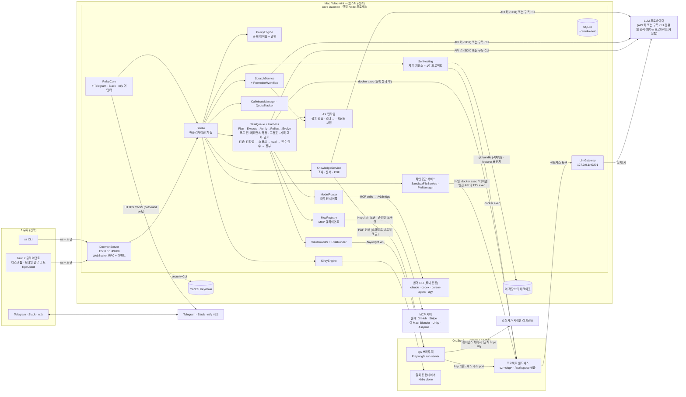
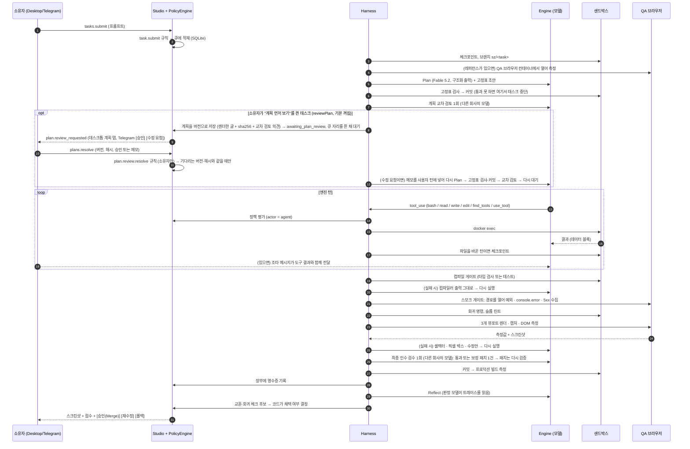

# Studio Zero 아키텍처

Studio Zero는 생각을 정리하고, 조사하고, 문서를 쓰고, 앱을 만들고, **스스로 검증한 뒤** 결과를 폰으로 보내 승인받는 스튜디오다.
이 문서는 저장소에 실제로 있는 코드를 기준으로 쓴 설계서다. 구현되지 않은 것과 검증되지 않은 것은 §17, §18에 따로 적었다.

- 코드: `packages/protocol` (계약), `packages/design` (디자인 계약·테마·UI 린트·문장 린트), `packages/ax` (AX 키트: 블록 어휘·이벤트 스트림·렌더러·텔레메트리), `packages/daemon` (코어 데몬), `apps/desktop` (Tauri 2 클라이언트)
- 규모: 소스 180개 파일 약 33,400줄
- 테스트: `pnpm test` 242개 (그중 17개는 옵트인)
- 런타임: Node.js 24 (개발은 TypeScript를 그대로 실행, 상시 가동은 `pnpm build`의 esbuild 번들), SQLite(`node:sqlite`), Fastify 5

## 1. 컨테이너 다이어그램 (C4 Level 2)



신뢰 경계는 세 개다.

1. **호스트 ↔ 컨테이너.** 샌드박스·QA 브라우저·일회용 컨테이너 안의 모든 것(에이전트가 쓴 코드, 렌더링된 페이지, 남의 저장소)은 비신뢰다. 여기서 나온 데이터는 스키마 검증을 거쳐 "데이터 블록"으로만 모델에 들어간다.
2. **소유자 ↔ 그 외.** 소유자는 전송 계층이 정한다: 토큰으로 인증된 제어 소켓, 허용 목록에 있는 Telegram·Slack 사용자 ID, ntfy의 경우 데몬이 HMAC으로 서명해 보낸 원탭 명령. 메시지 내용으로는 누구도 소유자가 될 수 없다.
3. **데몬 ↔ 바깥 서비스.** 웹 검색 결과, 읽어 온 페이지, 외부 MCP 서버가 말하는 도구 설명과 호출 결과는 전부 비신뢰 데이터다. 바깥으로 나가는 호출(외부 도구)은 소유자가 도구 단위로 허용한 것만 나간다.

## 2. 세 가지 불변식이 강제되는 위치

| 원칙 | 코드에서 강제되는 방식 | 파일 | 검증하는 테스트 |
|---|---|---|---|
| **Policy lives in the server** | 모든 부수효과는 타입이 있는 `Action`(32종)이다. 28개 규칙의 순서 있는 테이블이 `allow / deny / require_approval`을 결정하고, 일치하는 규칙이 없으면 거부한다. 규칙은 모델을 호출하지 않는다. 승인은 액션의 SHA-256 해시에 묶이고 1회용이며 만료된다. 승인 문구도 액션 필드에서 코드가 만든다. | `policy/actions.ts`, `policy/PolicyEngine.ts` | `vault-policy.test.ts` |
| **토큰 예산** | 모델 요청 전에 항상 `llm.request` 규칙(태스크 예산, 프로젝트 24시간 예산)을 평가한다. 데몬 자체 호출, 게이트웨이 경유 호출, CLI 브릿지 호출 모두 같은 규칙을 탄다. | `llm/ClaudeClient.ts`, `llm/LlmGateway.ts` | `vault-policy.test.ts`, `relay-gateway.test.ts` |
| **Untrusted by default** | 비신뢰 텍스트는 `untrusted()`로 감싼다(블록마다 96비트 난수 ID, 내용은 자기 블록을 닫을 수 없음). 시스템 프롬프트는 전부 상수이며 동적 내용을 이어 붙이는 코드 경로가 없다. | `trust/dataBlock.ts`, `harness/prompts.ts` | `vault-policy.test.ts`, `e2e.test.ts` |
| **Keys stay out of the sandbox** | 컨테이너 환경변수는 `OrbStackManager`가 타입 있는 입력으로만 조립한다. 샌드박스에는 프로바이더 키 대신 샌드박스 전용 토큰과 게이트웨이 주소가 들어간다. 게이트웨이가 호스트에서 토큰을 실제 키로 바꾼다. DB에는 토큰의 해시만 있다. 외부 도구 서버의 토큰도 같다: 호출은 데몬이 호스트에서 하고, 토큰은 Keychain에서 그 서버로 가는 요청 헤더로만 나간다. | `sandbox/OrbStackManager.ts`, `llm/LlmGateway.ts`, `vault/KeychainVault.ts`, `mcp/McpRegistry.ts` | `sandbox.test.ts`, `relay-gateway.test.ts`, `mcp.test.ts`, `engine.integration.test.ts` |

데이터 블록은 모델이 주입된 문장을 따를 확률을 낮출 뿐이다. 안전은 정책이 보장한다: 주입에 완전히 조종당한 에이전트도 `agent` 행위자가 가진 권한(샌드박스 안에서의 실행, `/workspace` 쓰기, 소유자가 이미 허용한 외부 도구 호출)만 쓸 수 있다.

## 3. 데이터 흐름

### 3.1 태스크 한 건



검증 단계의 주체는 데몬이다. 엔진이 "끝났다"고 말하는 것은 통과 조건이 아니다.

### 3.2 승인

에이전트 행위가 `require_approval`을 받으면 `PolicyEngine.authorize()`가 그 자리에서 기다린다. `approval.requested` 이벤트가 나가고(데스크톱 구독, Telegram 인라인 버튼), 소유자 채널에서 `resolveApproval`이 호출되면 기다리던 호출이 재개된다. 승인 건은 `pending → approved → consumed` 순서로 정확히 한 번만 쓰인다. 다른 액션(해시가 다름)에는 쓸 수 없다. 데몬이 승인과 실행 사이에 재시작해도 같은 액션에 대한 미사용 승인은 다시 쓸 수 있다.

### 3.3 키 경로

| 호출자 | 자격 증명이 있는 곳 | 경로 |
|---|---|---|
| 데몬 자체 (Plan, 비전 감사, Reflect, Kirby, 네이티브 코딩 루프) | Keychain → 데몬 프로세스 메모리 | Anthropic SDK, in-process |
| 샌드박스 안의 코드 (만들어진 앱이 LLM을 부를 때) | 샌드박스 전용 토큰 | `ANTHROPIC_BASE_URL` → LlmGateway → 실제 키로 교체 → 프로바이더 |
| 구독 세션 브릿지 (Claude Code, Codex, Cursor, Antigravity) | 벤더 CLI가 자체 보관 (데몬은 읽지 않음) | CLI는 호스트에서 "두뇌"로만 실행, 도구는 MCP shim → `/v1/bridge` → Toolbox (§4.1) |
| 데몬 자체 호출, API 키가 없을 때 | Claude Code의 로그인 (데몬은 읽지 않음) | 도구를 전부 끈 `claude -p`. 데몬의 도구가 필요하면 같은 MCP shim으로만 준다 (§4.1) |
| 샌드박스 안의 코드가 남의 API를 부를 때 (증권사, 결제, 지도처럼 키가 있어야 하는 것) | Keychain `ext/<프로젝트>/<API>/<변수>` → 게이트웨이의 요청 한 건 | 샌드박스에는 대역(`szs_…`)과 게이트웨이 주소만 있다. `<API>_BASE_URL` → LlmGateway `/ext/<API>` → 대역을 실제 값으로 교체 → 저장된 https 출처 (§3.4) |
| 외부 도구 호출 (GitHub, Stripe 등) | Keychain `mcp/<서버>/token` → 데몬 프로세스 메모리 | 에이전트는 `use_tool`로 요청만 한다. 데몬의 MCP 클라이언트가 등록된 주소로 호출하고, 리다이렉트는 같은 출처 안에서만 따른다. |

### 3.4 만드는 앱이 쓰는 남의 API 키

만드는 제품이 증권사나 결제사의 API를 부르면, 만드는 동안에도 그 키가 필요하다. 키를 샌드박스에 넣으면(환경 변수든 `.env`든) 거기서 일하는 에이전트와 그 에이전트를 조종한 글이 같이 갖게 된다. 그래서 모델 키와 같은 방식으로 한다(`app/ExternalApis.ts`, `llm/LlmGateway.ts`).

```
연결   데스크톱의 소유자가 프로젝트 메뉴 → 외부 API 키에서 이름, https 출처, 변수별 값을 넣는다
       → 값은 Keychain으로, 변수마다 무작위 대역(szs_ + 32자)이 DB로 (external_apis, external_api_vars)
사용   워크스페이스에 .studio-zero/external.env: KIS_BASE_URL=http://host.docker.internal:<게이트웨이>/ext/kis,
       KIS_APP_KEY=szs_…  → 앱 코드는 이 이름을 읽어 제공자가 원하는 자리(헤더, 쿼리, JSON·폼 본문)에 넣는다
교체   게이트웨이가 요청에서 대역을 찾는다 → 전부 그 프로젝트의 그 API 것인지 확인 → 정책(external.call)
       → 실제 값으로 바꿔 저장된 출처로만 보낸다(리다이렉트는 따르지 않는다)
       → 응답에 실제 값이 되돌아와 있으면 지운다(원문, JSON 한 번·두 번 이스케이프, URL 인코딩, HTML 이스케이프)
```

- 대역은 자리표시자이자 호출자의 증명이다: 그 프로젝트의 샌드박스만 받았고, 이 Mac의 루프백 게이트웨이를 거쳐 그 출처 하나에 닿는 데만 쓸 수 있다. 대역이 하나도 없는 요청은 누가 보냈는지 알 수 없으므로 거절한다.
- 연결과 해제는 데스크톱의 소유자만 한다(`external.configure-local-owner-only`). 출처는 공개 호스트 이름의 https만 받는다.
- 배포할 때는 같은 변수 이름에 제공자의 실제 주소와 실제 키를 넣는다. 게이트웨이는 개발 중에만 낀다.
- 막지 못하는 것: 에이전트는 대역으로 그 API를 **부를 수 있다**. 키를 읽지는 못해도 주문·결제 같은 호출은 낼 수 있으므로, 실계좌 주문 권한이 있는 키를 연결하는 것은 그 프로젝트의 에이전트에게 그 권한을 맡기는 것이다. 모의투자나 조회 전용 키를 쓴다.

## 4. 코어 데몬 모듈

조립은 `app/compose.ts` 한 곳에서 한다. 전역 상태와 서비스 로케이터는 없다.

| 모듈 | 파일 | 책임 |
|---|---|---|
| `DaemonServer` | `server/DaemonServer.ts`, `server/handlers.ts` | 루프백 Fastify. WebSocket RPC, 이벤트 재생 후 실시간 전환, 아티팩트, 브릿지 엔드포인트. 토큰(상수 시간 비교) + Host 허용 목록(DNS 리바인딩 차단) + Origin 허용 목록. 느린 구독자는 끊는다. |
| `Studio` | `app/Studio.ts` | 소유자가 할 수 있는 모든 동작. RPC와 메신저 릴레이는 이 클래스의 얇은 어댑터라서 채널이 달라도 동작과 정책 검사가 같다. |
| `PolicyEngine` | `policy/` | §2. 모든 평가를 `policy_decisions`에 기록한다. |
| `OrbStackManager` | `sandbox/OrbStackManager.ts`, `sandbox/scripts.ts` | `docker --context orbstack`. 프로젝트당 컨테이너 1 + 볼륨 1 + 네트워크 1. 비루트, `--cap-drop ALL`, `no-new-privileges`, CPU/메모리/PID 제한, 호스트 마운트 없음. 체크포인트와 롤백, 브랜치, 병합, QA 브라우저, 일회용 컨테이너. 프로젝트별 뮤텍스. |
| `KeychainVault` | `vault/KeychainVault.ts` | `/usr/bin/security`. 비밀은 argv에 나타나지 않는다(`security -i`에 stdin으로, 16진수로). 저장 형식은 `sz1:<base64>`. 쓰기 후 다시 읽어 확인한다. |
| 릴레이 | `relay/RelayCore.ts`, `TelegramRelay.ts`, `SlackRelay.ts`, `NtfyRelay.ts` | 명령 해석과 알림은 채널과 무관한 `RelayCore`에 있고 어댑터는 전송만 한다. Telegram: long polling, 허용된 사용자 ID의 1:1 대화만, 오프셋을 처리 전에 저장(at-most-once: 유료 태스크가 두 번 시작되지 않음), 음성 메모는 받아쓰기 후 같은 경로. Slack: Socket Mode(인바운드 포트 없음). ntfy: 알림과, 데몬이 HMAC으로 서명한 원탭 명령만 받는다. |
| `LlmGateway` | `llm/LlmGateway.ts` | 샌드박스용 리버스 프록시. 엔드포인트 허용 목록, 예산 게이트, 키 교체, 스트림을 건드리지 않는 사용량 계측. |
| `ModelRouter` | `llm/ModelRouter.ts`, `config.ts` | 태스크 종류별 후보 테이블에서 사용 가능한 첫 엔진을 고른다. 모델에게 묻지 않는다. 고려한 후보와 이유가 이벤트로 남는다. 교차 검토를 맡을 구독도 같은 방식으로 고른다(`pairReviewer`, §8.2). |
| 엔진 | `harness/engines/` | `NativeClaudeEngine`(Messages API 수동 루프, API 키 필요), `CliBridgeEngine`(구독 CLI 4종: Claude Code, Codex, Cursor, Antigravity). 전부 같은 `Toolbox`만 쓰고, 같은 조타 큐를 읽는다. §4.1. |
| `SessionBrain` | `llm/SessionBrain.ts` | API 키 없이 데몬 자체의 모델 호출을 Claude 구독으로 보낸다. §4.1. |
| 가둠, ACP | `bridge/jail.ts`, `bridge/acp.ts`, `bridge/cli.ts` | 자기 도구를 끌 수 없는 CLI를 가두는 macOS 샌드박스 프로필, Agent Client Protocol 클라이언트, CLI 공통 환경. §4.1. |
| `Toolbox` | `harness/Toolbox.ts` | 도구 6개: 샌드박스용 `bash`, `read_file`, `write_file`, `edit_file`과 외부 도구용 `find_tools`, `use_tool`. 스키마 검증 → 정책 → 샌드박스 또는 MCP 클라이언트 → 결과를 데이터 블록으로. 파일을 바꾼 턴마다 체크포인트를 남긴다. |
| `WorkspaceProvisioner` | `harness/bootstrap.ts`, `harness/axKit.ts`, `harness/mobileKit.ts` | 샌드박스를 띄우고 프로젝트 고유 테마, 런타임 설명 파일, AX 키트(§12)를 첫 커밋으로 넣는다. 모바일(Expo) 프로젝트에는 모바일 키트(`packages/design/src/mobile`: `MobileShell`, `InteractiveDropzone`, `BottomSheet`, `TactileButton`, 토큰)도 `.studio-zero/mobile-kit`에 넣는다. 이미 있으면 덮어쓰지 않고, 태스크 브랜치를 만든 뒤 한 번 더 확인해서 키트보다 먼저 생긴 프로젝트도 작업 브랜치에서 키트를 받는다. |
| `Harness`, `TaskQueue` | `harness/Harness.ts`, `queue/TaskQueue.ts` | §8. 큐는 SQLite 위에 있고 재시작 후 중단된 태스크를 한 번 다시 넣는다(계획 검토를 기다리던 태스크는 재시도 횟수를 쓰지 않고 다시 넣는다, §8.8). 프로젝트당 동시 1건. 사용 한도로 멈춘(`parked`) 태스크를 풀리는 시각에 다시 넣는 타이머 하나도 큐에 있다(§20). |
| `Scheduler` | `app/Scheduler.ts` | §20. 소유자가 저장한 예약을 1분마다 보고, 때가 된 프롬프트를 `Studio.submitTask`로 넣는다. |
| `CompilerGate`, `SmokeTester` | `harness/CompilerGate.ts`, `qa/SmokeTester.ts` | §8. 검증의 앞 두 단계. 모델을 쓰지 않는다. |
| `QaBrowser` | `qa/QaBrowser.ts` | 스모크 게이트와 시각 감사가 함께 쓰는 브라우저 컨테이너 한 개. 쓸 때만 프로젝트 네트워크에 붙고 10분 쉬면 내려간다. 이미지(`qaBrowserDockerfile`)는 Playwright 이미지에 `playwright` 패키지와 Pretendard를 더하고, fontconfig에 그 서체를 한국어와 `sans-serif` · `system-ui`의 기본으로 알린 것이다(파일만 깔면 `fc-match :lang=ko`는 여전히 WenQuanYi를 답한다): Playwright 이미지의 한글 폴백은 중국어 서체 WenQuanYi Zen Hei라, 서체를 아직 싣지 않은 한국어 화면은 전부 그 서체로 찍혀 리뷰어에게 갔다. 레시피의 해시가 태그라 레시피가 바뀌면 다음 사용 때 다시 만든다. |
| `VisualAuditor`, `EvalRunner` | `qa/`, `harness/EvalRunner.ts` | §7. |
| `SandboxFileService` | `sandbox/SandboxFileService.ts` | 소유자용 파일 탐색: 목록, 읽기, 쓰기. 전부 컨테이너 안 `/workspace` 볼륨에서 한다(호스트 마운트 없음). 목록은 한 단계씩 읽어 `git check-ignore`로 거르고 `.git`, `node_modules`, 빌드 산출물은 항상 뺀다. 스크립트 출력은 다른 샌드박스 출력처럼 줄 단위로 다시 검증한다. 워크스페이스 밖을 가리키는 링크는 따라가지 않는다. |
| `PtyManager` | `sandbox/PtyManager.ts` | 대화형 터미널. 컨테이너 엔진 API로 TTY가 붙은 exec를 만들고(`docker exec -it`가 내부에서 하는 세 호출) 그 연결을 원시 스트림으로 올려 제어 소켓과 잇는다. 네이티브 의존성이 없다. 터미널은 연 연결의 것이고 연결이 끊기면 함께 끝난다. 스트림을 닫는 것만으로는 exec된 셸이 끝나지 않으므로, 셸이 시작할 때 남긴 pid로 컨테이너 안에서 끝낸다. 클라이언트가 못 따라오면 셸 읽기를 멈춘다. |
| `ProjectNamer` | `app/ProjectNamer.ts` | 아이디어 한 단락을 2~4단어 제목과 슬러그로 줄인다(작은 모델 한 번). 모델이 없거나 12초 안에 답이 없으면 첫 구절로 이름을 정한다: 시작이 이름 짓기를 기다리지 않는다. |
| `LessonBook`, `ReflectionAgent` | `harness/` | §8. |
| 고정표, `RefKit` | `scratch/AnchorTable.ts`, `qa/RefKit.ts` | §8.1. 코드 전에 받는 것: 고정표의 스키마와 검사, 레퍼런스 페이지 측정. |
| 화면 명세, `MockupRenderer`, `FlowWalker` | `scratch/ScreenSpec.ts`, `qa/MockupRenderer.ts`, `qa/FlowWalker.ts`, `qa/mockupFaces.ts` | §8.4. 설계 태스크가 쓰는 화면 명세의 검사, 시안 페이지를 그림·서체와 함께 완결된 한 장으로 만들기, 그리기, 명세의 핵심 흐름을 페이지에서 직접 눌러 세기. |
| `SandwichReviewer`, `ReviewDesk` | `harness/SandwichReviewer.ts`, `llm/ReviewDesk.ts` | §8.2. 다른 회사의 모델이 계획과 결과를 한 번씩 본다. `ReviewDesk`는 리뷰어 한 명에게 질문 하나를 보내고 스키마로 답을 받는 한 곳이고, 디자인 심사(§7.4)도 같은 곳을 쓴다. |
| `Ledger`, `BuildMeter` | `harness/Ledger.ts`, `harness/BuildMeter.ts` | §8.3. 끝난 태스크마다 영수증 한 장. |
| `TextSlopAuditor` | `harness/TextSlopAuditor.ts`, `packages/design/src/textLint.ts` | §7.5. 화면의 글만 뽑아 글로 읽는다. |
| `SelfHosting` | `harness/SelfHosting.ts` | §19. 이 저장소 자신을 고정된 1호 프로젝트로 다룬다. |
| `CaffeinateManager`, `QuotaTracker` | `util/CaffeinateManager.ts`, `app/QuotaTracker.ts` | §20. Mac을 깨워 두기, 구독별로 본 것. |
| `KirbyEngine` | `kirby/` | §9. |
| `ScratchService`, `PromotionWorkflow` | `scratch/` | §10. |
| `KnowledgeService` | `knowledge/` | §11. `ResearchPipeline`, `DocumentCompiler`, PDF 내보내기. |
| AX 런타임 | `ax/`, `packages/ax` | §12. 블록 어휘와 검증, `SteeringQueue`, `ConfidenceCalibration`. |
| `McpRegistry` | `mcp/McpRegistry.ts` | §13. |

기본 라우팅(`config.ts`, 설정으로 바꿀 수 있음):

| 태스크 | 1순위 | 대안 |
|---|---|---|
| 기획·아이디어 (`ideate`), 계획 수립 | Claude Fable 5.2 | 없음 |
| 빌드 (`build`), 인라인 수정 | Claude Opus 5.5 (네이티브 루프) | Claude Code 브릿지 |
| 멀티파일 리팩토링 (`refactor`) | Codex 브릿지 (기본 비활성) | Claude Code 브릿지 → Opus 5.5 |
| 검증 측 모델 (비전 감사, Reflect), 조사의 검색·읽기 | Claude Opus 5.5 (코드에 고정) | 없음 |
| 작업 노트 대화, 문서 작성 | Claude Fable 5.2 (코드에 고정) | 없음 |

모든 종류에 Claude Code 브릿지가 대안으로 들어 있어서 API 키 없이도 길이 끊기지 않는다. 소유자가 작업을 시작할 때 엔진을 직접 고를 수도 있다(`tasks.submit`의 `engine`). 고른 엔진을 쓸 수 없으면 다른 것으로 바꾸지 않고 실패한다. Cursor와 Antigravity는 라우팅 표에 없고 소유자가 고를 때만 쓰인다.

**모델과 추론 강도 고르기.** 엔진을 고른 작업에는 그 엔진이 돌릴 모델과 추론 강도도 붙일 수 있다(`tasks.submit`, `projects.ignite`, `scratch.promote`의 `model`, `effort`). 클라이언트는 이 선택을 한 곳에 기억하고(`lib/engineChoice.ts`, `views/enginePicker.tsx`) 처음 화면, 프로젝트 입력창, 작업 노트의 빌드 시작이 같이 쓴다. 작업을 시작할 수 있는 세 곳이 모두 같은 선택을 싣는다: 작업 노트에서 올린 프로젝트의 첫 빌드는 그 프로젝트가 받는 가장 큰 작업인데, 전에는 그 길만 선택을 싣지 못해 표의 기본값으로 돌았다. 돌릴 수 없는 선택(엔진 없는 모델, 강도를 받지 않는 엔진의 강도)은 프로젝트를 만들기 전에 거절하므로 노트는 그대로 남는다. 기억해 둔 선택은 데몬이 엔진과 모델 목록을 돌려주기 전까지는 고른 그대로 보내고, 목록이 온 뒤에 거기 없으면 고르지 않은 것으로 친다: 화면에 보이는 것과 보내는 것이 같다. 모델 이름은 엔진마다 뜻이 다르고 강도를 설정으로 받지 않는 엔진도 있어서, 엔진 없이 둘만 고를 수는 없다. 고른 것만 표의 그 엔진 항목을 덮어쓰고, 고르지 않은 것은 표의 값 그대로다. 고를 수 있는 목록(`engines.models`)은 데몬이 정해 두지 않고 그 회사의 CLI에 묻는다. 묻는 것은 작업 밖에서, 모델이 끼지 않는 명령 하나다.

| 엔진 | 목록의 출처 | 모델을 넘기는 방법 | 추론 강도 |
|---|---|---|---|
| Claude API (네이티브 루프) | 코드의 네 모델(가격표가 있는 것) | 요청의 `model` | `output_config.effort`, 다섯 단계 |
| Claude Code | CLI에 목록 명령이 없다. 등급별 최신 모델의 별칭 `fable` · `opus` · `sonnet` · `haiku` | `--model` | `--effort`, 다섯 단계 |
| Codex | `codex debug models` (JSON, 숨김 표시된 내부용 모델 제외) | `--model` | `model_reasoning_effort`, 다섯 단계 |
| Cursor | `cursor-agent models` (`<id> - <이름>`, `auto` 제외) | `--model` | 설정 없음: 모델 이름에 들어 있다 |
| Antigravity | `agy models` (`<id><탭><이름>`) | ACP `session/set_model` | 설정 없음: 모델 이름에 들어 있다 |

강도는 `low` · `medium` · `high` · `xhigh` · `max` 다섯 단계이고 받는 엔진에서는 같은 뜻이다. 받지 않는 엔진에 강도를 붙인 요청은 버리지 않고 거절한다(제출할 때 한 번, 라우팅할 때 한 번). Codex에는 고른 단계를 그대로 넘긴다: 전에는 `max`를 `xhigh`로 바꿔 보냈는데 CLI가 `max`를 받는다. 작업에는 실제로 돈 강도가 남고(`tasks.effort`), 강도를 설정으로 받지 않는 엔진이면 비어 있다.

목록은 10분간 기억하고, 읽지 못했으면 비어 있다가 1분 뒤 다시 묻는다. 목록은 메뉴이지 관문이 아니다: 그 모델을 돌릴 수 있는지는 그 회사가 정하고, 없는 모델이면 그 차례가 실패한다(다른 모델로 바꿔 돌리지 않는다). 데몬이 직접 막는 것은 모양뿐이다. 모델 이름은 CLI의 인자 하나가 되므로 닫힌 문자 집합이고 `-`로 시작할 수 없다(`ModelId`). 계획·검증·교차 검토에 쓰는 모델과 강도는 이 선택과 무관하게 그대로다: 고르는 것은 누가 만드느냐이고, 만든 것을 보는 쪽은 만드는 쪽의 선택을 따라가지 않는다.

### 4.1 구독으로 쓰기

API 키는 선택 사항이다. 금고에 Anthropic 키가 없으면 데몬은 구독 모드로 돈다(`system.status`의 `brain: session`).

**데몬 자체의 생각** (계획, 판정, 비전 감사, 작업 노트, 조사, 문서)은 `SessionBrain`이 Claude Code CLI를 헤드리스로 돌려서 한다.

- 내장 도구는 전부 끈다(`--tools ""`). 사용자 설정·훅·플러그인은 읽지 않고(`--setting-sources project`, 빈 스크래치 폴더), MCP는 데몬이 준 것만 쓴다(`--strict-mcp-config`).
- 구조화 출력은 `--json-schema`, 이미지는 stream-json 입력으로 보낸다. 프롬프트는 stdin으로만 간다.
- 도구 루프(작업 노트의 `present`·`record_decision`, 조사의 `report_findings`)는 요청 하나짜리 브릿지 세션으로 MCP shim에 연결된다. 검증은 API 루프와 같은 코드가 한다.
- 조사에는 웹 검색(`WebSearch`)만 준다. 검색은 프로바이더 쪽에서 돌고 이 Mac은 페이지를 받아 오지 않는다. 그래서 구독 모드에서는 원문 인용 대조(§11)를 할 수 없고, 출처 URL이 실제 검색 결과에 있었는지만 검증한다.
- 토큰은 예산에 계상하고 금액은 0으로 적는다.

**코딩 엔진**으로서의 구독 CLI는 네 가지고, 원칙은 하나다: CLI는 두뇌이고 손은 데몬의 Toolbox뿐이다.

| CLI | 자기 도구를 무력화하는 방법 | 데몬 도구를 주는 방법 |
|---|---|---|
| Claude Code | `--tools ""` (도구 목록이 빈다) | `--mcp-config` |
| Codex | `--sandbox read-only` + 기능 플래그로 셸·파일 도구 끔. 빈 도구 목록보다 약하다. | `-c mcp_servers.studio…`, studio 도구만 사전 승인 |
| Cursor (`cursor-agent`) | 끌 수 없음 → **호스트 가둠** | 스크래치 폴더의 `.cursor/mcp.json` + `mcp enable` |
| Antigravity (`agy`) | 끌 수 없음 → **호스트 가둠** | ACP `session/new`의 `mcpServers` (세션 한정, 사용자 설정은 건드리지 않음) |

**호스트 가둠** (`bridge/jail.ts`, macOS `sandbox-exec`). 도구를 끌 수 없는 CLI는 다음 프로필 안에서 실행한다.

- 읽기: 홈 디렉터리 전체, 다른 볼륨, 임시 폴더가 보이지 않는다. 예외는 CLI 자신의 상태 폴더, 스크래치 폴더, Node와 MCP shim, 그리고 Keychain 파일(두 CLI 모두 로그인을 Keychain에 둔다). 사용자가 그 CLI에 저장해 둔 MCP 서버 설정(`~/.cursor/mcp.json`, `~/.gemini/config/mcp_config.json`)은 다른 서비스의 토큰이 들어 있을 수 있어 따로 가린다.
- 쓰기: 스크래치 폴더와 CLI 자신의 상태 폴더만.
- 실행: CLI 자신의 바이너리, Node(shim용), `/usr/bin/security`(로그인 읽기)만. 셸이 뜰 수 없으므로 에이전트가 터미널 도구로 시키는 명령은 시작 전에 실패한다.

실제 실행으로 확인한 것: 가둔 Cursor 에이전트에게 키체인 읽기, `~/.zshrc` 읽기, `ls ~`를 시키면 셋 다 실패한다(셸 spawn EPERM, 읽기 거부). 남는 위험은 §16에 적었다.

## 5. 프로토콜

`packages/protocol/src/rpc.ts`의 테이블 하나가 서버 검증, 클라이언트 타입, 이 문서의 근거다. 메서드 98개, 이벤트 50종.

- 연결: `ws://127.0.0.1:49200/v1/ws`. 첫 프레임은 `{t:"hello", protocol, token, client}`. 5초 안에 오지 않거나 토큰이 틀리면 닫는다.
- 프레임: 클라이언트 `hello | req | sub | unsub | terminal.data`, 서버 `ready | res | err | evt | sub_closed | terminal.output | terminal.exit`.
- 터미널은 RPC와 프레임을 나눠 쓴다. 열기·크기 변경·종료는 메서드(`terminal.spawn` · `terminal.resize` · `terminal.kill`)이고, 키 입력과 출력은 응답이 없는 프레임으로 같은 소켓을 오간다. 터미널 id는 연 연결에만 유효하다: 같은 토큰을 가진 다른 연결도 그 터미널에 쓰거나 끌 수 없다.
- 요청과 응답 모두 zod로 검증한다. 핸들러 버그는 깨진 프레임이 아니라 `internal` 오류가 된다.
- 이벤트는 추가 전용이고 `seq`가 단조 증가한다. `sub`에 `sinceSeq`를 주면 그 이후를 재생한 뒤 실시간으로 넘어간다(누락·중복 없음). 터널이 끊겨도 클라이언트는 마지막 `seq`로 다시 구독한다.
- 오류 코드: `unauthorized · invalid_params · unknown_method · not_found · conflict · stale · policy_denied · approval_denied · unavailable · internal`. `stale`은 클라이언트가 읽은 뒤 바뀐 것에 대고 한 요청이다(지금은 문서 수정 메모, §11): 다시 읽고 판단하라는 뜻이라 `conflict`와 나눈다.
- 종료 코드: `4401` 인증 실패, `4406` 프로토콜 불일치, `4400` 잘못된 프레임, `4408` hello 타임아웃. 클라이언트는 44xx에서 재접속하지 않는다.
- `vault.set`은 있고 `vault.get`은 없다. 비밀은 데몬에서 클라이언트로 나가지 않는다.

`RpcClient`(`packages/protocol/src/client.ts`)는 플랫폼 `WebSocket`만 쓰므로 Tauri 웹뷰(데스크톱, iOS, Android)와 Node에서 같은 클래스가 돈다.

## 6. 데이터베이스

`~/.studio-zero/studio-zero.db`, WAL, `STRICT` 테이블 33개(`db/schema.ts`). 마이그레이션은 전진 전용이다(현재 17단계).

| 영역 | 테이블 |
|---|---|
| 프로젝트 | `projects`, `sandboxes`(게이트웨이 토큰은 해시만) |
| 실행 | `tasks`(세션과 트랙, 한도 대기 시각과 횟수, 계획 먼저 보기 여부 포함), `plan_versions`(소유자에게 보인 계획의 버전, 해시, 교차 검토 의견, 답), `task_reviews`(태스크 코드에 대한 소유자의 줄 단위 리뷰와 그 리뷰가 시작한 태스크), `sessions`(프로젝트 안의 이름 붙은 작업 흐름), `schedules`(소유자의 예약), `events`(추가 전용 트레이스), `usage_ledger` |
| 정책 | `approvals`, `policy_decisions`(허용 포함 전부) |
| 복구 | `checkpoints` |
| 품질 | `audits`, `artifacts`, `evals`, `eval_runs`, `ledger_entries`(태스크당 영수증 한 줄) |
| 학습 | `lessons`(근거 이벤트 seq 포함) |
| Kirby | `kirby_ingests`, `kirby_proposals` |
| 작업 노트 | `scratchpads`, `scratch_entries`, `scratch_spec`, `decisions`(채택한 것과 기각한 대안, 그 이유) |
| AX | `ax_outcomes`(추천과 실제 선택의 일치 여부, 확신도별) |
| 지식 작업 | `knowledge_jobs`(문서, 사실 시트, 린트 결과, 수정본이면 원래 문서를 가리키는 `revised_from`) |
| 외부 도구 | `mcp_servers`, `mcp_grants`(프로젝트·서버·도구 단위 허용) |
| 외부 API | `external_apis`(프로젝트·이름·출처), `external_api_vars`(변수 이름과 대역. 값은 Keychain) |
| 기타 | `credentials`(Keychain 항목 이름만), `relay_chats`, `kv` |

비밀 값은 이 DB에 저장하지 않는다.

## 7. Anti-Slop 디자인 시스템과 Visual QA

### 7.1 디자인 계약

`packages/design/src/contract.ts`의 객체 하나를 세 곳이 쓴다: 테마 생성기, 소스 린터, 렌더 감사. 숫자를 한 곳에서 바꾸면 셋이 같이 바뀐다.

| 항목 | 값 |
|---|---|
| 간격 | 4px 배수 |
| 글자 크기 | 11 · 12 · 14 · 16 · 18 · 20 · 24 · 30 · 36 · 48 · 60 · 72 · 96 · 120 · 160px (한 화면에 최대 8종). 11px(`text-2xs`)은 타임스탬프 · 뱃지 · 스탯 라벨의 마이크로 단계다. 2026-11-13의 폰 빌드는 헤더 · 소제목 · 본문 · 보조 · 캡션 · 숫자 둘로 7종이었고, 6종 상한은 그 화면 11곳을 지적했다. 상한을 피하는 가장 쉬운 길은 캡션을 본문 크기로 키우는 것이라 카드가 터진다: 폰 화면의 위계는 7~8종이 정상이다 |
| 디스플레이 글자 | 60px 초과는 디스플레이 글자다: 단계에 맞지 않아도 되고(유동 크기) 160px까지. 본문 크기의 3~7배 안에 있어야 한다. 줄 높이 0.9~1.0 |
| 본문 | 최소 16px, 줄 높이 1.45–1.8, 한 줄 80자 이하 |
| 모서리 | 고정된 집합이 아니라 범위: 32px까지, 그리고 완전한 알약. 한 화면에 최대 3종 |
| 모션 | 조작에 답하는 120 · 200 · 320ms, 화면당 한 번의 등장 600–810ms, 페이지 전환 700–1100ms |
| 대비 | 본문 7:1 (WCAG AAA), 큰 글자 4.5:1, 비텍스트 3:1 |
| 터치 영역 | 44×44px |
| 서체 | 셋으로 고정이고 제품에 하나다: Pretendard, SUIT, SUITE 가운데 테마가 고른 한 서체로 한글과 라틴, 본문과 제목을 모두 놓는다(2026-11-13, 소유자의 결정). 제목은 같은 서체의 굵은 쪽이고 세리프와 둘째 산세리프는 없다. 고정폭은 `code` · `pre` · `kbd` 안에서만. 서체 파일은 데몬이 테마와 함께 프로젝트의 `.studio-zero/fonts/`에 넣고 테마 스타일시트의 `@font-face`가 그 파일을 가리킨다(`harness/fontKit.ts`, `writeProjectTheme`): 엔진은 서체를 찾거나 설치하지 않는다. 감사는 이름 부른 서체가 실제로 로드됐는지(`type/font-not-loaded`)와 첫 화면의 서체가 하나인지(`type/second-family`)를 잰다. 전에는 제목 서체 짝이 넷이었고(Fraunces, Instrument Serif, Bricolage Grotesque), 그 가운데 둘은 실제 빌드에서 한 번도 뜨지 않았다 |

처음의 계약은 글자 60px, 모서리 0·4·8·12px, 모션 120·200·320ms, 서체 한 벌로 묶여 있었고, 기준으로 삼은 사이트 여덟 곳이 전부 거기서 탈락했다. 가장 잘 만든 것을 떨어뜨리는 계약은 디자인이 아니라 정돈을 재고 있는 것이다. 그래서 값을 고정하던 항목은 범위와 비례로 바꿨고(`isOnTypeScale`, `isDisplayInProportion`, `isAllowedRadius`, `isAllowedDuration`), 큰 헤드라인이나 깊은 곡률이나 세리프 제목은 그 자체로는 결함이 아니다.

계약은 규율(스케일, 리듬, 대비, 절제)만 고정하고 생김새는 고정하지 않는다. 팔레트, 모서리 스타일(sharp · soft · round), 제목 서체는 프로젝트 이름에서 만든 시드로 정하므로 프로젝트마다 다르다.

### 7.2 테마 (Tailwind v4)

`createTheme(seed)` → `renderThemeCss()`가 프로젝트의 `.studio-zero/theme.css`를 만든다.

- 색은 OKLCH로 정의하고, 텍스트 토큰은 **풀어서** 구한다: 가장 불리한 배경에 대해 목표 대비(+0.25 여유)를 만족하는 명도를 이분 탐색한다. 채도는 sRGB 색역 안으로 줄인다.
- `--color-*: initial` 등으로 Tailwind 기본 색·글자 크기·모서리·그림자 스케일을 제거한다. `bg-indigo-500`이나 `rounded-3xl`은 컴파일되지 않는다.
- 남는 유틸리티: `bg-bg · bg-surface · bg-sunken · text-fg · text-fg-muted · text-accent · bg-accent · text-on-accent · border-border · border-control-border · danger · success · warning`, `text-xs…10xl`, `rounded-sm/md/lg/xl`, `shadow-sm/md`, `font-sans/display/mono`, `--duration-fast/base/slow/entrance/page`.
- **브랜드색은 채움이다.** 강조색 하나가 종이 위의 작은 글자색이자 버튼 색이면, 대비 때문에 어떤 색상이든 어둡고 탁해진다(실제 프로젝트 셋이 전부 "흰 바탕에 어두운 녹색"으로 나왔다). 그래서 `brand`는 채움 전용이고 밝기를 고를 수 있다: 그 위 글자(`on-brand`)는 거의 검정과 거의 흰색 가운데 AAA가 되는 쪽으로 풀고, 어느 쪽도 안 되는 중간 밝기면 브랜드를 가장 적게 옮긴다. `brand-soft`는 그 색의 옅은 면이고, 글자 토큰은 그 위에서도 AAA다. 중립색은 브랜드와 다른 색상으로 기울 수 있다(차가운 브랜드 아래 따뜻한 종이).
- **씨앗은 주제에서 나온다.** `.studio-zero/theme.json`이 씨앗과 그 출처 한 문장을 담는다. 새 프로젝트의 것은 이름 해시로 만든 자리표시이고 스스로 그렇게 적는다. 엔진은 `set_theme` 도구로 색상·채도·밝기·중립색의 기울기·모서리·제목 서체를 주제에서 골라 바꾼다. 스타일시트는 데몬이 씨앗에서 다시 만들고, 손으로 고치지 않는다. 범위 안의 어떤 선택도 대비가 풀려 나오므로 엔진이 틀릴 수 있는 것은 선택 자체뿐이다 (`harness/themeSeed.ts`). 그 범위는 깨끗한 종이 위의 선명한 브랜드 하나다: 채도 0.12~0.28, 밝기 0.4~0.75, 중립색 기울기 0~0.005. 화면의 대부분은 거의 흰(또는 차가운 회색) 종이와 표면이고, 구조는 헤어라인과 웰이고, 브랜드는 먼저 보여야 할 한두 가지에만 간다. 전에는 중립색 기울기를 0.03까지 받았고 "따뜻한 종이"를 권하기도 했다. 2026-11-13의 빌드가 0.018을 골라 모든 화면이 크림색 종이(#fff9f5)에 살구색 웰로 나왔고, 리뷰어는 그 화면을 문진표라고 읽었다. 색이 있는 종이는 더는 도구가 주는 선택지가 아니다. 이름에서 만드는 자리표시 씨앗과 스튜디오 자신의 기준 씨앗도 같은 범위 안에 있다.
- 기본 레이어: 터치 기기에서 컨트롤 최소 44px, `:focus-visible`, `prefers-reduced-motion`, 한글 `word-break: keep-all`.

### 7.3 슬롭 린트 (정적)

`lintSources()`: 소스에서 14개 패턴을 찾는다. 파란색–보라색 그라디언트, Tailwind 기본 팔레트 클래스, 하드코딩 색, 임의 값(`p-[13px]`), 아이콘 자리의 이모지, 자간 넓힌 대문자 라벨, 링크 뒤 화살표, 큰 그림자, 기본 서체, `!important`, 채움 문구, 과한 모서리, 블록마다 등장 애니메이션, 그라디언트 남발. 예외는 `// sz-allow <rule>` 주석으로 남긴다.

### 7.4 Visual QA 워크플로우

```
dev 서버 기동(샌드박스) → QA 브라우저 컨테이너를 프로젝트 네트워크에 연결
 → 뷰포트별(iPhone 15 Pro · iPad Pro 11 · Desktop 1440) × 경로별:
     라이트 렌더 → 화면 단위 PNG 캡처(기기 픽셀 비율 그대로) → DOM 측정(collector) → 결정론적 검사(22개 규칙) → 글만 뽑아 카피 린트(§7.5)
     다크 렌더 → 색 관련 검사만
     비전 리뷰(스크린샷 + 요소 목록 + 이미 측정된 결함 + 첫 화면 여부) → 루브릭 7축 + 슬롭 지수 + 화면 유형 + 발견 사항 + 재설계 패치
 → 점수와 등급 계산 → AuditReport 저장 → 실패 시 셀렉터·픽셀 박스·수정안·재설계 계획을 엔진에 전달
```

모바일(Expo) 프로젝트는 폰과 태블릿 크기에서만 감사한다(`auditViewports`). 데스크톱 폭에서 심사하면 데스크톱 레이아웃을 요구하게 되고, 그 요구를 가장 싸게 채우는 것이 감사가 막으려는 웹 랜딩 페이지다. 리뷰어에게는 폰 크기에서만 묻는다(`reviewViewports`, §8.4): 태블릿의 폰 앱은 같은 한 열이고, 리뷰 한 번이 모델 호출 1분이다.

- **QA 브라우저는 샌드박스를 이름이 아니라 주소로 연다** (`attachQaBrowser`). dev 서버는 자기가 받은 요청의 Host를 확인한다. Vite와 webpack dev 서버는 IP로 온 요청에는 답하고, 모르는 이름으로 온 요청은 403 "Blocked request. This host is not allowed."로 거절한다. 처음에는 `http://sz-<슬러그>:포트`로 열었고, Vite 프로젝트는 QA 브라우저에게 그 거절 문구만 내놓았다. 스모크 게이트는 4xx를 세지 않아 통과시켰고, 감사는 그 한 줄짜리 문구를 제품 화면으로 찍어 리뷰어에게 여섯 번 보여 F를 받았다. 지금은 프로젝트 네트워크에서의 샌드박스 IP로 열고, 경로가 4xx로 답하면 스모크는 실패로 세며 감사는 `render/load-failed`로 적고 리뷰어에게 묻지 않는다. 엔진이 `vite.config`에 호스트를 허용해 넣을 필요가 없다.
- **측정이 먼저다.** 대비, 터치 영역, 가로 넘침, viewport 메타 누락, 글자 크기·간격·모서리의 스케일 이탈, 서체 미로딩은 브라우저가 계산한 값으로 산술 검사한다(`qa/checks.ts`). 반복 가능하고 토큰을 쓰지 않는다.
- **손으로 눌러 본다** (`qa/InteractionProbe.ts`). 리뷰어는 그림 한 장을 보므로 누름 상태도 포커스 링도 보지 못하고 단서로 짐작한다. 그래서 감사가 화면을 직접 조작한다. 첫 화면에 보이는 컨트롤마다 누른 채 150ms 뒤 그 둘레의 화면을 쉴 때와 견주고(같으면 "답이 없다"), 키보드 Tab으로 포커스를 열 번 옮기며 각 자리를 포커스가 없을 때와 견준다(같으면 "포커스가 안 보인다"). 진짜 포인터 누름이라 `:active`(컨트롤과 그것을 담은 줄)와 스크립트 핸들러의 반응이 둘 다 잡힌다. 아무것도 클릭하지 않는다: 누른 자리에 투명한 판을 깔고 떼어서 클릭이 만들어지지 않게 한다(누른 채 포인터를 옮기면 링크나 라벨의 드래그가 시작되어 페이지가 입력을 받지 않는다). 손가락 아래에서는 호버가 답이 아니고, 마우스 아래에서는 누르기 전에 답한 것도 답이다. 한 목록의 줄마다 있는 같은 버튼은 둘만 눌러 본다. 결과는 발견 사항(`touch/no-press-answer` 메이저, `focus/not-visible` 데스크톱 메이저 · 폰 마이너)과 통과율(`measures.pressAnswer`, `measures.focusVisible`)로 남고 영수증에 찍힌다. 제품을 처음 쓰는 크기 하나에서만(폰 앱은 폰, 웹은 데스크톱), 경로 셋까지, 모션을 줄이지 않은 별도 페이지에서 한다: 움직임으로 답하는 누름이 감사의 다른 페이지가 모션을 줄였다는 이유로 "답 없음"이 되면 안 된다. 누름 하나가 클릭 없이도 무언가를 여는 수가 있다(컴포넌트 라이브러리의 메뉴는 포인터가 내려갈 때 열린다). 그러면 열린 것이 아직 눌러 보지 않은 컨트롤을 덮으므로, 다음 컨트롤에 닿지 않으면 Escape로 닫고 다시 닿을 때까지 기다린다. 그래도 닿지 않는 컨트롤은 "답 없음"으로 세지 않고 뺀다. 테마의 기본 레이어에는 포커스 링 옆에 기본 누름 상태를 넣었다(`:active`에서 1px 내려가고 옅어진다): 컴포넌트는 더 크게 답할 수 있지만 덜 답해서는 안 된다. 스튜디오 자신의 클라이언트도 같은 검사를 받는다(`apps/desktop/scripts/audit.ts`). 처음 돌렸을 때 컨트롤 342개 가운데 79개가 눌러도 그대로였고("새로 시작" 버튼도), 지금은 342개가 전부 답하며 포커스 자리 263곳이 전부 보인다. 이 검사를 넣으면서 모바일 키트의 버그도 하나 나왔다: 모션을 줄인 사용자에게는 `Tactile`이 눌러도 아무 답을 하지 않았다. 이제 움직이는 대신 그 자리에서 어두워진다.
- **로드할 때 화면이 튀는 정도**(누적 레이아웃 이동)도 잰다. 0.1을 넘으면 사소한 발견 사항(`motion/layout-shift`)으로 적고 `measures.layoutShift`에 남긴다. 게이트로 두지 않는 이유: 감사가 보는 것은 dev 서버이고, dev 서버는 스타일을 첫 그림 뒤에 넣기도 한다. 그때의 튐은 제품의 것이 아니다. 초당 프레임은 재지 않는다: QA 브라우저 컨테이너에는 GPU가 없어서 거기서 잰 프레임은 제품이 아니라 컨테이너를 채점한다.
- **화면이 어떻게 짜였고 무엇으로 만들어졌는지도 잰다** (`compositionFindings`, `qa/pixels.ts`). 핸드북(§8.7)의 규칙 가운데 셀 수 있는 것이다. 글자: 첫 화면의 서체 수, 코드 밖의 고정폭, 12px 이하 글자의 몫과 그 크기로 쓴 문장, 돌려 놓거나 한 글자씩 세운 글자, 끝에 맞춘 문단. 짜임: 반쯤 빈 카드, 카드 안의 카드, 누를 것의 수(탭은 세지 않는다). 색: 강한 색이 첫 화면의 45%를 넘는 것(`color/flood`), 밝은 폰 화면의 검정 띠(`color/dark-band`), 그리고 폰 앱의 첫 화면에서 색이 5분의 1에 못 미치고 사진도 없는 것(`color/grey-screen`). 재료: 첫 화면에 그린 것이 8% 미만이고 아이콘이 열 개 미만인 것(`material/nothing-drawn`), 헤어라인을 그은 상자가 셋 이상인 것(`material/ruled-boxes`). 재료의 두 검사는 제품의 첫 화면에서, 폰 크기에서만 묻는다: 자를 댄 곳이 거기다. 회색 화면은 제품을 처음 만나는 크기에서 묻는다(폰 앱은 폰, 웹은 책상). 틀: 폰 앱의 첫 화면 아래쪽에 탭이 셋 미만인 것(`layout/no-tab-bar`). 깨진 곳: 두 줄로 갈라진 숫자(`type/broken-figure`), 겹쳐 그려진 글자(`layout/overlapping-text`), 스크롤 끝에서 바 아래에 남는 내용(`layout/end-under-bar`), 떠 있는 버튼 아래의 글자(`layout/under-float`). 발견 사항의 고치는 법은 어긴 규칙의 번호로 시작한다. 한도는 디자인 랩(`docs/runs/2026-11-13-design-lab/`)에서 소유자가 살아 있다고 꼽은 제품 다섯 곳과 우리 화면을 같은 수집기로 재서 정했다.
- **초안은 한 번 잰다** (`VisualAuditor.measureDraft`). `fast` 트랙은 스모크 뒤에 아무것도 재지 않았고, 아무도 고르지 않은 서체로 놓인 웹 빌드가 그대로 나갔다. 이제 스모크가 통과하면 첫 경로를 제품을 처음 만나는 크기 하나에서 재고 찍는다. 리뷰어는 묻지 않고, 무엇이 나와도 돌려보내지 않는다: 감사 탭에 측정만 된 감사로 남고(`visionReviewed: false`, 이유 "a draft: measured only"), 경고가 아니라 알림 한 줄이 나간다.
- **비전 모델은 측정할 수 없는 것만 본다.** 위계, 여백 리듬, 타이포 체계, 색 절제, 마이크로카피와 톤, 독창성. 이미 측정된 결함 목록을 받고 반복하지 말라는 지시를 받는다. 프롬프트 템플릿은 `qa/vision.ts`의 `VISION_SYSTEM_PROMPT` 상수이고 출력은 구조화 출력 스키마다. 좌표는 모델이 추정하지 않는다: 모델은 요소 ID를 지목하고, 코드가 그 ID를 셀렉터와 박스로 바꾼다.
- **리뷰어는 순서대로 묻는다** (`qa/QaVisionBridge.ts`). Keychain에 API 키가 있으면 그것을 먼저, 그다음은 소유자의 구독을 `audit.reviewers` 순서대로 묻는다(기본: Codex → Claude → Antigravity → Cursor). 각 구독은 자기 CLI로, 그 CLI의 잠금 상태 그대로 간다: Claude는 도구를 전부 끄고 스크린샷을 stdin의 이미지 블록으로, Codex는 읽기 전용 샌드박스에서 `--image`와 `--output-schema`로, Antigravity와 Cursor는 호스트 격리(jail) 안에서 ACP 프롬프트의 이미지 블록으로 받는다. 어떤 리뷰어도 도구로 파일을 가져오지 않는다. 스키마는 CLI가 강제할 수 있으면 강제하고, 어느 경우든 여기서 다시 검증한다. 앞 리뷰어가 실패하거나 사용 한도에 걸렸을 때만 다음 리뷰어에게 간다. Claude 경로의 모델은 코드에 고정된 `claude-fable-5-2`이고, 다른 벤더는 그 CLI의 기본 모델이다. 보고서는 누가 심사했는지(`vision.via`, `vision.model`) 적는다. 리뷰 호출은 `judge` 범위라서 태스크 장부에는 기록되지만 프로젝트 일일 예산으로만 막힌다. 예전에는 엔진이 태스크 예산을 다 쓰면 리뷰가 `budget.task`로 거부됐고, 감사는 측정값만으로 100점 통과했다.
- **슬롭 냄새 검사.** 리뷰어는 다섯 가지를 먼저 본다: 기능 없는 범용 클립아트(`vision/stock-clipart`), 폰 화면의 웹 랜딩 레이아웃(`vision/web-layout-on-mobile`), 글과 선뿐인 첫 화면(`vision/no-living-visual`), 촉감과 어포던스, 타이포 대비. 앞의 셋은 모델이 뭐라고 적든 코드가 블로커로 올린다(`toScreenReview`). 셋째는 첫 화면(감사의 첫 경로)에서만 블로커다: 설정 화면은 글만 있어도 되지만 첫 화면은 안 된다. 거기에는 실물이 하나는 있어야 한다: 제품의 데이터로 움직이는 캔버스, 실제 제품 화면, 조작되는 뷰파인더, 손에 반응하는 요소. 일러스트와 로고는 세지 않는다. 정돈만 재면 화면이 밋밋할수록 점수가 올랐고, 이것이 그 구멍을 막는 규칙이다. 모바일 앱의 폰 화면을 리뷰어가 `mobile-app`이 아닌 유형으로 분류하면 발견 사항이 없어도 블로커가 생기고, 함정에 걸린 화면의 슬롭 지수는 60 아래로 내려가지 않으며, 블로커마다 재설계 패치가 붙는다(없으면 코드가 쓴다).
- **점수** = 측정 점수 × 0.4 + 판단 점수 × 0.6. (처음에는 0.6 대 0.4였다. 정돈만으로 재면 빈 목업이 가장 잘 만든 사이트보다 높게 나와서 뒤집었다. 측정이 가진 것은 거부권이다: 블로커는 판단이 어떻든 감사를 떨어뜨린다.) 판단 점수 = (루브릭 평균 × 10 + (100 − 슬롭 지수)) ÷ 2. 측정 점수 = 100 − (블로커 14, 메이저 5, 마이너 1.5; 규칙당 상한 20). 같은 규칙·경로·요소가 여러 뷰포트에서 나오면 결함 1건이다. **통과 = 블로커 0건, 카피 습관 0건(§7.5), 점수 ≥ 85, 슬롭 지수 ≤ 30.** 등급은 S(95 이상, 슬롭 10 이하, 메이저 0), A, B가 통과이고 C, D는 미달, 슬롭 지수 60 이상은 F다. 리뷰어의 취향은 점수를 움직일 수 있어도 결함을 뒤집지 못한다.
- **감사는 자기 자신에 대해 거짓말하지 않는다.** 리뷰어가 캡처한 화면을 전부 보지 못했으면(꺼짐, 물어볼 모델 없음, 실패, 일부만 심사) 보고서는 `visionReviewed: false`와 이유를 담고, 점수는 50을 넘지 못하며, 등급이 없고, 통과하지 못한다(`gradeAudit`). 측정에 문제가 없는데 리뷰만 못 받은 감사는 하네스에서 `unverified`로 다룬다: 엔진이 고칠 것이 없으므로 수정 라운드로 돌려보내지 않는다. 그 이유가 사용 한도(모든 리뷰어의 구독 한도, 또는 프로젝트 일일 예산)면 태스크는 끝나지 않고 `suspended`가 된다: 작업은 브랜치에 커밋되고, 태스크는 큐 자리와 엔진을 내려놓으며, 프로젝트는 다른 작업을 받을 수 있다. `ReviewResumer`가 10분마다 리뷰어들에게 한 단어짜리 질문을 순서대로 던져서, 하나라도 답하면 태스크를 다시 큐에 넣는다. 재개된 태스크는 계획과 구현을 건너뛰고 같은 브랜치에서 검증부터 이어 간다(리뷰어가 이번에는 반려하면 그때 엔진을 연다). 소유자는 `tasks.resume`으로 바로 재시도하거나 취소할 수 있다. 한도가 아닌 이유(꺼짐, 물어볼 리뷰어 없음, 로그인 문제)면 기다려도 달라지지 않으므로 태스크는 끝나고, 요약과 감사 화면에 "디자인 미보증"으로 남는다.
- **한 번에 다시 디자인.** `audits.redesign`은 감사의 비평·재설계 계획·발견 사항을 데이터 블록으로 담은 `build` 태스크를 감사받은 브랜치에서 시작한다. 전체 검증 트랙이라 결과는 같은 리뷰어에게 다시 간다.
- 감사 대상 경로와 dev 서버 명령은 워크스페이스의 `.studio-zero/project.json`에 있다. 에이전트가 고칠 수 있는 파일이라 비신뢰 입력으로 다룬다(스키마 검증, 포트는 공개된 프리뷰 포트로 제한).
- QA 브라우저는 필요할 때 뜨고 10분 쉬면 내려간다.

### 7.5 글에서 나는 AI 티: 카피 린트

스크린샷을 보는 리뷰어는 화면을 그림으로 읽고, 잘 짠 글자는 생성된 문장도 그럴듯하게 보이게 한다. 그래서 글은 렌더링에서 떼어 글로 읽는다. 감사는 DOM에서 화면의 글만 꺼내 읽는 순서로 놓고(`auditCopy`), 코드와 터미널 출력(모노 서체)은 뺀다.

`lintInterfaceText()`(`packages/design/src/textLint.ts`)가 한국어 문구의 일곱 가지 습관을 찾는다(`KOREAN_TEXT_SLOP_PATTERNS`). 각 항목은 무엇을 읽는지가 정해져 있다.

| 규칙 | 잡는 것 | 읽는 곳 |
|---|---|---|
| `copy/feature-list-dumping` | "…토론하고 …고칩니다"처럼 기능을 한 문장에 이어 붙인 것 | 본문 문장 |
| `copy/passive-explanation-tone` | "…로 이루어집니다", "확인하실 수 있습니다" 같은 설명 문구, 그리고 한 덩어리 안에서 "…니다"로 끝나는 문장이 셋 이상 이어지는 것 | 본문 문장 |
| `copy/empty-slogan-title` | "새로운 경험", "더 나은 미래", "스마트한 관리" 같은 구호. 숫자가 든 제목은 건드리지 않는다 | 제목 |
| `copy/generic-cta` | 라벨 전체가 "시작하기", "더 알아보기", "제출"인 버튼. "확인"은 넣지 않았다: 확인 버튼의 정직한 이름이고, 걸면 모든 대화상자의 버튼이 억지 문구가 된다 | 컨트롤 라벨 |
| `copy/translationese` | 영어를 옮겨 적은 문장: "…에 오신 것을 환영합니다", "…를 경험해보세요", "당신의 …", "…를 통해 …할 수 있습니다" | 제목 · 본문 · 컨트롤 라벨 |
| `copy/long-notice` | 본문 한 덩어리가 세 문장 이상이고 90자를 넘는 안내문 (사소: 보고만 한다. 화면에는 누가 쓴 메시지나 약관 같은 진짜 글도 있고, 글만 읽어서는 안내 상자와 가를 수 없다) | 본문 |
| `copy/uniform-card-grid` | 같은 크기의 상자 셋 이상이 한 줄에 나란한 것 (사소: 보고만 한다) | 레이아웃 |

- 걸린 문구는 발견 사항으로 엔진에 돌아간다: 인용한 문구, 그 요소의 셀렉터, 고쳐 쓰는 방법. 같은 문구가 여러 뷰포트에서 나오면 한 건이다.
- 카피 습관(사소 제외)은 소스 슬롭 린트처럼 0건이어야 통과한다. 점수에 섞여 평균에 묻히지 않는다(`scoreAudit`).
- 보고서의 `copy`에 화면의 글 전체와 카피 슬롭 점수가 남는다. 인수 검수(§8.2)의 리뷰어는 이 글 덩어리를 그림 없이 따로 받는다.
- 브리프의 정규식을 그대로 쓰지 않았다(§18): 원문대로면 "알림을 관리합니다" 한 줄도, "친구하고 봅니다"도 걸린다.

## 8. 하네스 루프와 자기 개선

`Harness.run()` (`harness/Harness.ts`). 일은 엔진 하나가 하고, 끝났는지는 실행 결과가 정한다. 모델이 다른 모델의 작업을 두고 토론하는 단계는 없다. 다른 회사의 모델은 `full` 빌드를 시작과 끝에 한 번씩만 본다(§8.2).

| 단계 | 하는 일 |
|---|---|
| **Plan** | 라우팅 → 워크스페이스 체크포인트 → 태스크 브랜치 → 활성 교훈 로드 → 레퍼런스 측정 → Fable 5.2가 계획(구조화 출력) 작성 → 고정표 검사와 커밋 → 계획 교차 검토 1회(§8.1, §8.2). 계획이 제안한 감사 경로는 단순 앱 경로만 남긴다. |
| **Execute** | 엔진이 Toolbox로 작업한다. 매 턴 전에 예산 규칙, 매 응답 후 사용량 기록. 예산을 다 쓰면 소유자에게 증액 승인을 묻는다(최대 2회, 에이전트는 스스로 올릴 수 없음). |
| **Verify** | 데몬이 직접 확인한다. 싸고 이견이 없는 것부터, 실패한 단계에서 그 회차를 끝낸다. 실패 내용은 데이터 블록으로 엔진에 돌아가고, 엔진은 최대 `verifyRounds`(기본 3)번 고칠 수 있다. 전부 통과하면 최종 인수 검수 1회(§8.2), 그 뒤 커밋과 빌드 측정, 장부 기록(§8.3). |
| **Reflect** | 판정 모델이 번호 붙은 트레이스를 읽고 원인, 교훈, 회귀 체크를 제안한다. |
| **Evolve** | 코드가 채택을 결정하고 `project_rules.md`, `system_heuristics.json`을 다시 쓴다. |

**검증의 세 단계.**

| 단계 | 하는 일 | 엔진에 돌아가는 것 |
|---|---|---|
| 1. 컴파일 게이트 (`CompilerGate`) | 샌드박스에서 타입 검사를 돌린다. `package.json`에 `typecheck` 스크립트가 있으면 그것, 없고 `tsconfig.json`과 설치된 `tsc`가 있으면 `tsc --noEmit`, 둘 다 없으면 `test` 스크립트. 아무것도 없으면 건너뛴다. 워크스페이스에서 읽는 것은 "있다/없다"뿐이고 명령줄은 데몬 코드에 적혀 있다. | `<compiler_error exit_code="2" command="…">` 안에 컴파일러 출력 그대로(데이터 블록으로 감싼다) + "Fix this compilation error immediately." |
| 2. 스모크 게이트 (`SmokeTester`) | dev 서버를 띄우고 QA 브라우저로 각 경로를 연다. 잡지 못한 예외, `console.error`, 5xx 응답, 열리지 않는 페이지, 그리고 경로 자체가 4xx로 답하는 것(서버의 거절이나 "없음" 문구이지 앱이 아니다)을 모은다. 없는 파비콘 같은 리소스 404는 세지 않는다. React가 DOM 요소의 prop 이름 · 타입을 두고 내는 경고(`React does not recognize the \`%s\` prop on a DOM element` 등 넷: Expo 웹에서 React Native의 `accessibilityElementsHidden` 같은 prop이 DOM에 닿은 것)도 세지 않는다: 요소는 그려졌고 앱은 돈다. 2026-11-13의 빌드는 그 경고만으로 스모크에 두 번 떨어져 두 차례(약 4분)를 prop 이름을 바꾸는 데 썼다. 동작에 관한 React 경고(렌더 중 갱신, key 누락)는 그대로 센다. 깨끗하면 바로 통과. | 브라우저가 보고한 내용 그대로 |
| 3. eval (`EvalRunner`) | 회귀 명령 → 슬롭 린트 → 시각 감사 (§7.4) | 셀렉터, 픽셀 박스, 수정안 |

**예산이 세는 것.** 태스크 예산(기본 200만 토큰)과 프로젝트 일일 예산은 입력과 출력 토큰을 더하되, 프롬프트 캐시에서 다시 읽은 입력은 10분의 1로 센다(`budgetTokens`, 제공자가 매기는 값과 같은 비율). 에이전트 세션은 턴마다 자기 문맥 전체를 다시 읽는다: 실제로 돌린 첫 `full` 빌드에서 Claude Code 구독 세션 하나가 입력 822만 토큰을 보고했고, 그대로 세면 평범한 빌드 한 번이 예산의 네 배였다. 사용 기록(`usage_ledger`)에는 제공자가 보고한 숫자가 그대로 남고 캐시분이 따로 적힌다.

- 증액은 **쓴 만큼에서부터** 센다: 새 한도 = max(이전 한도, 쓴 양) + 승인한 양. 구독 CLI 엔진은 세션 하나를 요청 한 건으로 돌리므로, 멈춰 세울 때는 이미 한도를 한참 넘어 있을 수 있다. 이전 한도에 더하던 처음 구현에서는 승인을 두 번 받아도 한도가 쓴 양에 못 미쳐서 태스크가 반드시 실패했다.
- 승인 문구에 지금까지 쓴 양이 들어간다.
- 구독 CLI 엔진의 한 차례 안에서는 예산을 중간에 확인하지 못한다. 확인은 차례 사이에만 있다 (§17).

게이트 결과는 `gate.result` 이벤트로 남는다. 브라우저를 쓰는 검사의 스위치는 프로젝트의 시각 감사 eval이다: 소유자가 그것을 끄면 스모크 게이트도 브라우저를 띄우지 않는다. 브라우저 컨테이너가 뜨지 않는 것은 작업물의 결함이 아니므로 스모크는 경고를 남기고 건너뛴다.

**두 가지 트랙** (`tasks.submit`의 `track`, 기본 `full`).

| | `fast` (Draft 0) | `full` |
|---|---|---|
| 계획 호출 | 없음. 첫 턴에 기본값 지침(`DRAFT_BRIEF`)이 들어간다: 묻지 말 것, 스택·상태·예시 데이터의 기본값, 화면 하나를 끝까지. 주제에서 꺼낸 아이디어 하나와 첫 화면의 실물은 초안에서도 요구한다. | 있음 |
| 고정표, 화면 명세, 레퍼런스, 교차 검토 2회 | 없음 | `build`에 있음 (고정표와 화면 명세는 디자인 게이트가 켜져 있을 때) |
| 검증 | 컴파일 → 스모크 → 회귀 명령 | 컴파일 → 스모크 → 회귀 명령 → 슬롭 린트 → 시각 감사 |
| 회고 | 없음 | 있음 |
| 장부 | 있음 | 있음 |

`fast`는 모델이 판정하는 부분(계획 호출, 고정표, 교차 검토, 비전 리뷰, 회고)을 뺀 같은 루프다. 실행으로 확인하는 게이트는 그대로 남는다.

### 8.1 만들기 전에 받는 것: 고정표와 레퍼런스

구조는 결과물을 바꾸지 못했다. 한 세션, 빌더 주도, 멀티 에이전트 룸을 견줬을 때 셋 다 기준에 못 미쳤고 구조가 무거울수록 시간과 토큰만 더 들었다. 결과를 바꾼 것은 빌더가 만들기 전에 받는 것과, 만든 뒤 같은 도구로 재서 견주는 것이었다. 그래서 하네스는 엔진을 늘리지 않고 엔진이 받는 것을 늘렸다.

**고정표** (`scratch/AnchorTable.ts`, 워크스페이스의 `.studio-zero/anchor-table.json`). 디자인 태스크(디자인 게이트가 켜진 프로젝트의 `full` 트랙 `build`)는 유효한 고정표가 커밋되어 있어야 코드를 쓰기 시작한다.

| 칸 | 내용 |
|---|---|
| `idea` | 우리 주제에서 나온 한 문장. 보고 난 사람이 기억할 것 |
| `directions` | 구조가 서로 다른 방향 두 개 |
| `firstScreen` | 가장 큰 것, 첫 화면에서 바로 할 수 있는 실제 행동, 볼거리와 그 출처 |
| `anchors` | 레퍼런스에서 본 것 → 통하는 원리 → 우리 주제와 데이터에서 나온 값. 세 줄 이상, 세 범주 이상 |
| `retainedPrinciples` · `discardedDefaults` · `strictlyExcluded` | 지킬 원리 3~5개, 버릴 기본값, 레퍼런스에서 절대 가져오지 않을 것 |

- 누가 쓰는가: 이전 태스크가 남긴 표가 유효하면 그대로 쓴다. 없으면 계획 모델이 계획과 함께 쓴다(구조화 출력). 계획 모델이 없거나 그 초안이 검사에 걸리면 엔진이 코드 전 회차에서 표만 쓴다(`ANCHOR_BRIEF`, 고칠 기회 2번).
- 검사(`checkAnchorTable`)는 판정이 필요 없는 것만 본다: 칸이 채워졌는지, 두 방향이 정말 둘인지, 볼거리가 일러스트가 아닌지("일러스트는 없고"처럼 배제하려고 쓴 말은 걸지 않는다: 실제 계획 모델이 그렇게 썼고, 전에는 그 낱말만으로 표가 거절되어 엔진이 한 회차를 들여 다시 썼다), 레퍼런스의 수치(`132px`, `810ms`)를 우리 값으로 그대로 옮기지 않았는지. 레퍼런스에서는 원리만 가져오고 값은 버린다: 크기와 비율과 색과 시간까지 따라 하면 다른 제품에서도 같은 냄새가 난다.
- 통과하지 못하면 태스크는 실행 단계에 들어가지 못하고 끝난다("blocked before any code"). 통과하면 `docs: anchor table`로 먼저 커밋되고, 엔진은 표를 데이터 블록으로 받는다.
- 엔진은 만들면서 표를 고칠 수 있다. 검증의 첫 단계가 표를 다시 읽고, 깨졌으면 그 회차는 거기서 실패한다.

**화면 명세도 코드 전에 고정한다** (`scratch/ScreenSpec.ts`, §8.4). 고정표가 "무엇을 중심으로 만드는가"라면 화면 명세는 "각 화면이 무엇을 하는가"다. 처음에는 설계부터 시작한 프로젝트에만 있었다. 이제 디자인 태스크(디자인 게이트가 켜진 `full` 빌드)는 모두 갖는다.

- 프로젝트에 성립하는 명세가 있으면 그대로 쓴다. 없으면 계획 모델이 계획·고정표와 함께 초안을 쓰고(구조화 출력의 `screens`), 검사를 통과하면 `docs: screen spec`으로 코드보다 먼저 커밋한다.
- 초안이 없거나 검사에 걸리면 엔진의 첫 지시에 "인터페이스 코드 전에 명세부터 쓰라"와 걸린 내용이 들어가고, 검증의 앞 단계가 명세를 다시 읽는다. 성립하지 않으면 그 회차는 거기서 실패한다(`screen-spec`). 고정표와 달리 코드 전에 태스크를 막지는 않는다: 계획 모델의 초안이 코드 전 경로이고, 그것이 없을 때 별도의 회차와 모델 호출을 하나 더 두는 대신 엔진의 첫 일로 맡긴다.
- 이미 있는 제품이면 "지금의 제품 + 이번 요청이 더하는 것"을 적는다.
- 명세가 있으면 따라오는 것: 핵심 흐름을 만든 앱에서 걷기(§8.4), 그리고 아래의 상태 화면.

**상태 화면.** 빈 목록, 실패, 한도 초과 화면은 사용자가 뭔가 어긋났을 때 처음 만나는 화면인데, 감사는 경로를 평소 상태로만 열었으므로 아무도 보지 않았다. 명세가 핵심 흐름이 시작하는 화면에 적은 상태마다(`coreStates`, 여섯까지) 빌드는 볼 길을 내야 한다. 그 화면 하나만인 것은 일부러다: 실제 계획 모델에게 명세를 받아 보니 화면 셋에 상태가 열하나였고, 전부에 경로와 픽스처를 요구하면 덜 중요한 화면에 엔진의 일이 몰린다. 나머지 상태는 명세에 남아 구현의 요건이고 인수 검수자가 본다. 볼 길이란 개발 중에 그 상태를 띄우는 경로(픽스처가 읽는 쿼리, 예: `/?state=empty`)이고, `.studio-zero/project.json`의 `states`에 `{ screen, name, route }`로 적는다.

| | 평소 상태의 경로 | 상태 화면 |
|---|---|---|
| 여는 크기 | 그 템플릿이 심사받는 전부 | 제품을 처음 쓰는 크기 하나 |
| 측정 (계약 22개 규칙, 카피 린트) | 함 | 함 |
| 캡처 | 함 | 함 (`screenshots[].state`에 화면 id와 상태 이름) |
| 디자인 리뷰어 | 물음 | 묻지 않음: "아직 없어요" 화면은 제품의 디자인을 심사하는 자리가 아니고, 리뷰 한 번은 소유자의 구독 호출 한 번이다 |
| 인수 검수자 | 첫 화면 캡처 | 상태 캡처 넷까지, 이름과 함께. "무슨 일이 있었고 무엇을 할 수 있는지 말하는 완성된 화면"이 기준 |

- 경로가 없는 상태는 `states/not-shown`, 경로는 있는데 평소 화면과 글이 똑같은 상태는 `states/same-as-default`다(둘 다 메이저, 고칠 방법과 함께 엔진에 돌아간다).
- 상태 이름은 명세의 것과 글자 그대로 맞춘다. `project.json`은 에이전트가 고치는 파일이라 여기서도 스키마로 읽는다(화면 id 형식, 단순 앱 경로, 12개까지).

**레퍼런스** (`qa/RefKit.ts`). 소유자는 `full` 빌드에 주소를 세 개까지 붙일 수 있다(`tasks.submit`의 `references`). 남의 페이지이므로 이 Mac에서 열지 않는다.

- 열리는 곳은 QA 브라우저 컨테이너뿐이다. 공개 호스트 이름의 https 주소만 받는다(IP, `localhost`, 한 단어짜리 이름, `.local`·`.internal` 등은 제출 때 거부). 페이지가 보내는 하위 요청도 공개 호스트로 가는 것만 컨테이너를 나가고, 응답한 서버의 주소가 사설 대역이면 버린다. 그래서 레퍼런스 페이지가 데몬이나 샌드박스나 집 안 네트워크를 향하게 만들 수 없다.
- **한 장이 아니라 프레임으로 본다** (`qa/filmstrip.ts`). 첫 화면이 돌아가는 제품 시연이거나 조립되는 등장이거나 루프인 페이지는 정지 화면 한 장으로 재면 "제목 위의 그림"으로 읽힌다. 그래서 페이지를 처음부터 다시 틀어 0.3·1·2·3.5·5.5초에 찍고, 최대 세 화면 아래까지 내려가며 찍는다. 프레임은 같은 브라우저의 빈 페이지에서 캡션 달린 한 장으로 합쳐 계획 모델이 순서대로 읽고, 함께 잰 것(프레임 사이에 첫 화면이 바뀐 비율, 등장 뒤에도 움직이는지, 돌고 있는 애니메이션과 시간, 비디오·캔버스의 크기와 위치, 페이지 깊이)은 요약에 붙는다.
- 돌아오는 것은 첫 화면 캡처와 측정값이다: 글자 크기와 서체, 가장 큰 글자의 줄 높이와 본문 대비 배수, 곡률, 색, 모션 시간, 첫 화면의 구성. 측정값은 `PageDigest` 스키마를 통과한 것만 쓰고, 프롬프트에는 `browser-page` 데이터 블록으로 들어간다. 계획 모델은 캡처도 본다. 엔진은 측정값만 받는다.
- 정책: `reference.capture`. 에이전트는 스튜디오의 브라우저가 어디를 열지 정할 수 없다.
- **만든 뒤 나란히 놓고 본다.** 레퍼런스를 준 빌드는 인수 검수(§8.2) 때 레퍼런스와 견준다. 전에는 계획 모델만 레퍼런스를 봤고, 결과물을 레퍼런스 옆에 놓고 보는 눈이 없었다. 감사는 빌드의 첫 화면을 레퍼런스를 재는 것과 같은 코드(`summariseReference`)로 재서 보고서의 `ownMeasure`에 남기고, 검수자는 레퍼런스의 측정값·첫 화면과 빌드의 측정값·첫 화면을 함께 받는다. 묻는 것은 둘이다. **수준**: 고정표가 "이 원리를 가져왔다"고 적은 것이 잰 값에서 지켜졌는가(가장 큰 글자와 본문의 차이가 정말 그만큼 결정적인가, 색을 정말 아꼈는가, 레퍼런스가 실물을 둔 자리에 우리 실물이 있는가), 아니면 종이에만 남고 화면은 더 밋밋해졌는가. **다름**: 같은 색 계열, 같은 서체, 같은 서명 동작, 같은 크기면 베낀 것이고, 베낀 것은 아무리 다듬어져 있어도 미충족이다. 값을 맞추라는 검사가 아니다: 레퍼런스의 숫자를 옮기면 고정표 검사에서 먼저 걸린다.

### 8.2 샌드위치: 시작과 끝에 한 번씩

매 턴 서로 따지는 토론은 두지 않는다. 다른 회사의 모델은 태스크를 정확히 두 번 본다(`harness/SandwichReviewer.ts`).

| | 언제 | 받는 것 | 돌려주는 것 |
|---|---|---|---|
| 위: 계획 교차 검토 | 고정표가 커밋된 뒤, 코드 전 | 요청, 계획, 고정표 | 세 가지 지적: 흔한 기본값에 갇힌 곳, 놓친 엣지 케이스와 보안 문제, 밋밋해질 위험 (종류마다 4개까지) |
| 아래: 최종 인수 검수 | 데몬의 검사를 전부 통과한 뒤 | 요청, 계획, 고정표, 측정한 증거(게이트 결과, 감사 판정), 화면의 글만 뽑은 덩어리, 첫 화면 캡처 | 통과, 또는 보정 패치 1건 |

- 그 사이에는 엔진 혼자 일하고 컴파일러 출력만 돌려받는다.
- 지적과 패치는 다른 모델이 비신뢰 입력을 읽고 쓴 글이라 엔진에게 `engine-output` 데이터 블록으로 간다. 패치를 받은 엔진의 결과는 여느 변경처럼 다시 검증된다. 재검수는 없다: 사용 한도로 멈췄다가 이어 간 태스크도 인수 검수를 두 번 받지 않는다.
- **상호보완 짝꿍** (`ModelRouter.pairReviewer`, `REVIEW_PAIRS`). 검토받는 쪽과 같은 회사의 모델은 고르지 않는다: 같은 계열의 두 번째 의견은 첫 번째 의견의 반복이다. Claude가 한 일은 Codex → Antigravity → Cursor, Codex가 한 일은 Claude → Antigravity → Cursor, Cursor·Antigravity가 한 일은 Claude → Codex 순서로 쓸 수 있는 첫 구독이 본다. 계획은 Claude가 쓰므로 위쪽 검토는 계획의 작성자 기준으로, 아래쪽은 엔진 기준으로 짝을 짓는다. 소유자가 태스크마다 직접 고를 수 있고(`tasks.submit`의 `reviewer`), 고른 구독을 쓸 수 없으면 다른 것으로 바꾸지 않는다.
- 검토를 받을 수 없으면(다른 회사 구독이 없음, 사용 한도, 깨진 답) `review.completed` 이벤트에 이유를 남기고 넘어간다. 태스크의 통과 여부는 데몬 자신의 게이트가 정하고 이 검토에 달려 있지 않다.
- 호출은 `judge` 범위라 프로젝트 일일 예산으로만 막힌다. 끄려면 `review.sandwich: false`.

### 8.3 장부

끝난 태스크마다 영수증 한 장을 남긴다(`harness/Ledger.ts`, 테이블 `ledger_entries`). 숫자는 전부 데몬이 돌린 검사와 자기 사용량 기록에서 나온다. 엔진이 자기 일에 대해 한 말은 들어가지 않는다.

| 묶음 | 내용 | 출처 |
|---|---|---|
| 코드 | 컴파일러 에러 수(첫 회차와 마지막), 통과까지의 검증 회차, 회귀 체크 통과·실패 목록, 프로덕션 빌드 시간과 번들 크기 | 컴파일 게이트, eval, `BuildMeter` |
| 디자인 | 등급과 점수, 슬롭 지수, 첫 화면 볼거리, AAA 대비 통과율, 터치 타깃 적합도, 카피 습관 수 | 그 태스크의 마지막 감사 |
| 비용 | 모델 호출 수, 입력·출력 토큰, 금액, 걸린 시간 | `usage_ledger` |
| 검수 | 누가 계획을 보고 누가 인수했는지, 판정(`pass` · `patch` · `patched`) | `SandwichReviewer`, 그리고 패치 전후의 작업 트리 |
| 조작 | 화면 명세의 핵심 흐름을 실행 중인 앱에서 걸은 결과: 완주한 작업 수, 누름, 스크롤, 가장 작은 컨트롤, 누름에 답한 컨트롤 수 (§8.4). 화면 명세가 없는 프로젝트는 비어 있다 | `SmokeTester.walk` |
| 직전 대비 | 달라진 지표만: "타입 에러 3→0, 디자인 등급 B→S, 텍스트 슬롭 4건→0건 클린, 핵심 흐름 누름 5번→3번" | 같은 프로젝트의 앞 영수증 (`ledgerDelta`) |

- 실패한 태스크도 영수증을 남긴다. 취소된 것과 문서만 쓰는 기획 태스크는 남기지 않는다.
- 소유자의 코드 리뷰(§8.9)가 시작한 태스크의 영수증에는 그 리뷰의 차단 코멘트 수(`reviewBlockingCount`)가 붙는다. 다른 태스크에는 이 칸이 없다.
- **인수 판정은 세 가지다.** `pass`는 그대로 통과, `patch`는 보정 패치가 나갔지만 반영된 것이 확인되지 않은 것, `patched`는 패치가 반영되고 다시 전부 통과한 것이다. 전에는 패치를 받은 태스크가 끝까지 `patch`로 남아서, 지적을 고쳐 깨끗하게 끝낸 작업과 고치지 못한 작업을 장부에서 가를 수 없었다. `patched`도 다른 숫자처럼 데몬이 본 것이다: 패치를 보내기 직전과 엔진이 답한 직후의 작업 트리(`workspaceTree`, 체크포인트가 담는 것과 같은 범위의 git 트리 id)가 다르고, 그 뒤 검증이 다시 전부 통과했을 때만 적는다. 엔진은 지적이 틀렸다고 보면 고치지 않고 이유를 적을 수 있고(§8.2), 그렇게 아무것도 바꾸지 않은 태스크는 통과하더라도 `patch`로 남는다. 패치 뒤에 검증이 깨져 실패한 태스크도 `patch`다.
- 사용 한도로 멈췄다가 이어 간 태스크의 영수증에도 누가 계획을 보고 누가 인수했는지가 남는다(멈출 때 함께 적어 둔다). 전에는 이어 간 실행이 빈 기록에서 시작해 계획 검토자가 "받지 않음"으로 찍혔다.
- `BuildMeter`는 커밋 뒤에 `build` 스크립트를 한 번 돌려 시간과 산출물 크기를 잰다. 게이트가 아니다: 빌드가 깨지면 영수증과 요약에 "검증되지 않음"으로 적히고 엔진에게 돌아가지는 않는다. 끝나면 작업 트리를 커밋한 상태로 되돌린다.
- 원본은 DB다. 같은 줄이 `~/.studio-zero/projects/<슬러그>/ledger.jsonl`에도 덧붙는다. 워크스페이스 바깥이라, 평가받는 엔진이 자기 영수증을 고칠 수 없다.

**다른 모델의 의견** (`advisor.ask`). 루프의 일부가 아니다. 소유자가 입력창에 `/ask-codex 질문`이나 `/ask-gemini 질문`을 적었을 때만, 그 CLI에 질문 하나를 보내 답 하나를 받는다(Gemini는 Antigravity의 `agy`로 간다). 태스크와 같은 잠금 아래에서 돌고, 연결된 도구 서버가 내놓는 도구가 0개라서 읽을 수도 바꿀 수도 없다. 상태도, 재질문도 없다. 답은 `advisor.answered` 이벤트로 남고 화면에서는 접힌 카드로 보인다. 에이전트와 하네스는 이 액션을 쓸 수 없다(정책).

실패하거나 취소되어도 작업은 브랜치에 커밋된 채 남고 워크스페이스는 통합 브랜치로 돌아간다. 데몬 종료로 중단된 태스크는 다음 기동 때 한 번 다시 실행된다.

**학습의 쓰기 경로를 좁힌 이유.** 비신뢰 내용이 섞인 트레이스에서 모델이 뽑은 문장을 다음 프롬프트에 자동으로 넣으면, 그것이 프롬프트 인젝션이 영구히 남는 통로가 된다. 그래서:

1. 교훈 문장은 `lintLesson()`을 통과해야 한다(URL, 네트워크 도구, 인코딩된 덩어리, 승인·정책·자격증명 언급, 지시 무효화, 검증 약화 금지).
2. 인용한 이벤트 `seq`가 그 태스크의 트레이스에 실제로 있어야 한다.
3. `candidate`로 시작한다. 후보는 소유자에게 보이고 에이전트에게는 보이지 않는다.
4. 승격은 정책이 정한다: 소유자가 직접 하거나, 서로 다른 태스크 2건이 독립적으로 같은 교훈을 내고 해가 보고되지 않았을 때(프로젝트 범위만). 전역 교훈은 항상 소유자가 승격한다.
5. 해 보고 2건이면 격리된다.
6. 활성 교훈은 user 턴의 조언으로 들어간다. 시스템 프롬프트에는 넣지 않는다.

회귀 eval도 같다. 모델은 명령을 만들어낼 수 없고, **그 태스크에서 에이전트가 실제로 실행해 0으로 끝난 명령만** 승격된다. eval 정의는 워크스페이스가 아닌 데몬 DB에 있어서 검증받는 에이전트가 고치거나 지울 수 없다. 끄는 것은 소유자만 한다.

**0으로 끝났다고 다 검사가 되지는 않는다(2026-11-14).** 엔진은 일하면서 출력을 줄여 본다(`pnpm test 2>&1 | tail -25`). 그 줄의 종료 코드는 `tail`의 것이라, 검사로 두면 테스트가 깨져도 통과한다. 그때까지 승격된 명령 넷이 전부 그 꼴이었고, 스튜디오 자신의 프로젝트에서는 검증 회차마다 테스트를 한 번 더 돌리면서 아무것도 잡지 못하고 있었다. 이제 종료 코드가 제 판정이 아닌 명령(파이프, `|| true`)은 승격하지 않고(`keepsItsVerdict`), 이미 있는 검사를 달리 적은 것(`cd /workspace &&`, `timeout N`, `2>&1`을 벗기면 같은 명령)과 컴파일러 게이트가 매 회차 먼저 도는 타입 검사도 받지 않는다. 이미 들어간 것은 마이그레이션 16이 지운다.

`project_rules.md`와 `system_heuristics.json`은 `~/.studio-zero/` 아래(워크스페이스 바깥)에 생성되는 읽기용 산출물이고 원본은 DB다.

### 8.4 설계 태스크의 시안: 눌러 보고, 재고, 고른다

`ideate` 태스크(§14의 **설계부터**)는 문서 네 개로 끝났다. 소유자는 아무것도 보지 못한 채 구현을 승인했고, 그 글이 화면에서 무엇이 되는지는 한 시간 뒤에야 알았다. 그래서 방향마다 첫 화면을 한 장씩 그리게 했다. 그렇게 나온 실제 시안 여섯 장(가사분담 기록, 랜덤 다이어트 매치)을 놓고 보니 문제가 넷이었다.

| 실제로 본 것 | 원인 |
|---|---|
| 조작한 **뒤**의 한 순간만 얼어 있다("5초 동안 되돌릴 수 있다"는 토스트가 떠 있는 화면). 누르기 전이 없고, 누를 수도 없다. 어떻게 쓰는 물건인지는 설명 한 줄로만 안다 | 지침이 "스크립트 없음"에서 멈췄다. 가만히 있는 시안은 디자인한 것이 아니다 |
| 사진이 주인인 방향("맞사진")의 사진 자리에 빗금 상자와 "상대가 올린 비빔밥 사진이 이 칸을 채운다"는 문장이 있다 | 지침이 "그림 파일은 넣지 않는다. 자리와 설명만 둔다"였다 |
| 제목 서체로 고른 Fraunces · Instrument Serif가 한 번도 뜨지 않았다. 컨테이너에서도 소유자의 앱에서도 시스템 세리프로 떨어진다 | 시안은 네트워크 없이 열리고, 서체 파일을 주는 곳이 없었다 |
| 토스트가 목록을 덮고, 글자가 잘리고, 다이얼이 줄을 가린다 | 빌드는 22개 규칙으로 재고 리뷰어에게 보이는데, 시안은 "파일이 400바이트 이상인가"만 확인했다 |

구조(누가 몇 번 검토하느냐)를 바꿔서는 결과가 달라지지 않았고, 만들기 전에 받는 것과 만든 뒤 재서 견주는 것이 결과를 바꿨다(§8.1). 시안 단계에는 둘 다 없었다. 그래서 넷을 같이 고쳤다.

```
ideate 태스크
  주 엔진 (IDEATION_BRIEF)   1 발산 · 2 수렴과 PRD · 3 docs/screens.json 화면 명세 (기능만. 생김새는 없다)
                             4 docs/mockups/directions.json 방향표: 모든 방향이 보여 줄 한 장면 + 방향마다 콘셉트 · 조작 · 구성 · 테마
        │  방향표 검사 (칸이 찼는가, 서로 다른가, 겉모습이 겹치지 않는가) → 안 되면 한 번 돌려보내고, 그래도 안 되면 주 엔진이 차례로 그린다
        ├─ 주 엔진: 5 심화 (architecture · erd · openapi)                ┐
        ├─ 방향 a의 엔진 → docs/mockups/a.html                            │ 동시에
        ├─ 방향 b의 엔진 → docs/mockups/b.html                            │
        └─ 방향 c의 엔진 → docs/mockups/c.html (표에 셋째 줄이 있을 때)   ┘
             각자 자기 줄과 공통 장면만 받는다. 다른 방향의 페이지는 보지 못한다
             그리는 동안 check_mockup으로 스튜디오의 측정을 받아 고친다 → 그때마다 mockups.drafted (소유자에게 초안이 보인다)
        │
검증    문서가 있는가 → 화면 명세가 성립하는가              (빚: 못 채우면 태스크 실패)
        시안 측정: 그리기 + 핵심 흐름 걷기 + 감사           (권고: 결과와 함께 보여 준다. 아무에게도 돌려보내지 않는다)
        │
        mockups.rendered 이벤트 → 결정 카드에 시안, 센 숫자, 눌러 본 장면
```

**2026-11-13의 실측, 그리고 그 뒤에 바꾼 것.** 실제 설계 태스크 하나(Opus, 추론 강도 xhigh, 방향 셋)가 72분에 272만 토큰을 쓰고도 끝나지 않았다. 이벤트와 사용량 장부로 본 내역:

| 구간 | 걸린 시간 | 본 것 |
|---|---|---|
| 첫 문서 전 | 약 8분 | 도구 호출이 없는 공백만 6분 17초 (xhigh) |
| 문서 6종 + 화면 명세 | 9분 | |
| 시안 a → b → c, 한 대화에서 차례로 | 약 17분 | 그 사이 엔진이 샌드박스에 Playwright · Chromium · 라이브러리 · 한글 폰트를 직접 깔았다(3분 30초). 지침은 "머릿속으로 눌러 보라"였다 |
| 측정 1회차 | 4분 12초 | 252초 가운데 약 230초가 디자인 리뷰 세 번(한 번에 75~80초, 차례로). 두 번째 크기에서 재는 데는 약 3초 |
| 재작업 1회차 | **21분 23초**, 약 100만 토큰 | 감사 38.3점 F(블로커 3, 메이저 16) → 69.5점 D(메이저 7). 걸어지던 핵심 흐름이 깨졌다 |
| 측정 2회차 | 3분 16초 | 그 뒤 재작업 2회차가 예산 연장 승인을 기다리며 섰다 |

엔진이 직접 깐 브라우저로 본 것은 스튜디오의 측정과 달랐고(그래서 첫 감사가 F), 소유자는 그 72분 동안 아무것도 보지 못했다. 바꾼 것은 다섯이다. 이 작업과 그 뒤 두 작업의 이벤트 전체는 `docs/runs/2026-11-13-diet-match/`에 있다.

1. **`check_mockup` 도구** (`MockupRenderer.check`, `VisualAuditor.measurePages`). 엔진이 그리는 동안 스튜디오의 측정을 그대로 받는다: 보여 줄 때와 같이 열고(스크립트와 네트워크 없이), 화면 명세의 핵심 흐름을 걷고, 모든 크기에서 명·암으로 재고, 컨트롤을 눌러 본다. 리뷰어는 묻지 않고, 감사로 저장하지도 알리지도 않는다. 엔진이 자기 일을 들여다보는 것이지 판정이 아니다.
2. **초안을 그때 보여 준다** (`mockups.drafted`). 측정하려고 그린 그림이 곧 소유자가 보는 초안이다. 끝난 세트(`mockups.rendered`)가 오면 초안은 자리를 내준다.
3. **방향마다 다른 엔진이, 동시에** (`scratch/Directions.ts`, `Harness.#drawDirections`). 전에는 방향을 다르게 만드는 것이 "서로 달라야 한다"는 문장 하나였고, 한 대화가 a를 쓰고 그 위에 b를, 그 위에 c를 썼다. 이제 주 엔진이 방향표를 먼저 쓰고(공통 장면, 방향마다 콘셉트 · 조작 · 구성 · 테마), 코드가 그리기 전에 검사한다: 둘이나 셋인가, 칸마다 그릴 수 있는 문장인가, 두 방향이 거의 같은 말을 하지 않는가, 색상(30° 안) · 모서리 · 제목 서체가 모두 같은 두 방향이 없는가. 그다음 줄마다 대화가 하나씩 열려 자기 줄, 공통 장면, 다른 방향이 무엇인지 한 줄씩만 받고 그린다. 테마는 스튜디오가 줄에서 만들어 방향마다 제 파일(`.studio-zero/themes/<id>.css`)에 둔다: 프로젝트의 테마 파일은 하나뿐이라 동시에 그리는 엔진들이 나눠 쓸 수 없다. 프로젝트 테마는 그리기 전에 추천 방향(a)의 것으로 둔다. 표가 한 번 돌려보낸 뒤에도 성립하지 않으면 주 엔진이 전처럼 차례로 그리고, 한 방향의 엔진이 죽으면 알리고 나머지는 선다. 도구 호출에는 어느 대화의 것인지(`lane`)가 붙는다.
4. **재작업 루프를 없앴다.** 측정이 시안에서 찾은 것은 소유자에게 보이고, 엔진에게 돌아가지 않는다. 위 표의 21분이 근거다. 엔진은 같은 측정을 그리는 동안 이미 받았고, 시안은 소유자가 고르는 것이다. 문서와 화면 명세는 여전히 빚이다.
5. **리뷰를 한꺼번에 묻는다** (`REVIEWS_AT_ONCE = 3`). 화면들은 서로 무관하므로 한 번에 셋까지 묻고, 묻던 순서대로 읽는다. 시안과 빌드의 감사 둘 다에 해당한다. 첫 리뷰에게만 3초를 먼저 준다: 달라질 수 없는 거절(하루 예산, 한도에 걸린 구독)은 바로 돌아오므로, 그 벽에 화면마다 부딪히지 않는다. 시안을 그리고 걷는 일과 감사도 동시에 한다.

같은 제안서에 있던 것 가운데 받아들이지 않은 것은 셋이고, 모두 숫자 때문이다. **시안을 한 크기에서만 재기**: 두 번째 크기는 약 3초였고, 그 폭은 달리 아무도 재지 않는다. **눌러 보기 생략**: 핵심 흐름 밖의 컨트롤이 눌림에 답하는지 보는 유일한 검사다. **걷기의 대기 상한을 250ms로**: 대기는 고정된 잠이 아니라 화면이 움직이는 동안만이고(가장 긴 전환 + 60ms, 상한 1.5초), 줄이면 전환 도중의 화면을 찍고 판정하게 된다. 그림은 이 Mac에서 한 번도 생성된 적이 없어 시간을 쓴 적도 없다. 그래도 지침은 좁혔다: 대부분의 제품은 그림이 필요 없고(자기 도구를 페이지 안에 그린다), 주제 자체에 모습이 있을 때만 방향마다 한 장까지다.

같은 날의 두 번째 제안서("골드 디자인 계약과 전구간 쾌속화")도 같은 기록(`docs/runs/2026-11-13-diet-match/`)으로 가렸다. 받아들인 것: 스모크 게이트가 React의 prop 이름 경고를 세지 않는 것(§8, 빌드가 그것만으로 두 번 떨어졌다), 중립색 상한 0.005와 브랜드의 범위(§7.2, 크림색 종이), 11px 단계와 한 화면 8종(§7.1, 7종 화면 11곳의 지적), 한글 서체 Pretendard를 시안 · 빌드 · QA 이미지에 넣는 것, 폰 빌드의 리뷰를 폰 크기에서만 묻는 것(아래). 받아들이지 않은 것: 시안 재작업 루프를 0회로(이미 없었다), 시안 그림 추출의 병렬화(이미 `Promise.all`이었다), 걷기 대기 250ms(위와 같은 이유), 본문 최소 14px(60자 이상 문단에만 적용되는 값이고 그 빌드에서 한 번도 걸리지 않았다. Apple과 Toss의 본문도 16 이상이고, 작은 단계는 라벨의 것이다), 디스플레이 기준 48px과 2.5배(근거가 되는 지적이 없었다).

**폰 빌드의 리뷰는 폰 크기에서만 묻는다.** 그 빌드의 검증 3회차 6분 47초 가운데 시각 감사가 386초였고, 그 안의 리뷰어 호출이 16건이었다: 경로 8개 × 폰과 태블릿. 제안서는 태블릿 뷰포트를 측정에서 빼자고 했지만, 두 번째 크기의 측정은 초 단위이고 비싼 것은 리뷰다. 폰 앱은 태블릿에서도 폰 모양의 한 열이라(§8.7의 모바일 지침) 같은 화면을 두 번 묻는 것이었다. 이제 `mobile-expo` 빌드의 감사는 모든 손 크기에서 재되 리뷰어에게는 폰 크기에서만 묻는다(`VisualAuditor.audit`의 `reviewAt`): 시안을 묻는 방식과 같다. 웹 템플릿은 데스크톱과 폰의 배치가 실제로 다르므로 전처럼 모든 크기에서 묻는다.

**추론 강도는 설계와 구현을 따로 기억한다** (`apps/desktop/src/lib/engineChoice.ts`의 `rememberedFor`). 엔진 · 모델 · 강도가 앱 전체에 하나였으므로 구현에 고른 강도가 다음 설계 태스크까지 따라갔다. 요청 옆 메뉴는 지금 시작하려는 일의 값을 보이고, 설정에는 둘이 나란히 있다. 시안을 고쳐 달라거나 다시 그려 달라는 요청은 전에는 아무 선택도 싣지 않았는데, 이제 소유자의 엔진과 모델에 설계 강도를 싣는다.

**화면 명세** (`scratch/ScreenSpec.ts`, 워크스페이스의 `docs/screens.json`). 화면기획서의 기능 쪽만 가져온 문서다: 화면 목록, 화면마다 진입 경로와 요소별 동작·규칙, 평소가 아닐 때의 상태, 예외, 그리고 측정 이벤트. 생김새는 한 줄도 없다. 그래서 겉모습이 전혀 다른 세 시안이 같은 명세를 따르고, 구현도 같은 명세를 따른다.

| 칸 | 내용 |
|---|---|
| `coreMoment` | 제품이 존재하는 이유인 한 가지를 사람이 하고 있는 순간, 한 문장 |
| `screens[]` | `id`(`H-01`), `name`, `purpose`, `entry`(다른 화면의 id 또는 바깥: 앱 실행, 알림, 공유 링크), `elements[]`(이름, 동작·규칙, 넘어가는 화면), `states[]`(기록 없음, 실패, 오프라인, 한도), `exceptions[]`, `later` |
| `tasks[]` | 핵심 흐름을 사람이 해내는 일 1~5개로: `id`, `goal`, `outcome`(끝난 뒤 화면에서 참인 것), `screen` |
| `events[]` | 제품이 기록할 것: 이름, 언제, 무엇을 재는가 |

- 검사(`checkScreenSpec`)는 고정표와 같은 종류다. 판정이 필요 없는 것만 본다: 칸이 채워졌는지, 화면 id가 겹치지 않고 서로 가리키는 곳이 실제로 있는지, 바깥에서 들어오는 화면이 하나는 있는지, 규칙이 라벨 한 단어가 아닌지, 핵심 흐름이 일어나는 화면이 다른 상태를 적었는지(제품의 이유가 일어나는 화면일수록 빈 상태와 실패가 빠진다). 어긋난 곳은 고칠 수 있는 문장으로 엔진에 돌아간다.
- 명세는 문서처럼 빚이다. 성립하지 않으면 시안은 재지 않고, `verifyRounds` 안에 고치지 못하면 태스크가 실패한다.
- 클라이언트는 결정 카드에서 명세를 화면기획서처럼 읽게 보여 준다(`panels/ScreenSpecView.tsx`): 핵심 흐름, 화면별 `# / 요소 / 동작·규칙 / 다음` 표, 상태, 예외, 측정 이벤트.

**동작하는 시안.** 스크립트는 여전히 없다. 시안은 에이전트가 쓴 페이지이고 소유자의 앱 안에서 보이기 때문이다(아래 "봉인"). 상태는 CSS 상태로 만든다: 체크된 라디오·체크박스와 `:has()`, 버튼 구실을 하는 `<label for>`, `<details>`, `:focus-within`, 입력란의 `:placeholder-shown`. 실제 Chrome에서 스크립트를 끈 채 이 방식의 페이지를 누르고 입력해서 상태가 바뀌는 것을 확인했다. 페이지는 흐름이 어디인지를 속성 둘로 말한다.

| 속성 | 뜻 |
|---|---|
| `data-step="T:k"` | 작업 `T`의 `k`번째로 사람이 누르는 컨트롤 (입력란이면 `data-sample`에 칠 값) |
| `data-done="T"` | 작업 `T`의 결과가 참일 때만 화면에 있는 것 |

**핵심 흐름 걷기** (`qa/FlowWalker.ts`). UX를 사람 눈으로만 견주던 것을 세게 만든 부분이다. 리뷰어는 그림을 보고 "잘 읽힌다"고는 할 수 있어도, 한 방향에서는 네 번 누르고 다른 방향에서는 한 번 누른다는 것, 그 버튼이 토스트 밑에 깔려 있다는 것, 눌러도 손에 답이 없다는 것은 말하지 못한다. 그래서 QA 브라우저가 페이지를 직접 조작한다.

```
작업마다:  data-done="T"가 이미 보이면 멈춤(already-done: 끝난 뒤의 모습으로 열렸다)
          k = 1, 2, … : 보이는 data-step="T:k"를 찾는다 → 화면 밖이면 스크롤(센다)
                        → 가운데에 다른 요소가 얹혀 있으면 멈춤(covered)
                        → 쉴 때의 모습을 읽고, 누른 채 140ms 뒤의 모습을 읽는다(다르면 "답했다").
                          두 가지로 읽고 하나만 달라도 답한 것이다: 컨트롤의 계산된 스타일, 그리고 컨트롤 둘레 40px의 화면
                        → 뗀다(입력란이면 data-sample을 친다) → 그 누름이 일으킨 전환·애니메이션의 길이를 읽고 끝나기를 기다린다 → 한 장 찍는다
          표시된 단계가 끝나면 data-done="T"가 보이는가(아니면 outcome-not-shown)
```

- 돌아오는 것은 전부 센 것이다(`FlowTaskWalk`): 누른 횟수, 친 글자 수, 스크롤 횟수, 가장 작은 컨트롤의 짧은 변, 누른 동안 모습이 달라진 컨트롤 수, 누름이 일으킨 가장 긴 움직임(ms), 그리고 끝까지 못 갔으면 어디서 왜 멈췄는지. 모델은 끼지 않는다.
- 같은 명세의 같은 작업을 세 시안이 각자의 방식으로 해내므로, 숫자가 방향끼리 견줘진다. 결정 카드의 시안마다 한 줄로 나온다: "핵심 흐름 누름 2번 · 스크롤 없음 · 가장 작은 버튼 56px · 눌렀을 때 답함 2/2".
- 걷는 동안 찍은 화면(처음, 그리고 누를 때마다)은 한 장으로 붙여 보관하고, 카드의 **브라우저가 눌러 본 장면**에서 본다.
- 끝까지 걷지 못한 페이지, 엄지에 작은 컨트롤(폰에서 44px 미만), 눌러도 그대로인 컨트롤은 문장으로 엔진에 돌아간다(`walkProblems`).
- 속성 둘이 계약의 전부라서, 같은 걷기가 스크립트 없는 시안과 실행 중인 앱을 똑같이 읽는다.

**시안도 빌드처럼 감사한다** (`VisualAuditor.auditPages`). 같은 계약으로 같은 측정(대비, 터치 영역, 넘침, 잘린 글자, 글자 크기와 간격의 스케일), 같은 카피 린트(§7.5), 같은 리뷰어다. 페이지마다 첫 화면으로 심사하고(글과 선뿐이면 블로커) 라이트와 다크를 둘 다 본다. 측정은 그 템플릿이 심사받는 모든 크기에서 하고, 리뷰어에게는 페이지마다 한 번, 제품을 처음 만나는 크기(폰 프로젝트는 폰, 나머지는 데스크톱)에서만 묻는다. 리뷰어는 시안이라는 말을 듣는다: 기준은 같고, 고칠 것을 컴포넌트 이름이 아니라 그 페이지의 마크업과 CSS로 말하며, 그림 자리에 문장을 적어 둔 것과 화면에 독자에게 쓴 메모가 있는 것은 미완성으로 지적한다. 보고서는 여느 감사처럼 저장되어 감사 탭에 뜬다(경로 자리에 시안 파일).

**재는 것과 보여 주는 것이 같은 페이지다** (`MockupRenderer.page`, `mockups.page`). 그림은 페이지가 `assets/<이름>`으로 가리키고, 스튜디오가 `docs/mockups/assets/`에서 읽어 페이지 안에 데이터로 넣는다(평범한 파일 이름의 그림만, 한 장 900KB · 한 페이지 2.4MB까지). 테마가 이름을 부른 서체(Pretendard, Geist, Fraunces, Instrument Serif, Bricolage Grotesque)는 데몬이 가진 파일을 `@font-face`로 넣는다(`qa/mockupFaces.ts`). Pretendard는 통째로 2MB라 배포판이 코드포인트 범위로 나눈 조각 92개 가운데 페이지의 글과 속성값에 쓰인 글자가 속한 조각만 넣고, 규칙마다 `unicode-range`를 단다(마크업의 꺾쇠와 스타일시트는 세지 않는다: 그 기호들이 든 조각은 페이지에 없는 음절로 차 있다). 짧은 페이지는 5조각 약 180KB, 긴 페이지는 12조각 약 430KB다. 클라이언트는 워크스페이스의 파일이 아니라 이렇게 채운 페이지를 받아 봉인해 띄운다. 컨테이너에서 잰 것과 소유자가 보는 것이 한 글자도 다르지 않다. 세리프 한글 짝(Noto Serif KR 등)은 넣지 않으므로 세리프 제목 아래의 한글도 Pretendard로 찍히고, 페이지에는 그렇게 말해 준다: 컨테이너에서나 소유자의 앱에서나 같다.

**빚과 권고.** 문서와 화면 명세는 빚이다. 시안에서 측정이 찾은 것은 권고다: 태스크를 실패시키지도 엔진에게 돌려보내지도 않고, 시안을 측정 결과와 함께 내놓는다(요약에 "Not verified: the measurement finds problems on the mock-ups…"). 두 번까지 고치게 하던 루프는 위의 실측을 보고 없앴다. 빌드에서 측정이 거부권을 갖는 것은 통과한 것이 `main`에 합쳐지기 때문이다. 시안은 아무 데도 합쳐지지 않고, 고르는 사람은 소유자다. 측정이 할 일은 그 선택에 숫자를 붙이는 것이지 설계를 버리는 것이 아니다. 같은 이유로 리뷰어가 사용 한도에 걸려도 설계 태스크는 기다리지 않는다: 잰 것만으로 내놓고 "측정만 됨"이라고 적는다.

**구현으로 이어지기.** 승인한 설계는 세 군데로 따라간다.

- 계획: 구현 요청이 시안 경로를 부르면 계획 모델은 화면 명세와 그 시안의 이름·한 줄 설명을 데이터로 받는다(`#approvedDesign`). 전에는 요청문과 파일 목록만 받아서, 계획과 고정표가 승인받지 않은 다른 방향을 적을 수 있었다.
- 엔진: `docs/screens.json`이 저장소에 있으면 그것이 화면 계획이다. 화면마다 요소의 규칙, 상태, 예외를 그대로 만들고, 핵심 흐름의 `data-step` · `data-done` 표시를 구현에도 남긴다(React Native는 `dataSet`). 카메라나 로그인처럼 테스트 브라우저에 없는 것은 픽스처 뒤에 둔다.
- 검증: 스모크 게이트가 통과하면 같은 걷기를 실행 중인 앱에서 한다(`SmokeTester.walk`, `walkApp`). 스크립트가 도는 앱이므로 누른 뒤 다음 단계나 결과가 나타나기를 2.5초까지 기다린다. 결과는 영수증의 `flow`(작업 몇 개 중 몇 개 완주, 누름, 스크롤, 가장 작은 컨트롤, 누름 응답)에 남고 직전 영수증과 견줘지며("핵심 흐름 누름 5번→3번"), 인수 검수자에게 화면 명세와 함께 증거로 간다. 인수 지침에서 "걸을 수 없는 흐름은 미충족"이다.
- 이 걷기는 빌드에서 게이트가 아니다. 새 계측이고, 카메라나 로그인을 거치는 흐름은 헤드리스 브라우저로 끝까지 누를 수 없다. 멈춘 걷기를 엔진에게 고치라고 돌려보내면 엔진은 검사를 통과시키는 우회를 만든다. 그래서 멈춘 곳은 적고(영수증, 작업 흐름의 알림), 판단은 인수 검수자와 소유자가 한다. 실제 빌드 몇 건에서 숫자가 믿을 만한 것이 확인되면 게이트로 올릴 수 있다.

- **보는 곳은 프리뷰 탭이고, 거기서 눌러 본다.** 시안은 그림이 아니라 페이지 그 자체로, 앱과 같은 틀(폰·태블릿·데스크톱, 라이트·다크)에 뜬다. 상태가 CSS 상태라서 스크립트 없이도 소유자가 직접 조작할 수 있다. 보여 주기 전에 봉인한다: 페이지의 어떤 것보다 먼저 파싱되는 정책(스크립트 없음, 요청 없음)을 문서 맨 앞에 두고, 스크립트를 돌리지 않는 프레임에 넣는다. 프레임은 앱과 같은 출처라서, 페이지 쪽에서 아무것도 실행하지 않아도 "포인터 아래에 무엇이 있나"를 물을 수 있다. 카드의 그림도 같은 페이지를 폰 폭으로 줄인 것이다.
- **모든 시안은 같은 장면을 그린다.** 처음 지침은 "무엇을 앞에 두느냐로 다르게"였고, 실제로 나온 것은 한 앱의 서로 다른 화면 셋이었다(오늘 라운드, 기록판, 체중). 이제 세 시안 모두 제품이 존재하는 이유인 그 한 가지를 사람이 하고 있는 순간을 같은 데이터로 그리고, 다른 것은 콘셉트·조작 방식·구성·겉모습이다. 방향마다 `set_theme`로 자기 팔레트와 모양을 받고, 쓴 씨앗을 페이지의 `theme-seed` 메타에 남긴다. 승인된 시안으로 빌드할 때 엔진은 그 씨앗으로 프로젝트의 테마를 맞춘다.
- **전부 새로 그리기.** 카드에서 방향을 적거나 비워 둔 채 보내면, 같은 경로(설계 브랜치 위의 `ideate`)로 시안을 처음부터 다시 그린다. 수정이든 다시 그리기든 엔진은 처음 그릴 때의 규칙 전체(`MOCKUP_RULES`)를 다시 받는다.
- **수정 요청.** 프리뷰에서 요소를 고르고(또는 고르지 않고) 바꿀 것을 적으면 메모가 쌓이고, 보내면 설계 태스크의 브랜치 위에서 도는 `ideate` 태스크가 된다. 요소는 놓인 자리(태그, 순서, 단계마다 식별자 하나)로만 가리키고, 페이지에 적힌 글은 소유자의 요청에 들어가지 않는다. 이미 설계가 있는 곳에서 시작한 설계 태스크는 전체 지침 대신 수정 지침을 받고, 끝나면 시안을 다시 그린다.
- **구현은 설계의 브랜치에서 시작한다.** 설계 태스크는 합쳐지지 않으므로 문서와 시안은 그 브랜치에만 있다. 처음 구현에서는 승인한 빌드가 `main`에서 시작해 그 파일들 없이 돌았다.
- 시안은 에이전트가 쓴 페이지다. 그래서 스튜디오가 쓰지 않은 다른 페이지와 똑같이 다룬다: 컨테이너 안에서만 열고, 실행도 호출도 못 하게 하고, 그림과 센 숫자만 꺼낸다. 걷기가 페이지에서 읽는 값(위치, 크기, 계산된 스타일)은 스키마 검증을 거친 숫자와 불리언이고, 페이지의 글은 걷기 결과에 들어오지 않는다. 제목과 설명은 모델의 말이라 카드에 글로만 보인다.
- 카드에서 안을 하나 고르고 승인하면 빌드 요청에 그 시안의 **파일 경로만** 들어간다(`buildRequest`). 요청은 소유자의 말로 제출되므로 모델이 쓴 제목이나 설명은 거기에 넣지 않고, 데몬이 그리는 세 경로가 아니면 경로도 넣지 않는다.
- 첫 파일(A안)은 문서가 추천하는 방향이라 처음부터 골라져 있다. 고르지 않고 승인해도 전과 같이 동작한다.
- 그리지 못해도(브라우저 컨테이너가 안 뜸) 태스크는 성공이다. 문서는 그대로이고, 그림이 없다는 경고가 남는다.

### 8.5 그림: 구독의 이미지 도구

제품이 겉모습이 있는 것(음식, 장소, 파는 물건, 게임의 세계)을 다룰 때 그것의 그림은 서체와 같은 재료다. Codex CLI에는 이미지 생성 도구가 있고(0.153.4에서 `image_generation`), 엔진은 `generate_image` 하나로 그것을 쓴다 (`qa/ImageDesk.ts`).

- 그리는 것은 호스트의 Codex CLI이고, 다른 내장 도구를 전부 끄고 도구 서버 없이 띄운다: 그리는 것밖에 못 한다. 엔진의 묘사는 데이터로 들어간다. 파일은 모델이 말한 경로가 아니라 CLI가 그 스레드의 생성물을 두는 자리에서 가져온다.
- PNG인지 확인하고, 긴 변 1600px 이하의 JPEG나 PNG로 줄여(macOS의 `sips`) 워크스페이스에 쓴다. `.studio-zero/images.json`에 무엇을 왜 청했는지 한 줄 남는다. 호출은 태스크에 계량된다.
- 정책: `image.generate`는 태스크당 허용량(`images.perTask`, 기본 8)까지다. 다 쓰면 그리기 전에 거절한다.
- 지침: 그림은 제품의 주제 그 자체일 때 재료다. 첫 화면의 실물(데이터, 도구)을 대신하지 않고, 빈 자리를 메우지 않고, 범용 장면이 아니다. 생성기가 없으면 그림 없이 설계한다. 리뷰어의 `vision/stock-clipart` 블로커는 그대로다.
- 시안에도 그림이 들어간다(§8.4). 방향이 주제의 생김새에 기대면 그 그림을 `docs/mockups/assets/`에 만들어 쓰고, 방향마다 두 장까지다. 그림 자리에 설명 문장을 적어 두는 것은 금지다: 그림을 만들 수 없으면 그림 없이도 서는 구성으로 그린다.

### 8.6 UI/UX 플레이북: 어디에 있고, 무엇을 받아들이지 않았나

"기능 오류는 쓰다 이탈하지만 UI가 별로면 진입조차 하지 않는다"는 전제로 쓴 플레이북 명세(UI/UX 디자이너 넷, 기획 둘)를 코드와 대조했다. 여섯 가운데 대부분은 다른 이름으로 이미 있었고, 실제로 비어 있던 것은 다섯이었다: 누름과 포커스를 재는 일, 상태 화면을 보는 일, 만든 것을 레퍼런스 옆에 놓는 일, 화면 명세를 모든 빌드의 코드 전 산출물로 두는 일, 번역투를 잡는 일.

| 플레이북 | 명세가 말한 것 | 이 시스템에서 | 이번에 더한 것 |
|---|---|---|---|
| `visual-audit-redesign` | 상태별 캡처 | 감사는 경로를 평소 상태로만 열었다 | 화면 명세의 상태마다 경로를 받아 열고 재고 찍는다 (§8.1) |
| | 계약의 기계적 검증 | `qa/checks.ts` 22개 규칙 (§7.4) | 없음. 대비는 AA가 아니라 AAA 그대로 |
| | 디자인 리드의 S~F 심사 | `qa/vision.ts`, 리뷰어 순서대로 (§7.4) | 없음 |
| | 재설계 패치 | `redesignPatches`, `audits.redesign` | 없음 |
| | 전후 비교와 장부 | 영수증의 "디자인 등급 B→S" | 검증 회차마다 앞 회차와 이번 회차의 첫 화면 캡처를 나란히, 등급과 리뷰어의 평과 함께 (`ActionStepper`) |
| `living-visual-injection` | 첫 화면의 실물 | 고정표의 `livingVisual`, `vision/no-living-visual` 블로커 | 없음 |
| | 더미 데이터 추방 | 슬롭 린트의 채움 문구, 초안 지침의 픽스처 | 없음 |
| | 레이아웃 안정성 | 없었다 | 로드 중 누적 레이아웃 이동을 잰다 (§7.4) |
| `gold-visual-parity` | 구조 추출, 우리 값 도출 | `RefKit`, 고정표의 "본 것 → 원리 → 우리 값" (§8.1) | 없음 |
| | 나란히 놓고 검증 | 없었다: 계획 모델만 레퍼런스를 봤다 | 인수 검수에서 같은 도구로 잰 양쪽을 견준다: 수준과 다름 (§8.1) |
| `micro-interaction-polish` | 누름 피드백, 포커스 | 리뷰어의 "촉감" 축(그림 한 장을 보고 짐작), 모바일 키트의 `Tactile` | 화면을 직접 눌러 보고 포커스를 옮겨 본다 (§7.4). 키트가 모션을 줄인 사용자에게 무반응이던 것을 고쳤다 |
| `anchor-spec-and-two-forks` | 코드 전에 뼈대 고정 | 고정표 게이트 (§8.1) | 화면 명세도 모든 디자인 빌드의 코드 전 산출물 (§8.1). 고정표의 두 방향 가운데 첫째가 만드는 쪽, 둘째가 견준 쪽과 진 이유 |
| | 두 방향을 보여 주고 고르게 | 설계부터 트랙의 시안: 눌러 보고, 센 숫자와 함께 (§8.4) | 없음 |
| | 첫 화면에서 뺄 것 | 고정표의 `discardedDefaults` | 흔한 틀뿐 아니라 첫 화면에서 일부러 뺀 것(설정, 옵션, 배너, 온보딩)도 거기에 적는다 |
| `korean-copy-unslop` | 한국어 습관 린트 | `textLint.ts` 다섯 가지 (§7.5) | 번역투, 세 문장 넘는 안내문, "제출" |
| | 화면 없는 글 심사 | 카피 린트, 인수 검수자가 받는 글 덩어리 (§8.2) | 없음 |
| 통합 | 빠른 모드와 엄격 모드 | `fast` · `full` 트랙 ("초안 먼저" · "검증까지") | 컴포저가 "검증까지"의 여섯 조건을 시작 전에 말한다 (`lib/rigor.ts`) |
| | 장부의 디자인 지표 | 등급, 점수, 슬롭, 카피 습관 수 | 누름 응답률, 포커스 가시율, 카피 슬롭 지수, 핵심 흐름. 추이 그래프에 등급 글자와 카피 슬롭 선 |

**받아들이지 않은 것.** 하나하나가 범위를 줄인 것이 아니라 입장이다.

1. **요청을 플레이북 하나로 보내는 라우터는 만들지 않았다.** 여섯은 서로의 대안이 아니다. 화면 하나에 여섯이 다 필요하고, 하나를 고르면 다섯을 건너뛴다. 고르는 주체가 모델이면 작업의 입구에 판정 단계가 하나 생기는데, 이 스튜디오는 거기를 일부러 표 조회로 뒀다(`ModelRouter`). 키워드면 틀리게 보낸다. 그리고 만드는 구조를 바꾸는 것은 결과를 바꾸지 못했다(§8.1): 바꾼 것은 만들기 전에 받는 것과 만든 뒤 재는 것이었고, 플레이북의 알맹이는 전부 그 둘이다. 그래서 여섯은 `full` 트랙의 모든 빌드에 게이트와 측정으로 적용된다.
2. **`PlaybookExecution` 같은 실행 기록 타입을 따로 두지 않았다.** 단계, 증거, 판정은 이미 게이트 이벤트와 감사 보고서와 영수증에 있다. 같은 사실을 두 번째 모양으로 적으면 둘이 어긋나는 날이 온다.
3. **고정 레시피를 주입하지 않는다** (`active:scale-[0.98] duration-100`, `border-zinc-800/80 bg-zinc-900/50 backdrop-blur-md`, 자간 −0.02em). 기본 팔레트 클래스와 임의 값은 이 스튜디오의 테마에서 컴파일되지 않고 슬롭 린트에 걸린다. 무엇보다 모든 제품에 같은 값을 넣으면 모든 제품에서 같은 냄새가 난다. 대신 결과를 잰다: 눌렀을 때 화면이 달라지는가.
4. **대비 기준을 AA 4.5:1로 내리지 않는다.** 이미 AAA 7:1을 풀어서 낸다(§7.2).
5. **토스·애플식 모바일 틀은 모바일 프로젝트에만 강제한다.** 웹 제품은 페이지여도 된다.
6. **초당 프레임은 재지 않는다.** QA 브라우저 컨테이너에는 GPU가 없다. 거기서 잰 프레임은 컨테이너의 성적이다.
7. **레이아웃 이동 0을 게이트로 두지 않는다.** 재고 적는다. 감사가 보는 dev 서버는 스타일을 늦게 넣기도 한다.
8. **"확인" 버튼을 게으른 문구로 잡지 않는다.** 확인의 정직한 이름이다.
9. **직접 빌드는 고정표 승인을 기다리며 멈추지 않는다.** 소유자가 방향을 고르는 자리는 설계부터 트랙이고, 거기서는 글이 아니라 눌러 본 시안과 센 숫자를 보고 고른다. 바로 만드는 빌드는 맡기고 돌아오는 것이 약속이다.
10. **모드 토글에 이모지를 쓰지 않고 이름도 바꾸지 않는다.** 아이콘 자리의 이모지는 이 클라이언트가 스스로 지키는 린트 위반이고, 두 트랙에는 이미 이름이 있다.
11. **방향별 "감정 곡선"은 적게 하지 않는다.** 잴 수 없고 검사할 수 없다. 그 자리를 방향별로 센 숫자(누름, 스크롤, 컨트롤 크기, 응답)가 맡는다.

### 8.7 하우스 기준과 플랫폼 지침

**기준은 스타일이 아니다** (`harness/houseBar.ts`). 소유자가 "보고 괜찮다고 생각했던" 사이트 여덟 곳을 2026-11-13에 스튜디오의 브라우저로 열어 레퍼런스를 재듯 쟀다(`summariseReference`). 캡처는 저장소에 두지 않았고, 아래는 잰 값이다.

| 곳 | 무엇 | 첫 화면에서 본 것 | 가장 큰 글자 / 본문 | 모서리 | 색 |
|---|---|---|---|---|---|
| agentshot.si | 말로 시키는 영상 편집기 | 실제 영상이 든 편집기 창, 누를 수 있는 지시문 칩 | 187px, 굵기 800, 자간 −0.05em / 18px (10.4배) | 알약 + 부드러운 카드 | 보랏빛이 도는 검정, 노랑 한 색 |
| usekuroko.com | 발표자의 메뉴 막대 도우미 | 실제 대시보드 위에 주석 도구로 그은 화살표, 기능 탭 | 굵은 시스템 서체 / 19px | 알약 | 연한 바탕, 노랑은 제목의 한 단어에만 |
| shapefinder.cc | 손에 맞는 마우스 찾기 | 소개 문구가 없다. 제품 사진들 한가운데 첫 질문 "어느 손을 쓰나요?" | 25px / 본문 없음 | 알약 + 15px | 돌빛 흰색, 강조색 없음 |
| whatsintheirbag.com | 레코드 가게 연재물의 기록 보관소 | 가게에서 찍은 실제 사진, 로고의 색을 흐린 빛망울 | 88px, 굵기 400, 행간 0.91 / 16px (5.5배) | 거의 각짐 | 검정, 따뜻한 흰 글자 |
| novadeck.dev | 코딩 에이전트용 터미널 | 눌러 볼 수 있는 실제 터미널, 제목의 한 단어는 상자에, 한 단어는 줄을 그어 | 86px, 굵기 900 / 18px (4.9배) | 전부 각짐 | 검정, 자홍과 청록 두 색을 번지지 않는 면으로 |
| forevercomponents.com | 컴포넌트 갤러리 | 설명 없이 살아 있는 컴포넌트의 격자 | 27px / 15px | 8 · 16px | 검정, 초록 한 색 |
| hakonfreyr.com | 엔지니어의 포트폴리오 | 제도 용지: 표제란, 도면 목록, 수정 구름, 번호 붙은 부품도 | 273px 좁은 고딕 / 22px (12.5배) | 전부 각짐 | 푸른 기 도는 종이, 링크의 파랑과 수정 구름의 빨강 |
| getbraindump.com | 메모 앱 | 실제 메모가 든 앱 화면, 가장자리로 내다보는 캐릭터 | 72px, 굵기 700 / 16px (4.5배) | 알약 + 부드러운 카드 | 따뜻한 종이, 검정 버튼 |

색도 서체도 배치도 겹치지 않는다. 겹치는 것은 여덟 가지였고, 그것이 기준이다: ① 주제에서 나온 한 가지 발상이 작은 부분까지 간다(행 번호, 라벨 이름, 장식의 재료) ② 진짜가 첫 화면에 있고 거기서 작동한다 ③ 본문의 몇 배 되는 한 줄이 화면을 끌고, 나머지는 조용하다 ④ 어느 쪽으론가 기운 무채색에 한두 색을 온전한 세기로, 번지지 않게 ⑤ 모양은 한 번 정해서 끝까지 지킨다 ⑥ 손으로 만든 것 하나가 격자를 일부러 깬다 ⑦ 글에 입장이 있다(짧은 문장, 실제 숫자, 무엇이 아닌지) ⑧ 밀도는 일을 따른다(도구는 바로 시작하고 설명하지 않는다).

모바일의 기준은 애플 디자인 어워드다. 부문의 정의를 애플의 말로 가져와(2026년 6월 뉴스룸) 이 스튜디오가 만들고 볼 수 있는 것으로 옮겼다. 인터랙션("intuitive interfaces and effortless controls", 플랫폼에 맞게): 웹 패턴이 아니라 폰의 패턴, 온보딩 벽 없이 해 보면서 배운다. 비주얼과 그래픽("skillfully drawn interfaces"): 주제의 데이터가 화면을 채우는 계기다. 2026년 수상작 Tide Guide는 전체 화면 차트와 하늘을 따르는 팔레트로 받았다. 즐거움("memorable, engaging, and satisfying"): 일이 끝나는 순간을 한 번, 디자인한다. 포용("a great experience for all"): 글자는 시스템 크기 설정을 따르고, 색만으로 말하지 않고, 컨트롤마다 읽어 줄 이름이 있다. 2026년 수상작 Guitar Wiz는 Dynamic Type · Increased Contrast · Differentiate Without Color로 받았다. 그리고 실용이 먼저다: 상을 받은 조석표도 1초 안에 읽힌다.

| 어디에 | 무엇을 |
|---|---|
| 모든 엔진의 시스템 프롬프트 (`codingSystemPrompt`) | 웹 템플릿에는 웹 기준, `mobile-expo`에는 모바일 기준. 설계 태스크의 주 엔진, 방향별 엔진, 빌드 엔진이 같은 글을 받는다 |
| 디자인 리뷰어 (`vision.ts`의 `visionParts`) | 첫 화면을 볼 때만, 같은 글. 기준의 어느 점을 놓쳤는지를 지적으로 낸다 |
| 정적 린트 (`slop/font-scaling-off`, major) | `allowFontScaling={false}`, `maxFontSizeMultiplier={1}`. 모바일 기준 가운데 코드에서 보이는 것 하나 |

입장 셋. **사이트 이름을 엔진에게 주지 않는다.** 이름을 받은 모델은 그 사이트를 흉내 내고, 기억이 틀리면 틀린 것을 흉내 낸다. 여덟 곳은 `houseBar.ts`의 주석과 이 표에만 있다. **값을 옮기지 않는다.** 187px도 자홍과 청록도 그 사이트의 것이다(§8.1과 같은 이유). **린트는 그대로 둔다.** 여덟 곳 가운데 둘은 대문자 라벨을, 셋은 버튼 끝의 화살표를 쓴다. `slop/caps-eyebrow`와 `slop/arrow-suffix`는 그것을 버릇으로 쓰는 생성 화면 때문에 있고 둘 다 minor라 막지 않는다. 발상에서 나온 대문자 라벨(제도 용지의 표 머리)은 적히고 지나간다.

**플랫폼이 먼저** (`web_guidance` 도구). [Modern Web Guidance](https://github.com/GoogleChrome/modern-web-guidance)는 Chrome · Edge · Firefox · MDN 팀이 관리하는 가이드 208편(대화상자와 팝오버, 폼 검증과 자동 완성, 진입·퇴장 애니메이션과 뷰 전환, 앵커 포지셔닝, 텍스트 줄바꿈, 성능, 보안)과 그것을 찾는 CLI다. 모델은 학습 데이터의 옛 코드 때문에 요소 하나나 CSS 몇 줄로 되는 일에 라이브러리나 스크립트를 쓴다. 엔진은 이제 손으로 쓰기 전에 찾는다(`search` → `retrieve`), 빌드를 끝내기 전에 `scan`으로 옛 패턴 후보를 본다.

- 샌드박스 안에서 돈다. 버전은 고정이다(`WEB_GUIDANCE_VERSION`): 샌드박스에서 도는 것이 "오늘의 latest"여서는 안 된다. 패키지는 의존성이 없고 검색은 로컬이다(내장 임베딩 + BM25).
- **이 패키지는 끄지 않으면 검색어를 제작사에 보낸다**(설치 수, 에이전트 이름, 가이드 id, 검색어). 검색어는 만들고 있는 제품을 몇 낱말로 적은 것이므로 나가지 않는다: `DISABLE_TELEMETRY=1`을 도구가 호출마다 붙인다. 엔진이 기억할 일로 두지 않았다.
- 긴 가이드는 CLI가 출력이 파이프일 때 제멋대로 임시 파일에 쓰고 경로만 말한다(파일 도구가 있는 에이전트를 위한 것). 여기 엔진은 그 경로를 읽을 수 없으므로 도구가 파일로 받아 읽어 돌려준다. 실제 샌드박스에서 돌려 보고 알았다.
- `scan`은 게이트가 아니다. 결정적 규칙은 가이드의 약 20%만 다루고, 찾은 것마다 "유지할 조건 / 버릴 조건"이 붙어 나오는 잠정 후보다. 이 저장소의 클라이언트를 스캔하면 토큰 입력칸 셋을 로그인 폼으로 지목하는데, 스캔 자신의 버릴 조건(API 키·토큰 입력)에 걸린다. 그래서 판정하는 것은 엔진이고, 장부에 숫자로 적지 않는다.
- 시안은 스크립트 없이 열리므로 브라우저의 부품이 곧 할 수 있는 일이다. 지침에 넣었다: `popovertarget`으로 여는 팝오버(시트, 메뉴, 토스트), `<details name>`(한 번에 하나만 열리는 패널), `@starting-style` + `transition-behavior: allow-discrete`(나타나는 것이 깜빡이지 않고 들어온다). 걷기가 이 페이지를 스크립트 없이 끝까지 누르는 것은 실제 Chrome으로 확인했다.

**핸드북** (`harness/handbook.ts`). 화면을 짜는 법을 번호 붙은 규칙으로 적은 것이다(T 글자, C 색, M 폰 화면, K 부품, P 웹 페이지, A 웹 앱 화면, I 그림, E 화면의 재료). 규칙은 데이터여서 엔진의 시스템 프롬프트와 리뷰어의 지침이 같은 목록에서 만들어지고, 감사의 발견 사항은 어긴 규칙의 번호로 고치는 법을 시작한다. 셋이 같은 말을 한다.

첫 판(2026-11-13 낮)은 빼는 규칙뿐이었다: 강한 색은 10분의 1, 아이콘은 잉크색, 사람은 이니셜, 카드는 헤어라인. 디자인 랩에서 같은 브리프를 옛 지침과 그 핸드북으로 그리게 했더니 결함은 줄었고(리뷰어가 어겼다고 본 규칙이 화면당 4.3건에서 1.9건) 눈가림 점수는 그대로였으며(7.03과 7.02), 소유자는 둘 다 밋밋하다고 했다. 살아 있다고 꼽은 제품(닌텐도, 네이버쇼핑, 치지직, 당근, 토스)을 같은 자로 재 보니 그 화면들은 4분의 1이 강한 색이고 아이콘이 열 개를 넘고 헤어라인을 그은 상자가 없었다. 우리 화면은 회색 종이 위의 글자와 선이었다.

그래서 마지막 절이 **화면의 재료**(E1~E8)다: 첫 화면의 4분의 1은 그린 것(사람은 얼굴 있는 아바타, 제품이 이름 부르는 물건은 그린 것, 상태에는 히어로 그림 하나), 줄과 탭과 칩과 수치마다 색 타일의 아이콘, 글자는 4분의 1까지, 캔버스 위의 테두리 없는 둥근 카드와 알약, 강한 색 5분의 1에서 3분의 1을 히어로에서 열기, 블록 섞기, 배지, 문장으로 된 머리말. 금지선은 남는다: 그리는 것은 이 제품의 명사이고, 어느 제품에나 놓일 장면은 여전히 클립아트다(리뷰어의 함정도 같은 말로 고쳤다). 이 절은 소유자가 네 가지 가운데 고른 글 그대로이고, 잰 값의 표 아래에 놓인다.

**놓이는 자리가 효과의 절반이었다.** 같은 규칙을 핸드북의 마흔 개 남짓 가운데 다섯으로 적었을 때 랩의 화면은 절반쯤만 왔다(강한 색 6%에서 17%; 엔진은 검사가 묻는 아이콘 수에서 멈췄다). 표 아래에 하한으로 적고 지시의 맨 끝에 한 번 더 놓자 소유자가 고른 수준이 됐다(27%, 아이콘 17개, 헤어라인 상자 0). 그래서 이 절은 핸드북의 마지막에 있고, 방향 하나를 그리는 엔진의 지시(`directionBrief`)와 초안 빌드의 첫 지시(`executeMessage`) 끝에 다시 놓인다(`materialFor`). 각진 테마의 가장 큰 모서리도 12px에서 16px로 올렸다: 고른 화면에 그보다 각진 카드가 없다.

### 8.8 계획 먼저 보기 (선택, 기본 꺼짐)

`harness/PlanGate.ts`. 제품의 약속은 "질문 없이 초안부터"라서 기본은 꺼져 있다(`planReview.defaultOn: false`). 소유자가 입력창 위의 **계획 먼저 보기**를 켜고 보낸 태스크(`tasks.submit`의 `reviewPlan`)만, 계획 교차 검토가 끝난 자리에서 첫 엔진 턴 전에 멈춘다. 방향이 틀렸을 때(다른 화면, 다른 데이터 모델, 요청을 다르게 읽음) 빌드 한 번과 그 검증과 토큰을 치르기 전에 고칠 수 있는 가장 싼 자리다. 계획을 쓰는 태스크(검증까지 가는 만들기·리팩터링·제안 구현)에만 해당하고, 초안과 설계 태스크에는 보일 계획이 없다. 켰는지는 제출할 때 한 번 정해 `tasks.review_plan`에 남는다. 플래그가 꺼진 태스크의 흐름은 이전과 같다: 하네스에서 이 단계 전체가 `if` 하나 안에 있다.

- **버전과 해시.** 계획은 플래너의 구조화 출력을 데몬 코드가 정해진 순서로 마크다운으로 렌더한 글(`renderPlanMarkdown`, 모델 호출 없음)로 보이고, 그 글의 sha256과 함께 버전으로 저장한다(`plan_versions`). 교차 검토 의견도 같은 행에 남는다. 답(`plans.resolve`)은 버전과 해시를 함께 보내야 하고, 지금 기다리는 버전·해시와 다르면 `conflict`로 거절한다: 승인이 액션 해시에 묶이듯, 예전 메시지의 버튼이 그 뒤에 바뀐 계획을 승인하지 못한다. 승인되면 하네스는 저장된 계획을 다시 읽어 렌더한 해시가 승인한 해시와 같은지 확인하고, 그 계획으로 엔진을 연다.
- **정책.** `plan.review.resolve` 액션, 규칙 `plan.review-owner-only`: 소유자(데스크톱, 메신저)만 허용하고 에이전트와 하네스는 거부한다.
- **수정 요청.** 메모(고른 구절과 한 줄, 또는 계획 전체에 대한 한 줄)가 하나 이상 있어야 한다. 플래너는 같은 시스템 프롬프트(`PLANNER_SYSTEM_PROMPT`)로 다시 불리고, 사용자 턴에 고정 지시(`PLAN_REVISION_BRIEF`), 앞 계획(데이터 블록), 소유자의 메모가 들어간다. 메모가 인용한 구절은 모델이 쓴 계획의 글이라 데이터 블록으로 간다. 플래너가 쓴 고정표와 화면 명세는 다시 검사·커밋되고(프로젝트가 원래 갖고 있던 것은 그대로), 교차 검토를 다시 받은 뒤 다음 버전으로 다시 기다린다. 수정 요청은 `planReview.maxRevisions`(3)번까지이고, 그 뒤에도 승인은 열려 있다.
- **기한.** 버전을 저장한 시각부터 `planReview.timeoutHours`(24)시간 안에 답이 없으면 태스크는 이유를 남기고 `cancelled`로 끝난다. 버전은 남는다. 조용히 진행하지 않는다: 소유자가 보겠다고 한 계획이다. 끝난 태스크에는 영수증도 회고도 없다.
- **재시작.** 기다림은 프로세스 안의 약속이지만 답은 DB에 있다. 기다리던 태스크는 다음 기동 때 재시도 횟수를 쓰지 않고 다시 큐에 들어가고, 하네스는 플래너를 부르지 않고 저장된 마지막 버전으로 돌아가 기다린다(브랜치에 커밋된 고정표와 화면 명세도 그대로 간다). 돌아오는 사이에 받은 답은 그 버전에 남아 있다가 도착하자마자 쓰인다. 기한은 저장 시각에서 세므로 재시작으로 늘어나지 않는다. 승인된 뒤 한도 대기 등으로 다시 도는 태스크도 다시 계획하지 않고 승인한 버전으로 간다.
- **자리.** 기다리는 동안 태스크는 `awaiting_plan_review`로 프로젝트의 자리 하나(와 큐의 동시 실행 자리 하나)를 쥐고 있다. 승인 대기(`awaiting_approval`)와 같다. 그 사이 같은 프로젝트의 다음 태스크는 차례를 기다린다.
- **어디서 답하나.** 데스크톱은 작업공간의 **계획** 탭(`views/panels/PlanReview.tsx`): 버전 선택, 앞 안과의 낱말 단위 비교(`lib/planDiff.ts`, 공백으로 나눈 낱말 위의 LCS, 의존성 없음), 교차 검토 의견, 구절을 골라 메모 달기. Telegram·Slack은 요약과 단계 수, 두 번째 안부터 더해지고 빠진 단계 줄을 [승인] [수정 요청] 버튼과 함께 보낸다. [수정 요청] 뒤의 다음 메시지 하나가 메모 하나가 된다(새 작업으로 접수되지 않는다). 버튼은 버전과 해시 앞 16자를 실어 다시 해시로 확인한다. ntfy는 답장 메시지를 받지 않으므로 [승인]만 있다. 구절에 다는 메모는 데스크톱에서만 된다. 터미널에서는 `sz task <프로젝트> build --plan "…"`로 켜고, `sz plan <태스크>`로 읽고, `sz plan approve <태스크>` · `sz plan change <태스크> <고칠 것>`으로 답한다(읽은 버전과 해시로 답하므로 그사이 바뀐 계획에는 닿지 않는다).
- **소유자가 읽는 글.** 교차 검토 의견은 엔진에게 줄 때와 같은 내용을 소유자의 말로 된 소제목(흔한 기본값에 머문 곳, 빠진 것, 밋밋해질 수 있는 곳)으로 보낸다. 프로젝트 목록은 계획이 기다리는 프로젝트를 "작업 중"이 아니라 "계획 검토 대기"로 적는다(`projects.list`의 `planWaiting`): 승인 대기와 같이 소유자의 차례다. 낱말 비교는 바뀐 부분이 낱말 4,000개씩을 넘으면 표를 만들지 않고 가운데를 통째로 뺀 것과 넣은 것으로 보인다.

### 8.9 코드 리뷰: 줄에 다는 코멘트

`harness/DiffReview.ts`, `reviews.diff` · `reviews.submit`. 끝난 태스크의 코드가 틀렸을 때(추상화가 어긋남, 놓친 경우, 위험한 호출) 소유자가 말할 수 있는 길이 자유 글 재수정뿐이면, 엔진은 어느 파일 몇째 줄 이야기인지와 반드시 고칠 것과 권하는 것을 짐작해야 한다. 그래서 작업공간에 **변경** 탭을 두고, 태스크 브랜치의 diff에 줄 단위로 코멘트를 달아 하나의 타입 있는 결과로 보낸다.

- **diff.** 태스크 브랜치를 그 태스크가 시작한 브랜치(`baseBranch`, 없으면 `main`)와 `base...branch`로 비교한 것이다. 모든 프로젝트에서 그 프로젝트의 샌드박스 안에서 `OrbStackManager.diff`로 읽는다. Studio Zero Core도 같다: 내보낸 뒤에도 태스크 브랜치는 Core 샌드박스에 남아 있으므로 호스트에서 git을 돌리지 않는다. 출력은 샌드박스 출력으로 다룬다: `parseUnifiedDiff`가 줄마다 다시 읽고, 작업 공간 밖을 가리키거나 `..`이 든 경로의 파일은 버리고, 제어 문자는 바꿔 놓고, 읽는 양(400KB), 파일 수(300), 파일당 줄 수(4,000), 줄 길이(2,000자)를 넘으면 실패하지 않고 `truncated`로 잘라 보낸다. 이름 바뀜, 새 파일·삭제, 바이너리, 끝 줄바꿈 없음 표시를 다룬다.
- **결과.** `{ decision: 'approved', comments: [] }` 또는 `{ decision: 'annotated', comments: [1..30] }` 둘 중 하나다. 코멘트는 파일, 쪽(`old`·`new`), 줄 범위, 종류(`issue` 문제 · `suggestion` 제안 · `question` 질문), 차단 여부, 본문, 선택적인 대신 넣을 코드를 가진다. 차단은 문제와 제안에만 붙는다. 이 규칙은 UI가 아니라 `packages/protocol/src/review.ts`의 스키마에 있고, 소켓에서 한 번, `Studio.submitReview`에서 한 번 더 검사한다. 데몬은 `decision`으로만 갈라지고 코멘트 글을 읽어 무엇을 정하지 않는다.
- **승인.** 태스크의 합치기 버튼이 부르는 바로 그 병합으로 간다: 제품 프로젝트는 `Studio.merge`(`git.merge` 정책), Core는 `Studio.selfHostMerge`(`selfhost.merge` 정책). 새 정책 액션은 없다. 각 길은 부르는 쪽의 정책과 가드를 그대로 물려받는다.
- **재수정 요청.** 데몬이 diff를 다시 읽어, 코멘트마다 그 줄이 지금 diff의 한 묶음(hunk) 안에 다 있는지 확인하고, 아니면 리뷰 전체를 `conflict`로 거절한다. 그다음 그 브랜치에서 시작하는 새 태스크를 `submitTask`로 낸다(`task.submit` 정책, 종류는 리팩터링·빠른 수정이면 그대로, 아니면 만들기, 트랙과 세션은 원래 태스크의 것). 요청 글의 첫 줄은 "코드 리뷰 코멘트 N개 반영 (차단 M개)"이고, 그 아래에 차단을 먼저, 그다음 파일과 줄 순으로 코멘트마다 파일·줄 범위·쪽·종류·차단 여부, 소유자의 말(소유자 내용이라 그대로), 그 줄의 코드, 대신 넣을 코드가 있으면 그것이 따로 이름 붙은 블록으로 들어간다. 인용하는 코드는 클라이언트가 보낸 것이 아니라 데몬이 방금 읽은 diff에서 찾은 것이고, 데이터 블록(`untrusted`)에 넣는다. 코멘트당 40줄까지만 인용하고, 전체가 120,000자를 넘으면 자르지 않고 거절한다. 시스템 프롬프트는 바뀌지 않는다.
- **기록.** 받아들여진 리뷰마다 `task_reviews`에 한 줄(결정, 코멘트, 차단 수, 재수정 요청이면 그 태스크 id)을 남긴다. 병합이나 새 태스크가 거절되면 남기지 않는다. 진행 중인 태스크의 리뷰는 받지 않고(diff는 볼 수 있다), 승인은 합치기 버튼처럼 성공한 태스크에만 받는다.
- **어디서부터 비교하나.** 태스크가 시작할 때 워크스페이스가 서 있던 커밋(기준 체크포인트의 `headSha`)부터다. 지금의 기준 브랜치와 비교하면(`main...브랜치`) 머지된 태스크의 브랜치는 `main`의 조상이라 바뀐 것이 하나도 나오지 않는다: 실제 데몬에서 첫 카드의 태스크(22개 파일)를 읽었을 때 그랬다. 다른 태스크의 브랜치에서 이어 간 태스크(`baseBranch`)는 그 브랜치와 비교해 이 태스크가 더한 것만 보인다.
- **데스크톱.** `views/panels/Changes.tsx`. 고른 태스크에 자기 브랜치가 있으면(설계 태스크 제외) 작업공간에 **변경** 탭이 생긴다. 끝난 태스크의 카드와 Core 넘겨받기 카드에는 **줄에 코멘트 달기**가 있어 이 탭을 연다. 입력창에 적어 보내는 자유 글 재수정은 그대로다. 파일 목록, 구문 색(`lib/highlight.ts`), 줄 번호를 마우스로 끌어 고르기(터치와 키보드에서는 한 줄을 누르고 같은 묶음의 다른 줄을 눌러 넓히기), 코멘트 상자, 보낼 코멘트 목록, 그리고 **승인** · **재수정 요청** 두 버튼. 보낼 코멘트가 있으면 승인은 막히고 이유가 옆에 적힌다. 보내지 않은 코멘트는 태스크별로 이 창이 열려 있는 동안 남는다. 배치는 창이 아니라 작업공간 창의 폭으로 정한다(`@container`): 900px 아래에서는 한 줄씩(두 번호와 함께), 그 위에서는 바뀐 묶음마다 뺀 줄을 왼쪽, 더한 줄을 오른쪽에 두고 그대로인 줄은 양쪽에 보인다. 같은 DOM 하나를 CSS 그리드로 두 가지로 놓는다. 바뀐 줄이 400줄을 넘는 파일은 경로와 +N −M만 보이게 접혀서 시작한다.
- **만들지 않은 것.** 메신저(Telegram·Slack·ntfy)에서는 줄 코멘트를 달 수 없다: 휴대폰 대화창에 맞지 않고, 그쪽의 [승인] [재수정] 버튼은 이미 타입이 있다. 리뷰를 그냥 닫는 세 번째 결정, `nit`·`praise` 종류는 두지 않았다.

## 9. Kirby 파이프라인

남의 저장소가 **잘하는 것**을 이 프로젝트로 가져온다. 소유자가 넣는 것은 제품이나 도구의 저장소다(앱을 짓는 도구는 스튜디오 자신에게, 돈이 되는 제품은 새 프로젝트의 씨앗으로).

```
ingest      허용 호스트의 https 저장소만(주소창에서 복사한 모양 그대로 받는다). 일회용 컨테이너(볼륨·자격증명 없음,
            읽기 전용 루트)에서 얕은 clone(훅·서브모듈·https 외 프로토콜 차단) → 파일을 텍스트로만 읽어 호스트로 전달
            → 호스트가 출력을 다시 검증(경로 정규화, 크기 한도). 어떤 언어든 읽는다. 다 읽을 수 없으면
            사람이 먼저 여는 파일, 얕은 것, 본체(테스트와 예제보다) 순서로 읽는다.
read        도구가 없는 모델이 두 번 읽는다(`kirby/reader.ts`).
            조사: 먼저 여는 파일들과 트리의 모양 → 이 저장소가 무엇이고 무엇을 하는가, 각각 어디서 하는가.
            연구: 그 자리의 파일들과 소유자 프로젝트의 설명 → 각각 어떻게 하는가(파일의 줄을 인용), 이 프로젝트가
                  얻을 것이 있는가(가져올 것 / 이미 있음 / 맞지 않음), 순위.
            모델이 인용한 줄은 호스트가 그 파일에서 찾는다. 없으면 버리고, 남은 인용이 없는 것은 제안하지 않는다.
propose     가져올 것 상위 몇 개마다 제안 카드(근거, 계획된 변경, 위험도, 예상 효과)와 구현 브리프.
            빈 프로젝트에는 그것을 중심으로 지을 제품의 첫 버전을 제안한다.
materialize 소유자가 시작. 초안 빌드로 `kirby/<id>` 브랜치에 짓는다. 붙잡는 것은 초안 빌드와 같다:
            컴파일, 스모크, 화면설계서의 시나리오 걷기(새로 생긴 것은 설계서에 더해진다). 시각 감사에는 붙잡지 않는다.
            스튜디오 자신의 저장소(Core, §19)에서는 초안이 아니다: 계획을 먼저 세우고 그 저장소의 게이트 전부에 붙잡는다.
measure     JS/TS 프로젝트면 구문 트리 분석을 브랜치와 통합 브랜치(임시 worktree)에 돌려 실제 diff와 실측 변화를 카드에 붙인다.
merge       소유자 승인. 일반 병합과 같은 경로(사전 체크포인트, 필요 시 재검증, 실패 시 자동 복원).
```

- **처음 판은 달랐고, 실제로 돌려 보고 바꿨다(2026-11-14).** 처음에는 두 코드베이스를 구문 트리에서 찾은 열두 가지 엔지니어링 관행으로 비교했다. 잘 만든 Expo 템플릿에서 가져온 것이 env 모듈, CI 파일, lint 규칙이었고, 소유자가 넣으려던 저장소 넷 가운데 셋(Python, Ruby, 에이전트 스킬 묶음)은 읽지도 못했다. 그 분석은 이제 JS/TS 프로젝트의 **실측**(전후 비교)에만 쓴다.
- **남의 글이 모델에 닿는다.** 처음 판은 남의 저장소의 산문을 모델에 보내지 않았다(구문 트리에서 뽑은 줄만). 무엇을 하는지 읽으려면 README와 문서와 코드를 읽어야 한다. 지키는 선은 그대로다: 읽는 모델에는 도구가 없고, 읽은 것은 모두 신뢰하지 않는 자료로 표시되며, 모델이 파일에 대해 한 말은 파일에서 확인된 것만 남고, 카드는 소유자가 읽고 시작해야만 구현되며, 구현하는 엔진은 브리프를 지시가 아닌 자료로 받는다.
- 읽기는 넓게 읽는 모델(Sonnet)이, 판단은 Opus가 한다. 가장 비싼 모델은 쓰지 않는다.
- 남의 코드는 어디서도 실행되지 않고(설치, import, 훅 모두 없음) 프로젝트 워크스페이스에 들어오지 않는다. 넘어오는 것은 프랙티스에 대한 설명이다.
- 카드의 **예상 효과**는 모델의 추정으로 표시되고, **실측**(`any` 수, 순환, 테스트 파일, 슬롭 린트, 프랙티스 채택 여부)이 그 옆에 붙는다. 런타임 성능 수치는 측정하지 않는다.
- 코드를 복사하지 말라고 지시한다(라이선스, 맥락 차이). 카드에는 소스 저장소와 커밋이 기록된다.

## 10. 작업 노트와 승격 (2단계 수명주기)

생각을 정리하는 데 컨테이너와 저장소는 필요 없다. 그래서 수명주기를 둘로 나눴다.

**1단계: 작업 노트** (`scratch/ScratchService.ts`). `scratch.create`는 DB에 행 하나를 만들고 바로 돌아온다. 샌드박스도, 저장소도, 프로젝트도 없다. 에이전트의 한 차례는 도구 세 개로만 바깥에 영향을 준다.

| 도구 | 하는 일 |
|---|---|
| `present` | A2UI 블록(§12)을 노트에 올린다. 질문은 `choice`·`form` 블록이고 소유자의 답을 기다린다. |
| `record_decision` | 결정 하나를 `decisions`에 남긴다: 무엇을 골랐는지, 왜, **무엇을 왜 기각했는지**, 확신도. |
| `update_spec` | 기획 명세의 한 항목(문제, 사용자, 범위 포함·제외, 요구사항, 성공 기준, 미해결 질문)을 쓴다. |

소유자가 고르는 네 가지 기법(`scratch.move`)은 같은 루프에 주는 지시다: 여덟 갈래(Crazy Eights), 가상 사용자 5명, 반대 검토(레드팀), 명세로 모으기.

`decision_log.md`와 `spec.md`는 모델이 쓰는 파일이 아니다. `scratch/compile.ts`가 테이블에서 매번 다시 만든다. 그래서 기각된 대안이 대화가 길어져도 사라지지 않는다.

**상태 기계.** `exploring → ready → promoted`, 그리고 어디서든 `archived`. `promoted`는 프로젝트가 된 노트뿐이다: 기획서를 발행해도 노트는 `ready`로 남아서, 문서를 읽고 나서 그대로 빌드로 넘어갈 수 있다(처음에는 발행이 노트를 닫아서 그 길이 막혔다). `ready`는 데몬이 계산한다(`readiness()`): 명세의 문제·사용자·범위(포함)·요구사항이 채워져 있고, 기록된 결정이 1건 이상이고, 답하지 않은 질문이 없을 때. 에이전트가 "준비됐다"고 말하는 것은 조건이 아니다.

**2단계: 승격** (`scratch/PromotionWorkflow.ts`). 소유자만 할 수 있다(`scratch.promote` 규칙).

```
[1. 기획서로 읽어 보기]
  명세와 결정 기록을 DocumentCompiler(§11)에 브리프로 넘긴다 → 결과가 노트에 블록으로 돌아온다
  → 노트는 ready 그대로. 다른 종류로 다시 발행할 수도, 아래의 빌드를 시작할 수도 있다

[2. 이 기획으로 프로젝트 만들기]
  준비 상태 재확인 → 정책 → 프로젝트 생성 + 샌드박스 프로비저닝(완료까지 대기)
  → docs/spec.md, docs/decision_log.md, 그리고 발행한 기획서가 있으면 docs/plan.md를 워크스페이스에 쓰고 커밋
  → 첫 build 태스크 제출: 문서 전문이 요청 본문에 들어간다(<plan>, <spec>, <decision_log>)
  → 노트는 promoted, projectId가 연결된다
```

순서는 읽고 나서 만드는 쪽이다. 기획서는 명세를 사람이 읽을 글로 푼 것이라, 그것을 보고 고칠 곳을 고친 뒤에 빌드로 가는 것이 맞다. 화면도 그 순서로 놓고, 기획서가 아직 없으면 1번이, 있으면 2번이 주 버튼이 된다. 발행한 기획서는 빌드가 그대로 받는다: 읽고 승인한 글과 만드는 쪽이 받은 글이 다르면 읽은 의미가 없다. 기획서 없이 바로 2번을 눌러도 된다.

빌더는 대화에 없었어도 무엇이 결정됐고 무엇이 왜 기각됐는지를 전부 받는다. 프롬프트는 기각된 대안을 다시 꺼내지 말라고 지시한다.

## 11. 지식 작업: 조사와 문서

코드가 아닌 일은 `KnowledgeService`가 백그라운드 작업으로 돌린다. 샌드박스를 쓰지 않고(아무것도 실행하지 않으므로), 비용은 스튜디오 자체 예산 범위(`prj_studio`, 일일 한도)에 계상한다.

**조사** (`knowledge/ResearchPipeline.ts`). 프롬프트 하나에 맡기지 않고 데몬이 단계를 돈다.

```
plan     질문을 겹치지 않는 하위 질문 3개(brief) 또는 6개(deep) 이하로 나눈다 (구조화 출력)
gather   하위 질문마다 모델이 프로바이더의 서버 도구(web_search, web_fetch)로 찾고 읽는다.
         결과는 산문이 아니라 report_findings 도구로 넘기는 주장 목록이다: 주장 + 출처 URL + 원문 인용
verify   코드가 검증한다 (verifyFindings):
           · 출처는 이 실행에서 실제로 검색되거나 읽힌 URL일 때만 센다
           · 인용은 읽어 온 페이지 본문에 그 문장이 있을 때만 "확인됨"
           · 확신도는 모델이 아니라 근거로 정한다: 독립 도메인 2곳 이상 high, 1곳 medium,
             출처끼리 어긋나면 speculative, 확인된 출처가 없으면 버리고 "버린 주장"에 남긴다
compile  남은 사실에 번호 붙은 출처를 달아 문서 컴파일러로 넘긴다
```

크롤링은 프로바이더 쪽에서 일어난다. 이 Mac은 남의 페이지를 받아 오거나 실행하지 않는다. 사실 시트는 작성 모델에 데이터 블록으로 들어간다.

**문서** (`knowledge/DocumentCompiler.ts`, `packages/design/src/textLint.ts`). 작성 모델이 초안을 쓰면 결정론적 린터가 판정한다.

| 규칙 | 잡는 것 |
|---|---|
| `text/cliche` | "혁신적인", "패러다임", "급변하는 시대", seamless, leverage 같은 빈 수식어 |
| `text/throat-clearing` | 문서 자신이나 시대를 설명하는 서두 |
| `text/no-bluf`, `text/long-bluf` | 첫 섹션이 결론이 아니거나 너무 긴 것 |
| `text/structure` | 문서 종류(brief, report, PRD, RFC)에 필요한 섹션 누락 |
| `text/vague-quantity`, `text/no-numbers` | "많은", "상당한"처럼 수치 없는 양 |
| `text/hedge-stack` | 한 문장에 겹친 유보 표현 |
| `text/unsourced-figure`, `text/bad-citation`, `text/no-citations` | 출처 없는 수치, 없는 번호를 가리키는 인용 |
| `text/empty-list` | 설명 없이 덕목만 늘어놓은 목록 |
| `text/emoji`, `text/exclamation`, `text/mermaid-syntax` | 이모지, 느낌표, 다이어그램 종류가 없는 Mermaid |

위반은 줄 번호와 함께 작성 모델에 돌아가고 최대 3회 고친다. 끝까지 남은 위반은 문서와 함께 반환된다. 통과 여부는 린터가 정한다.

**PDF.** Markdown을 HTML로 바꿔 인쇄용 스타일을 입히고, 시각 감사와 같은 QA 브라우저 컨테이너에서 스크립트와 네트워크를 끈 채 인쇄한다. 문서가 웹에서 온 문장을 인용하고 있어도 배치만 된다.

**수정 메모** (`knowledge/annotations.ts`, `views/panels/DocAnnotator.tsx`, `knowledge.revise`). 다 쓴 문서를 고치려고 채팅에 그 문단을 기억으로 다시 적지 않는다. 노트의 문서 줄에서 **주석**을 열면 문서가 블록 단위로 그려지고(블록마다 원문 줄 범위를 `data-line-start`/`data-line-end`로 지닌다, `lib/annotate.ts`), 구절을 고르면 그 줄 범위와 원문 인용이 다음 메모의 자리가 된다. 메모를 여러 개 적어 한 번에 보낸다. 계획 검토(`PlanReview`)와 같은 조각, 같은 문구다(선택 감지는 `lib/useSelectionQuote.ts`로 함께 쓴다). 고른 글은 렌더된 글이 아니라 원문으로 보낸다: 굵게 · 링크 · 인용 번호의 표시를 걷어낸 글에서 선택을 찾아 원문 위치로 되돌리고, 찾지 못하면(다이어그램처럼 원문과 다르게 그려진 것) 블록 전체 줄을 인용한다.

데스크와 데몬은 문서의 줄을 각자 세고 각자 해시한다. 둘이 어긋나면 메모는 전부 거절되거나 엉뚱한 줄에 붙으므로, 데스크가 선택에서 만든 메모를 데몬이 저장된 글에서 그대로 찾는지 테스트 하나가 둘을 맞대어 본다(굵은 글씨와 링크가 든 문단, 표, 코드 울타리, 여러 문단에 걸친 선택, 줄 끝의 CR; `knowledge-annotate.test.ts`). 실제 작성자로도 한 번 돌렸다(옵트인 `SZ_TEST_SESSION=1`, Claude 구독, 4초, 2,388토큰): 메모 둘이 가리킨 두 곳만 바뀌었고 나머지 줄과 검토한 원본은 그대로였다. 보낼 메모 목록은 문서 아래가 아니라 늘 보이는 아래쪽 메모 칸 안에 있다: 긴 문서에서는 적어 둔 메모가 화면 밖으로 나가 개수만 보였다.

- **해시에 묶인다.** 요청은 화면에 있던 Markdown의 sha256을 싣는다. 저장된 문서와 해시가 다르거나 그 문서에 이미 (실패하지 않은) 수정본이 있으면 `stale`로 거절한다. 승인이 액션 해시에 묶이듯, 지난 판에 단 메모가 그 뒤의 판을 고치지 못한다. 앱은 가장 새 판을 다시 읽고, 그 글에서도 인용이 그 줄에 있는 메모만 남긴다. 남기지 못한 메모는 몇 개인지와 함께 읽을 수 있게 보여 주고 버리지 않는다.
- **데몬이 다시 확인한다.** 줄 범위가 문서 안에 있는지, 인용이 그 줄에 있는지(공백을 하나로 접어 비교)를 모델을 부르기 전에 저장된 문서로 확인하고, 하나라도 어긋나면 그 메모의 줄 번호를 대며 요청 전체를 거절한다. 조용히 빼는 메모는 없다.
- **문서의 글은 데이터 블록 안에만 있다.** 작성 모델에 가는 사용자 메시지는 지금 문서 전체(데이터 블록), 원래 사실 시트(있으면, 데이터 블록), 그리고 메모들이다. 메모마다 줄 표시(`L12–L15`), 그 줄을 클라이언트가 보낸 것이 아니라 저장된 문서에서 다시 꺼낸 글(데이터 블록), 고른 낱말이 더 좁으면 그것(데이터 블록), 소유자의 말(블록 밖)이 줄 순서로 놓인다. 시스템 프롬프트는 상수 `REVISER_SYSTEM_PROMPT`(작성 프롬프트 옆, `DocumentCompiler.ts`)다. 문서는 모델이 쓴 글이고 웹 조사에서 왔을 수 있으므로 인용 안의 지시는 지시가 아니다.
- **새 판으로 남는다.** 수정은 같은 노트의 새 지식 작업(`kind: document`, `revisedFrom` = 원래 문서)이고 원래 문서는 바뀌지 않는다. 쓰는 길은 첫 작성과 같다: 같은 모델과 `llm.request` 예산 규칙, 같은 린트 회차, 문서 종류와 인용 번호 검사는 원래 문서의 것을 이어받는다. 정책은 문서 작성과 같은 `knowledge.run`(소유자만)이고 새 액션은 없다. 실패한 수정본은 다시 시도할 수 있고, 그때도 같은 확인을 다시 거친다. 기획서를 고친 판은 빌드가 들고 가는 문서가 된다(가장 늦게 끝난 문서).
- **만들지 않은 것.** 릴레이(Telegram · Slack)에서 다는 메모, 쓰던 메모를 창을 닫은 뒤까지 남기기, 메모를 새 판의 다른 줄에 다시 붙이기. 데모(`?demo`)는 조사 노트의 문서에 미리 적은 수정본을 돌려주지만 실시간 이벤트는 내지 않는다(보낸 뒤 화면을 다시 읽는다).

**이동 중 심부름.** Telegram이나 Slack에서 `/research 이번 주 AI 인프라 투자 소식`(또는 "조사해줘"로 읽히는 문장)을 보내면 brief 깊이의 조사가 시작되고, 끝나면 `knowledge.state` 이벤트를 받은 릴레이가 브리핑을 그 채널로 보낸다.

## 12. AX: 에이전트와 일하는 방식

**A2UI.** 에이전트는 마크업을 보내지 않는다. `packages/ax/src/blocks.ts`의 타입 있는 블록 8종 가운데 고르고 채운다: `text`, `choice`, `comparison`, `form`(슬라이더·토글 포함), `diagram`(Mermaid), `decision`, `sources`, `checklist`. 데몬이 스키마로 검증하고, 클라이언트는 이미 가진 컴포넌트로 그린다. 링크는 http(s)만 통과한다. 에이전트가 고르는 것은 위젯의 종류와 내용이고, 위젯의 코드는 쓰지 못한다.

**확신도.** 선택지, 비교, 결정에는 `high / medium / speculative`가 붙고 화면에 그대로 보인다.

- `medium` 이하의 결정을 에이전트가 스스로 기록하려 하면 데몬이 거부한다(도구 오류). 그 수준의 분기는 소유자에게 물어야 한다.
- 소유자의 답이 추천과 같았는지를 `ax_outcomes`에 남긴다. 최근 20건(8건 이상일 때) 가운데 25%를 넘게 뒤집히면 `high`도 `medium`으로 취급한다(`ax/Calibration.ts`). 다시 맞히면 돌아온다.

**멈추지 않는 조타.** `tasks.steer`는 메시지를 큐에 넣고 바로 돌아온다(`ax/Steering.ts`). 네이티브 엔진은 도구 턴이 끝날 때마다 큐를 비워 메시지를 도구 결과와 같은 턴에 넣고, 엔진이 끝났다고 판단한 순간에도 한 번 더 확인한다. 벤더 CLI 브릿지는 라운드 경계에서 읽는다. `steer.queued`, `steer.delivered` 이벤트로 전달 여부가 보인다.

**시점 이동.** 태스크 시작 전과, 파일을 바꾼 턴마다 체크포인트가 생긴다(실측 약 45ms). 되돌리기는 지금 상태를 먼저 저장하고 돌아간다. 갈라 시작하기(`checkpoints.fork`)는 지금 작업을 건드리지 않고 그 시점에서 `fork/<id>` 브랜치를 만들며, `tasks.submit`의 `baseBranch`로 거기서 다음 태스크를 잇는다.

**만들어진 앱을 위한 AX 키트.** 스튜디오가 자기 화면에 쓰는 것과 같은 코드를 프로비저닝 때 모든 프로젝트의 `.studio-zero/ax/`에 넣는다(`react`와 `zod`만 필요).

| 부분 | 내용 |
|---|---|
| 스트림 | 서버용 `encodeEvent`, 클라이언트용 `readEvents`·`streamAgent`. 이벤트는 `text`, `block`, `activity`, `done`, `error`. 블록은 렌더러에 닿기 전에 스키마 검증을 거치고, 어긋난 이벤트는 세고 버린다. |
| 훅 | `useAgentStream`: 스트리밍 텍스트, 블록, 에이전트가 지금 하는 일, `stop`, 그리고 응답을 끊지 않는 `steer` |
| 렌더러 | `Block`, `Markdown`, `Flow`. 프로젝트의 테마 토큰만 쓴다. Markdown은 React 요소로만 만들어지고 HTML을 넣는 경로가 없다. |
| 텔레메트리 | `createTelemetry`: 첫 출력까지 걸린 시간, 실패 코드, 보인 블록 종류, 추천을 따랐는지와 그때의 확신도. 사람이 쓰거나 읽은 내용은 이벤트에 없다. |

코딩 엔진의 시스템 프롬프트는 제품에 AI 기능이 들어갈 때 채팅 말풍선 대신 이 키트를 쓰라고 지시한다.

## 13. 외부 도구: MCP 레지스트리

데몬이 MCP 클라이언트다(`mcp/McpRegistry.ts`, 스트리밍 HTTP). 에이전트는 서버에 직접 닿지 않는다.

- **레지스트리.** 코드에 든 카탈로그(GitHub, Stripe는 토큰 방식, Notion과 Figma는 OAuth라서 아직 사용 불가로 표시)와 소유자가 추가한 서버. 추가·삭제·허용 취소는 데스크톱의 소유자만 한다(`mcp.configure-local-owner-only`).
- **두 가지 연결.** 원격 서버는 주소로 붙는다(https만, 이 Mac의 서버만 http://localhost 허용). **로컬 서버는 이 Mac에서 실행되는 프로그램**이고 stdio로 말한다: Blender, Unity, Aseprite 같은 데스크톱 도구의 MCP 서버가 이 형태다. 소유자가 실행 명령을 적으면 데몬이 그 프로그램의 절대 경로를 그때 확정해 저장하고, 필요할 때 띄워 2분 쉬면 내린다. 토큰이 필요하면 환경 변수 이름을 지정하고 값은 Keychain에 둔다. 프로그램에는 데몬의 환경 변수를 넘기지 않는다.
- **필요할 때 찾기.** 도구 목록을 프롬프트에 미리 싣지 않는다. 엔진에는 고정된 도구 두 개가 있다: `find_tools(query)`는 서버별 사용 가능 여부와 맞는 도구의 입력 스키마를 돌려주고, `use_tool(server, tool, arguments)`가 호출한다. 도구 정의가 바뀌지 않으므로 프롬프트 캐시가 깨지지 않는다.
- **정책.** `mcp.call` 액션은 프로젝트, 서버, 목적지(원격 호스트 또는 `local:<프로그램>`), 도구 이름을 담는다. 로컬 서버의 도구는 샌드박스 밖 이 Mac에서 직접 동작하므로(예: Blender 안에서 Python 실행) 승인 문구가 그 사실을 말한다. 그 프로젝트에서 그 도구를 처음 쓸 때 소유자 승인을 기다리고, 승인은 `mcp_grants`의 행으로 남아 다음부터는 묻지 않는다. 다른 도구는 다시 묻는다. 승인을 요청하기 전에 서버가 쓸 수 있는 상태인지와 그 도구가 실제로 있는지를 먼저 확인하므로, 소유자가 없는 도구를 승인하게 되는 일은 없다.
- **자격 증명.** 토큰은 Keychain의 `mcp/<서버>/token`에 있고 데몬이 요청 헤더에 넣는다. 샌드박스, 모델, 이벤트 어디에도 나타나지 않는다.
- **결과.** 서버가 말하는 도구 설명과 호출 결과는 `external-tool` 데이터 블록으로 들어간다. 지금은 텍스트만 전달하고 이미지 결과(뷰포트 캡처 등)는 생략 표시로 바뀐다.

## 14. 클라이언트 (Tauri 2)

`apps/desktop`. Vite + React 19 + Tailwind 4, 셸은 Tauri 2(Rust). 데몬과는 `RpcClient` 하나로 말하고, 로컬에서는 Rust 쪽 명령이 Keychain에서 클라이언트 토큰을 읽어 준다.

프로젝트는 **작업대**다: 왼쪽에 에이전트와의 대화, 오른쪽에 만들어지는 것.

- 레일: 프로젝트와 작업 노트 목록. 맨 위에는 스튜디오 자신의 저장소인 Studio Zero Core가 별 표시와 함께 고정된다(§19, 이름 변경과 삭제 메뉴가 없다). 레일 머리에는 Mac 잠자기 방지 세 단계 토글이 있다(§20). 레일과 작업대는 같은 테마의 한 단계 차이 색을 쓴다. 프로젝트 행에는 샌드박스 상태 점(실행 중이면 초록, 태스크가 쓰는 중이면 깜박임), 종류 아이콘, 이름, 그리고 메뉴(이름 변경, 샌드박스 재기동, 프로젝트 삭제)가 있다. 삭제는 무엇이 사라지는지 적힌 확인 창을 거친다.
- 처음 화면: 빈 종이 한 장과 시작 방식. 기본은 **바로 만들기**다: 아이디어를 적으면 `projects.ignite`가 이름과 슬러그를 짓고(§4 `ProjectNamer`), 스택을 고르고, 질문 없이 첫 `fast` 태스크를 시작한다. **설계부터**는 PRD·데이터 모델·API 명세를 먼저 쓰는 `ideate` 태스크이고, 끝나면 결정 카드가 나온다: 구조가 다른 첫 화면 시안 두세 장(§8.4)이 나란히 놓이고, 하나를 골라 승인하면 그 안으로 구현을 시작한다. 시안은 크게 볼 수 있고, 문서 링크는 그 아래에 있다. 생각 정리·조사·문서는 그대로 고를 수 있다.
- 실패한 태스크의 작업물은 그 태스크의 브랜치에 커밋되어 남는다. 카드의 **이 작업물에서 이어가기**가 다음 태스크의 시작점을 그 브랜치로 잡는다(`tasks.submit`의 `baseBranch`).
- 왼쪽 창: 세션 탭(프로젝트 안의 이름 붙은 작업 흐름. 세션마다 스크롤 위치와 쓰던 글이 남는다), 태스크 흐름, 아래에 붙은 입력창. 입력창은 레이아웃의 일부라서 위 내용을 가리지 않는다.
- 태스크 흐름은 **단계 목록**이다(`lib/steps.ts`, `ActionStepper`): "프로젝트 스캐폴드 (Expo / TypeScript)", "의존성 설치 (skia, image-picker)", "파일 3개 작성", "검증 2회차 통과"처럼 한 줄에 한 일. 문구는 실제로 실행된 도구 호출과 게이트 결과에서 코드가 만든다. 에이전트가 작업 도중에 한 말은 그 단계의 메모로 접히고, 한 회차의 마지막 말만 따로 보인다. 명령 전체와 실패 출력은 단계를 펼치면 나온다.
- 오른쪽 창: 프리뷰(모바일 프로젝트는 iPhone 15 Pro 틀 안에 실제 포인트 크기로, 웹은 창 크기로. 모바일·태블릿·데스크톱 전환), 변경(고른 태스크 브랜치의 diff와 줄 코멘트, §8.9), 파일(트리 + 줄 번호와 구문 색이 있는 뷰어, 편집 가능), 터미널(샌드박스 안의 실제 셸), 시점(체크포인트 되돌리기와 갈라 시작하기), 그리고 감사·장부·제안·학습. 장부 탭은 디자인 점수와 슬롭 지수가 작업마다 어떻게 움직였는지를 그래프로, 작업별 영수증(코드·디자인·비용·직전 대비)을 그 아래에 보여 준다(§8.3). 한 번 연 탭은 살려 두므로 터미널의 셸이 탭을 옮겨도 유지된다. 프리뷰는 보여 줄 것이 있고 작업이 진행 중이 아닐 때 스스로 켜지고, 태스크가 끝나면 새로 고친다.
- 입력창 위: 작업 종류, 검증 범위, 엔진. `검증까지`로 만드는 작업에는 검수 구독(기본 "자동 짝꿍")과 레퍼런스 주소 칸이 더 붙는다.
- 단계 목록에는 코드 전후의 일도 한 줄씩 나온다: 레퍼런스 측정, 고정표 확정(펼치면 두 방향과 첫 화면 볼거리), 계획 교차 검토(펼치면 지적), 최종 인수 검수, 프로덕션 빌드. 받지 못한 교차 검토는 빠지지 않고 "받지 못함"으로 나온다.
- Core 프로젝트에서 끝난 작업에는 "합치기" 대신 넘겨받기 카드가 나온다: 이 Mac의 저장소에 생긴 `feature/` 브랜치 이름, 바뀐 파일 수, 살펴볼 `git diff` 명령, 그리고 머지 버튼.
- 창 맨 아래 상태 줄: 구독별 연결 여부와 한도 도달 여부. 누르면 최근 5시간·7일 동안 스튜디오가 그 구독으로 쓴 토큰과 호출 수, 한도가 풀리는 시각까지 남은 시간이 나온다(§20).
- 좁은 창에서는 두 창 가운데 하나만 보이고 프로젝트 바에서 전환한다.
- 설정의 "화면": 테마 프리셋 4종(같은 테마 생성기의 시드라서 대비 기준이 그대로다)과 코드 서체. 이 기기에만 저장된다.

이 화면도 스튜디오가 만드는 앱과 같은 검사를 받는다: `apps/desktop/scripts/audit.ts`가 42개 화면 × 3개 뷰포트 × 라이트·다크를 실제 Chrome으로 그려 데몬의 DOM 검사를 돌린다(2026-11-15 측정: 블로커 0, 주요 0, 사소 102. 누름 443개와 포커스 340개가 모두 답했다). **이 숫자는 한동안 거짓이었다.** 핸드북의 규칙이 늘어난 뒤로 이 화면을 다시 재지 않았고, 다시 재 보니 주요 54건으로 실패하고 있었다(새 화면 넷이 더한 것까지 73건). 원인은 셋이었다. 경로와 명령을 `code`가 아닌 곳에 고정폭으로 적은 것(작업 단계 목록, 파일 보기, 화면 명세, 터미널: 이제 `code` · `samp` 요소이고 줄 번호는 본문 서체의 고정폭 숫자다). 변경 화면이 바뀐 줄 밑에 색을 깔아 코드 글자의 대비가 5.9~6.7:1로 내려간 것(이제 색은 줄 번호 칸과 코드 가장자리의 막대에만 있다). 그리고 측정 도구의 오탐 둘: 줄이 바뀐 글귀의 상자(칸 너비 × 두 줄)를 그 뒤의 낱말과 겹친다고 센 것과, 스크롤로 가려져 화면에 없는 줄을 그 위의 제목과 겹친다고 센 것이다. 둘 다 제품의 감사에도 같은 오탐을 내던 것이라 도구를 고쳤다(`qa/collector.ts`: 겹침은 글자가 선 줄 단위로 재고, 가리는 상자 밖의 점은 보이지 않는 것으로 친다). 카피 린트(§7.5)도 같이 돌지만 이 화면의 문구에는 아직 통과 조건이 아니다: 문구 14곳이 걸리고, 고쳐 쓰지 않았다(§17).

데스크톱 셸(Tauri)은 메뉴 막대에 항목 하나를 둔다: 잠자기 방지 세 단계와 창 열기. 셸은 데몬과 직접 말하지 않는다. 고른 값은 웹뷰로 이벤트로 가고, 웹뷰가 인증된 소켓으로 `power.set`을 부르며, 체크 표시는 데몬이 답한 값으로만 움직인다.

### 14.1 기본기 점검 (2026-11-13)

소유자가 "작업 노트는 삭제가 안 되네"로 시작한 점검이다. 클라이언트를 네 갈래(객체마다 만들기 · 이름 바꾸기 · 지우기가 되는가, 처음 화면과 작업 노트, 프로젝트 화면과 패널, 설정과 연결)로 나눠 코드를 읽히고, 나온 것을 코드로 다시 확인한 뒤 고쳤다. 기준은 하나였다: 말해 주지 않아도 사람이 기대하는 것.

| 사람이 하려던 일 | 전에는 | 지금 |
|---|---|---|
| 작업 노트 지우기 | 보관만 있었고, 보관하면 어느 목록에도 나오지 않아 되돌릴 수 없었다. 문서로 넘긴 노트는 아무 버튼도 없이 레일에 남았다 | 레일의 노트마다 메뉴(이름 변경 · 보관 · 삭제). 보관한 노트는 제 목록에 있고 다시 꺼낸다. 삭제는 한 번 더 묻고, 생각 중이거나 제 작업이 도는 동안은 거절한다 (`scratch.delete` · `restore` · `rename`) |
| 노트가 하는 일 멈추기 | 생각 중인 차례도 조사 · 문서 작업도 멈출 길이 없었다 | 돌고 있다고 적힌 그 줄에 멈추기 (`scratch.stop`, `knowledge.cancel`). 멈춘 것은 실패로 적지 않는다 |
| 실패한 조사 · 문서 다시 하기 | 질문을 다시 쳐야 했다 | 요청받은 그대로 다시 (`knowledge.retry`). 결과는 글로 복사할 수 있다 |
| 대기 중인 작업 취소 | 중단 버튼이 실행 중일 때만 그려졌다 | 대기 중이든 실행 중이든, 입력창과 작업 카드 양쪽에서 |
| 실패 · 취소한 작업 다시 하기, 지난 요청 다시 쓰기 | 없음 | 같은 요청 다시 실행, 요청을 입력창으로 |
| 다른 모델에게 묻다 실패 | 질문이 입력창에서 지워진 채 사라졌다 | 입력창에 되돌려 놓는다 |
| 합친 작업 다시 열기 | 합치기 버튼이 다시 나왔다 | 합쳤다는 것을 이 기기에 기억한다 |
| 승인까지 남은 시간 | 말없이 닫혔다 | 결정하는 자리에서 센다 |
| 폐기한 교훈 되살리기 | 목록에서 사라졌다 | 폐기한 교훈 목록과 다시 적용 |
| 편집 중에 다른 파일 열기 | 고친 것이 말없이 사라졌다 | 먼저 묻는다. 경로 복사, 잘린 폴더 목록 표시 |
| 되돌리기 확인에서 물러나기 | 확인만 있었다 | 취소, 되돌린 뒤의 한 줄, 작업 중에는 잠금 |
| 죽은 개발 서버 다시 켜기, 프리뷰 끄기 | 프레임 새로 고침뿐 | 둘 다. 켜진 뒤의 실패도 보인다 |
| 샌드박스 끄기 · 켜기 | 재기동뿐 | 프로젝트 메뉴에서 |
| 연결이 끊긴 것 알기 | 레일의 한 줄(좁은 화면에는 없음). 다시 붙어도 화면은 옛것 | 어느 폭에서나 띠로 알리고, 다시 붙으면 모든 조회를 새로 읽는다. 데몬이 세션을 끝내면 연결 화면이 이유를 말한다 |
| 저장한 키 · 도구 서버 지우기 | 한 번 누르면 삭제 (키는 다시 볼 수 없다) | 한 번 더 누른다. 키 저장은 저장했다고 말한다 |
| 쓰던 글 두고 다른 화면 보기 | 처음 화면의 아이디어도 노트의 답글도 사라졌다 | 창이 열려 있는 동안 남고, 보내면 비운다 |
| 긴 줄이 있는 문서 읽기 | 가로로 밀어야 했다 | 줄바꿈이 기본, 마크다운은 문서로 열린다 |

점검이 감사 도구의 오탐도 하나 드러냈다. 닫힌 `<details>` 안의 버튼은 상자는 있고 그려지지 않는데, 눌러 보기가 그것을 "답 없음"으로 셌다. 화면에 없는 것은 세지 않게 고쳤다.

가장 큰 구멍은 데몬 설정을 앱에서 바꿀 수 없다는 것이었다. 신뢰 경계가 걸린 일이라 소유자에게 물은 뒤 넣었고, 따로 적는다(§14.2).

찾았지만 고치지 않은 것, 그리고 이유:

- **파일 만들기 · 이름 바꾸기 · 지우기.** 워크스페이스는 에이전트가 쓰는 곳이고, 소유자의 편집은 체크포인트도 검증도 거치지 않는 예외다. 그 예외를 넓히지 않는다. 터미널이 있다.
- **체크포인트에 이름 붙이기 · 비교, 감사 기록 고르기, 작업 검색.** 기대할 만하지만 없어서 일이 막히지는 않는다. 장부가 추이를, 작업 단계가 직전 감사와의 비교를 보여 준다.
- **합친 상태의 영구 기록.** 이 기기에만 기억한다. 다른 기기에서는 버튼이 다시 보이고, 다시 눌러도 바뀌는 것이 없다.

### 14.2 데몬 설정을 앱에서: 읽는 것은 누구나, 바꾸는 것은 이 Mac에서만

기본기 점검에서 나온 가장 큰 구멍이었다. 알림을 켜려면 `~/.studio-zero/config.json`을 손으로 쓰고 터미널에서 데몬을 다시 띄워야 했고, 앱은 둘 중 어느 것도 필요하다고 말하지 않았다.

설정을 RPC로 열면 제어 토큰이 할 수 있는 일이 넓어진다. 이 구역들은 다른 채널에서 누가 소유자인지(Telegram · Slack의 허용 ID), 알림과 버튼 명령이 어디로 가는지, 얼마를 쓸 수 있는지를 정한다. 전에는 이 Mac의 파일을 고칠 수 있어야 하던 일이다. 그래서 소유자에게 묻고 이렇게 정했다: **읽기는 토큰을 가진 어느 클라이언트나, 쓰기와 재시작은 이 Mac에서 연 연결만.**

| 무엇 | 어떻게 |
|---|---|
| 범위 (`OwnerSettings`) | ntfy(켬, 서버, 알림 토픽, 명령 토픽), Telegram · Slack(켬, 허용 ID), 예산(작업 하나, 프로젝트 하루), 승인 대기 시간. 토큰 같은 비밀 값은 여기에 없다: 자격 증명은 키체인에 있다 |
| `config.get` | 파일에 적힌 값, 이 연결이 바꿀 수 있는지(`writable`), 파일이 데몬이 시작할 때 읽은 것과 다른지(`restartRequired`), 스스로 다시 켜질 수 있는지(`supervised`) |
| `config.set` | 로컬이 아니면 `policy_denied`. 자기 구역만 파일에 쓰고 나머지 키는 소유자가 적은 그대로 둔다(임시 파일에 쓰고 이름을 바꾼다, 0600). 쓰기 전에 파일 전체가 성립하는지 본다: 데몬이 시작하지 못할 파일은 변경이 없는 것보다 나쁘다. 켜진 채널은 작동할 수 있어야 한다(ntfy는 서로 다른 두 토픽, Telegram · Slack은 허용 ID 하나 이상). `config.changed` 이벤트로 어느 구역이 바뀌었는지 남는다 |
| 적용 | 파일만 바뀐다. 릴레이는 부팅할 때 한 번 시작하고 예산은 곳곳에서 읽으므로, 도는 데몬은 그대로이고 "다시 시작해야 적용"이라고 말한다 |
| `system.restart` | 로컬만. LaunchAgent 아래에서는 스스로 멈추면 다시 켜지므로(KeepAlive) 멈추는 것이 곧 재시작이다. 진행 중이거나 대기 중인 작업, 조사 · 문서 작업, 생각 중인 노트가 있으면 무엇이 끊기는지 말하고 거절한다. 터미널에서 직접 띄운 데몬은 다시 켜 줄 것이 없으므로 그렇게 말하고 그대로 돈다 |

**"이 Mac에서 연 연결"을 어떻게 아는가** (`DaemonServer.ts`의 `openedHere`). 원격 접속은 같은 리스너를 Tailscale Serve나 Cloudflare Tunnel 뒤에 둔 것이라 모든 연결이 루프백에서 온다. 주소만으로는 구별되지 않는다. 구별해 주는 것은 전달자가 요청에 남기는 것이다: 요청받은 이름(tailnet · 터널의 이름, `allowedHosts`에 있어야 들어온다)과 덧붙이는 전달 헤더(`X-Forwarded-For`, `Forwarded`, `CF-Connecting-IP`, `Tailscale-User-Login` 등). 로컬은 루프백 주소 + 루프백 이름 + 그 헤더가 하나도 없는 것이다. 판정은 소켓이 열릴 때 서버가 하고 클라이언트의 말은 쓰지 않는다. 한계 하나: 아무것도 덧붙이지 않는 전달(SSH 포트 포워딩, 맨 TCP 프록시)은 로컬로 보인다. 그것을 세우려면 이 Mac의 셸이 필요하고, 그것은 파일을 고칠 수 있는 것과 같은 권한이다.

화면은 설정의 "알림과 한도"다. 토픽 이름을 추측할 수 없게 새로 만들어 주는 버튼이 있고, 원격에서 열면 잠긴 채로 보인다. 저장하면 재시작이 필요하다고 말하고, 작업이 없을 때 누를 수 있는 재시작 버튼이 나온다. 재시작하면 연결이 끊겼다가 붙고, 화면은 새로 읽는다(§14.1의 재연결).

## 15. 배포

### Phase 1 — MacBook 단독

```bash
pnpm install
pnpm daemon                                   # 127.0.0.1:49200 (제어), 49201 (게이트웨이). 상시 가동은 pnpm build && pnpm start
pnpm sz vault set provider/anthropic/api-key  # 숨김 입력으로 키를 받아 Keychain에 저장
pnpm sz project create ledger "Ledger"
pnpm sz task ledger build "미결제 청구서 화면을 만들어줘"
```

첫 기동 때 클라이언트 토큰을 만들어 Keychain(`studio-zero` 서비스, `daemon/client-token`)에 둔다. 같은 Mac의 클라이언트는 거기서 읽는다.

데스크톱 앱: `pnpm --filter @studio-zero/desktop tauri build` (Rust 필요). 데몬 없이 화면만 보려면 `pnpm --filter @studio-zero/desktop dev` 후 `http://127.0.0.1:1420/?demo`.

### Phase 2 — Mac mini 상시 가동

1. **LaunchAgent로 등록**: `deploy/install-launch-agent.sh`(의존성 설치 → 번들 빌드 → 등록 → 시작). 시스템 LaunchDaemon이 아닌 이유는 로그인 Keychain과 OrbStack이 로그인한 사용자 세션에만 있기 때문이다. 로그인할 때 시작되고(`RunAtLoad`) 죽으면 다시 뜬다(`KeepAlive`). 등록한 뒤에는 `pnpm daemon`을 따로 켜지 않는다(같은 포트를 쓴다).
   - 코드를 바꾼 뒤: `pnpm build && pnpm daemon:restart`. 빌드는 번들을 통째로 바꾸므로 재시작하지 않으면 실행 중인 데몬이 나중에 불러올 조각을 찾지 못한다. 빌드가 끝나면 이 안내가 출력된다.
   - 로그: `~/Library/Logs/studio-zero/daemon.log`. 해제: `launchctl bootout gui/$(id -u)/zero.studio.daemon && rm ~/Library/LaunchAgents/zero.studio.daemon.plist`.
   - plist에는 설치할 때의 `node` 절대 경로가 들어간다. nvm으로 Node 버전을 바꾸거나 지우면 스크립트를 다시 실행한다.
2. **전원이 돌아왔을 때 스스로 올라오게 하려면** 자동 로그인이 필요하고, 자동 로그인은 FileVault와 함께 쓸 수 없다. 둘 중 하나를 고른다: 자동 로그인(디스크 암호화 포기) 또는 FileVault(정전 뒤 누군가 잠금을 풀 때까지 대기). 계획된 재부팅은 `sudo fdesetup authrestart`로 넘길 수 있다.
3. 잠자기 방지(`sudo pmset -a sleep 0 disksleep 0`), OrbStack 로그인 시 시작.
4. **원격 접속은 Tailscale Serve**(tailnet 전용 HTTPS, 포트 개방 없음):
   ```bash
   tailscale serve --bg 49200        # 문법은 `tailscale serve --help`로 확인
   ```
   그리고 `~/.studio-zero/config.json`에 `"listen": {"allowedHosts": ["macmini.<tailnet>.ts.net"]}`. 클라이언트는 `SZ_URL=wss://macmini.<tailnet>.ts.net/v1/ws`와 `sz token`으로 옮긴 토큰을 쓴다.
5. **메신저는 인바운드 연결이 필요 없다.** Telegram은 long polling, Slack은 Socket Mode다. `sz vault set relay/telegram/bot-token`(Slack은 `relay/slack/app-token`, `relay/slack/bot-token`), 설정에 `telegram.enabled`·`slack.enabled`와 각자의 `allowedUserIds`.
6. tailnet에 들어올 수 없는 기기가 있을 때만 Cloudflare Tunnel(`deploy/cloudflared/config.example.yml`)을 쓰고 Cloudflare Access를 앞에 둔다. **Tailscale Funnel은 권하지 않는다**: 제어 소켓이 인터넷 전체에 노출되고 방어선이 토큰 하나가 된다.

데몬은 공용 인터페이스에 바인딩하지 않는다. 원격 접속은 항상 같은 루프백 리스너 앞에 터널을 두는 형태다.

## 16. 위협과 대응

| 위협 | 대응 |
|---|---|
| 웹 페이지, 빌드 로그, 남의 저장소에 심어진 프롬프트 인젝션 | 데이터 블록 + 상수 시스템 프롬프트. 뚫려도 `agent` 권한뿐. 병합·롤백·외부 코드 도입은 승인 필요. |
| 인젝션이 교훈으로 저장되어 다음 세션에 재주입 | §8의 쓰기 경로(린트, 근거 seq, 후보 상태, 독립 확인 2회) |
| 에이전트가 자기 검증을 무력화 | eval 정의는 DB에 있음. 끄기는 소유자만. 교훈 린트가 검증 약화 문구를 거부. |
| 샌드박스 코드가 프로바이더 키를 탈취 | 키가 샌드박스에 없음. 샌드박스 토큰은 게이트웨이에서 그 프로젝트의 예산 안에서만 유효. |
| 샌드박스에서 호스트의 제어 포트로 접근 | 모든 경로에 토큰. 브릿지 엔드포인트는 루프백 + 태스크 전용 토큰. |
| 로컬 웹 페이지가 `ws://localhost:49200`에 접속 (DNS 리바인딩 포함) | Origin 허용 목록, Host 허용 목록, 토큰 |
| Telegram 사칭, 그룹방 | 숫자 사용자 ID 허용 목록 + 1:1 대화만. 자격증명 관리는 Telegram에서 불가(`vault.local-owner-only`). |
| 악성 저장소 (Kirby) | 호스트 허용 목록, 일회용 컨테이너, 실행 없음, 출력 재검증 |
| 승인 재사용 | 액션 해시 바인딩, 1회 소비, 만료 |
| 조종당한 에이전트가 만드는 앱의 외부 API 키를 읽어 감 | 키가 샌드박스에 없다. 있는 것은 대역이고, 게이트웨이를 거쳐 저장된 출처 하나에만 쓸 수 있다. 응답에 되돌아온 키는 지운다 (§3.4) |
| 대역으로 그 API를 마음대로 호출 (주문, 결제) | 막지 않는다. 키를 연결한 프로젝트의 에이전트는 그 키의 권한으로 호출할 수 있다. 연결 화면이 그렇게 적고, 조회 전용이나 모의 키를 쓰라고 한다 (§3.4) |
| 에이전트가 쓴 시안 페이지가 호스트에서 실행되거나 밖으로 호출 | 시안은 QA 브라우저 컨테이너에서 스크립트와 네트워크를 끄고 그린다. 호스트로 오는 것은 PNG와 짧은 문자열 둘이고, 그 문자열은 글로만 보이며 빌드 요청에 들어가지 않는다 (§8.4) |
| 레퍼런스로 지정된 페이지가 악의적이거나, 그 주소가 이 Mac 안쪽을 가리킴 | QA 브라우저 컨테이너에서만 연다. 공개 호스트 이름의 https만 받고, 하위 요청도 공개 호스트만 나가며, 사설 주소가 응답하면 버린다. 돌아오는 것은 스키마 검증을 거친 측정값이고 데이터 블록으로만 들어간다. 주소는 소유자가 적은 것만 쓰고 에이전트는 고를 수 없다 (§8.1) |
| 교차 검토 모델의 답에 심어진 지시 | 지적과 보정 패치는 `engine-output` 데이터 블록으로 엔진에 간다. 따르더라도 엔진은 `agent` 권한뿐이고 결과는 다시 검증된다 |
| 스튜디오가 자기 코드를 고치다가 자기를 망가뜨림 | Core 태스크는 샌드박스 안에서만 돈다. 저장소에는 새 `feature/` 브랜치만 생기고, 데몬이 돌아가는 파일은 소유자가 데스크톱에서 머지할 때만 바뀐다(빨리 감기만, 깨끗한 체크아웃에서만). 실행 중인 데몬은 번들에서 돌므로 머지 뒤에도 `pnpm build && pnpm daemon:restart` 전까지는 그대로다 (§19) |
| 엔진이 자기 영수증을 고침 | 장부의 원본은 데몬 DB, 사본은 워크스페이스 바깥 (§8.3) |
| 데몬이 죽은 뒤에도 Mac이 계속 깨어 있음 | `caffeinate`를 `-w <데몬 pid>`로 띄운다: 데몬이 어떻게 끝나든 같이 끝난다 (§20) |
| 환경 변수로 모델 요청의 목적지나 자격 증명이 바뀜 | SDK 클라이언트의 주소를 코드에 고정하고 환경의 토큰을 받지 않는다. 키는 Keychain의 것만 쓴다. |
| 잘못 붙여 넣은 API 키가 작업 도중에야 드러남 | 저장할 때 공백을 거르고 제공자에게 토큰을 쓰지 않는 요청으로 물어본다. 거부된 키는 저장하지 않는다. |
| 폭주하는 비용 | 태스크 예산, 프로젝트 일일 예산, 턴 상한, 검증 라운드 상한. 증액은 소유자 승인. |
| 조종당한 에이전트가 외부 서비스에 쓰기 (이슈 생성, 결제, 삭제) | 외부 호출은 `use_tool` 하나뿐이고, 프로젝트·서버·도구 단위로 소유자가 한 번 승인해야 한다. 승인 문구에 목적지 호스트가 들어간다. |
| 외부 도구 결과나 도구 설명에 심어진 인젝션 | `external-tool` 데이터 블록. 뚫려도 이미 허용된 도구만 쓸 수 있다. |
| 외부 도구 토큰 유출 | Keychain → 요청 헤더. 샌드박스·모델·이벤트에 없음. 리다이렉트는 같은 출처만. |
| 모델이 출처를 지어내거나 인용을 꾸밈 | 이 실행에서 실제로 받은 URL만 출처로 인정, 인용은 받아 온 본문과 대조, 확신도는 코드가 계산 (§11) |
| 에이전트가 낮은 확신의 결정을 혼자 내림 | `record_decision`은 `high`만 받는다. 보정 기록이 나쁘면 `high`도 묻게 된다 (§12) |
| 구독 CLI가 호스트의 파일을 읽어 샌드박스로 넘김 | Claude Code는 도구 목록이 빈다. Codex는 읽기 전용 샌드박스 + 도구 기능 끔. Cursor와 Antigravity는 호스트 가둠(§4.1): 홈이 보이지 않고 셸이 뜨지 않는다. |
| 가둔 CLI에 남는 것 | (1) CLI 자신의 로그인은 그 CLI가 읽을 수 있어야 하므로 가릴 수 없다. 조종당한 에이전트가 그 로그인 하나를 샌드박스로 옮길 가능성은 남는다. (2) CLI 프로세스는 `/usr/bin/security`를 실행할 수 있다. 셸 없이 명령을 직접 실행하는 CLI라면 `security`로 읽히는 Keychain 항목(이 데몬의 금고 포함)에 닿을 수 있다. 확인한 두 CLI의 터미널 도구는 셸을 거치므로 막힌다. 이 때문에 두 엔진은 자동 라우팅에 넣지 않았다. |
| 로컬 MCP 서버의 도구가 이 Mac에서 임의 동작 (예: Blender에서 코드 실행) | 로컬 서버는 데스크톱의 소유자만 추가. 도구마다 프로젝트에서 처음 쓸 때 승인, 문구에 "샌드박스 밖" 명시. 승인 뒤의 그 도구 호출은 다시 묻지 않으므로, 임의 코드 실행 도구를 승인하는 것은 그 프로젝트의 에이전트에게 이 Mac을 맡기는 것과 같다. |
| 만들어진 앱에서 모델 출력이 마크업으로 실행됨 | AX 키트: 스키마 밖 블록은 버림, 링크는 http(s)만, Markdown은 요소로만 렌더 |

남는 위험: `security` CLI로 만든 Keychain 항목은 같은 로그인 세션의 다른 프로세스가 `security`로 읽을 수 있다(디스크 탈취와 다른 사용자는 막고, 같은 세션의 악성코드는 못 막는다). 앱별 ACL은 코드 서명된 헬퍼가 필요하다.

## 17. 검증 현황

`pnpm typecheck`와 `pnpm test`가 통과한다: 343개 가운데 322개 통과, 21개는 옵트인이라 기본 실행에서 건너뛴다(실제 Keychain 1개, 실제 컨테이너 엔진 9개, 실제 구독 CLI 10개, 둘 다 필요한 것 1개). 헤드리스 Chrome이 필요한 테스트는 Chrome이 없으면 건너뛴다. 옵트인 `SZ_TEST_ENGINE=1`은 이 Mac의 OrbStack에서 9개 하위 테스트가 모두 통과했다.

| 검증됨 | 방법 |
|---|---|
| 정책 규칙 테이블, 예산과 증액 승인, 승인 수명주기, 데이터 블록 | 단위 테스트 |
| 체크포인트·롤백·병합·충돌 중단, 턴 단위 체크포인트, 포크와 포크에서 이어가기 | 실제 git (작업 트리가 정확히 복원되는지 포함) |
| 제어 소켓 인증, Origin/Host 차단, RPC, 이벤트 재생 | 실제 WebSocket |
| 세션 브릿지 도구 경로 | MCP shim을 실제 자식 프로세스로 실행 |
| 게이트웨이 키 교체·계측·예산 | 가짜 업스트림 HTTP 서버 |
| Telegram, Slack, ntfy 흐름 | 가짜 서버 (Bot API, Socket Mode, ntfy) |
| 테마의 AAA 대비 | 24개 색상 × 3개 채도 × 라이트/다크 수치 검사 + 실제 Chrome 렌더 측정 |
| DOM 수집기와 검사 | 실제 헤드리스 Chrome |
| 하네스 전체 루프 (감사 실패 → 좌표 피드백 → 수정 → 통과 → 회고 → 병합 → 롤백) | 실제 Chrome + 스크립트된 모델 |
| 실행 중 조타가 다음 턴에 도구 결과와 함께 전달되는 것 | 스크립트된 모델 |
| 작업 노트 → 승격: 낮은 확신 결정의 거부, 결정 기록 컴파일, 명세·결정 기록이 저장소와 첫 요청에 그대로 들어가는 것 | 스크립트된 모델 + 컨테이너 에뮬레이터 |
| 확신도 보정 (강등과 회복) | 단위 테스트 |
| 조사: 실제로 받은 URL만 출처로 인정, 인용 대조, 근거 기반 확신도, 버린 주장 기록 | 프로바이더 응답 형태의 픽스처 |
| 문서: 린트에 걸린 초안이 줄 번호와 함께 되돌아가 고쳐지는 루프, 인용 번호 검사 | 스크립트된 모델 |
| PDF 내보내기 (스크립트·네트워크 끔) | 실제 Chrome |
| 문서 수정 메모: 줄 순서와 줄 표시, 문서의 글은 데이터 블록 안에만, 가짜 닫는 태그가 블록을 끝내지 못함, 줄에 없는 인용 · 문서 밖 줄 · 빈 요청 거절, 다른 해시와 이미 수정본이 있는 문서는 모델 호출 전에 `stale`, 새 판으로 저장되고 원래 문서는 그대로 | 단위 테스트 + 스크립트된 모델, 실제 WebSocket (`knowledge-annotate.test.ts`) |
| 렌더된 선택을 원문 줄과 인용으로: 블록 줄 범위, 두 블록에 걸친 선택, 표시가 다른 글의 원문 대체, 다시 읽은 글에서 메모가 서는지 | 단위 테스트 (`apps/desktop/test/annotate.test.ts`). 주석 창 자체(선택이 메모 자리가 되는 것, 보내고 새 판이 오는 것)는 이 샌드박스에 브라우저가 없어 감사(`audit.ts`의 `document-*` 세 화면)와 함께 돌려 보지 못했다 |
| 사용 한도 대기: 풀리는 시각을 말한 거부만 대기, 시각 전에는 깨우지 않음, 한 번 깨워 다시 실행, 깨어난 태스크는 멈출 때 커밋한 작업에서 이어 가고 그 말을 들음, 상한에서 실패와 `parkCapHit`, 시각 없는 거부와 너무 먼 시각은 전과 같이 실패, 재시작을 건너 대기 유지와 재시도 기회 보존, 취소, 폰 알림 | 스크립트된 엔진 + 실제 하네스·큐·저장소, 움직이는 가짜 시계 (`scheduler.test.ts`) |
| 예약: 다음 시각 계산, 첫 시각을 정한 반복(매일 7시), 소유자만 설정, 평범한 `tasks.submit`으로 들어감, 쓰기와 제출 사이에 죽어도 두 번 돌지 않음, 이전 태스크가 남아 있으면 건너뜀, 내려가 있던 동안 놓친 시각은 한 번, 일시 정지·재개·삭제 | 실제 Studio·정책·저장소, 가짜 시계 (`scheduler.test.ts`) |
| AX 키트: 바이트가 어디서 잘려도 같은 이벤트, 스키마 밖 블록과 `javascript:` 링크 거부, 텔레메트리 배치 | 단위 테스트 |
| AX 키트가 프로젝트에 들어가는 형태 그대로 번들되는 것 (외부 의존은 react, zod뿐) | esbuild |
| MCP: 발견, 도구별 1회 승인과 기억, 거부·없는 도구·OAuth 서버 처리, 토큰이 이벤트에 없음 | **공식 MCP SDK 클라이언트가 같은 SDK의 실제 서버와 HTTP로 통신** |
| 로컬 MCP 서버: 프로그램 기동, "샌드박스 밖" 승인 문구, 토큰이 지정한 환경 변수로만 전달, 프로세스 재사용, 데몬 종료 시 정리 | 같은 SDK의 실제 stdio 서버를 자식 프로세스로 실행 |
| **구독 모드 (실제 Claude 구독, `SZ_TEST_SESSION=1`)**: 계획 구조화 출력(Fable 5.2, Opus 5.5), MCP shim을 통한 데몬 도구 호출 + 웹 검색 결과 수집, 작업 노트 실제 한 턴(결정·질문 블록 생성) | 이 Mac의 Claude Code 로그인으로 실제 호출 |
| **구독 CLI 엔진 4종 (실제)**: Claude Code, Codex, Cursor, Antigravity가 각각 데몬의 `write_file`로 샌드박스 워크스페이스에 파일을 쓰는 것 | 각 CLI의 실제 로그인으로 한 파일짜리 작업 실행 |
| 호스트 가둠: 홈 디렉터리 읽기·쓰기 거부, 셸 기동 거부, 스크래치 쓰기 허용 | 실제 `sandbox-exec`. 가둔 Cursor 에이전트에게 키체인·홈 파일 접근을 직접 시켜 실패하는 것도 확인. |
| ACP 클라이언트 | 가짜 에이전트 프로세스 + 실제 `agy acp` |
| Kirby 전체 파이프라인 | 스크립트된 모델 + 로컬 저장소 픽스처 |
| 실제 컨테이너 엔진: 격리 설정(uid 1000, 권한 0, no-new-privileges), 샌드박스→게이트웨이 키 교체, 제어 소켓 차단, dev 서버와 프리뷰 URL, 볼륨 체크포인트·롤백, 재생성, QA 브라우저 컨테이너로 시각 감사, Kirby 실제 clone | OrbStack 2.2.5 (`SZ_TEST_ENGINE=1`) |
| 클라이언트 화면 | 31개 화면 × 3개 뷰포트 × 라이트·다크를 Chrome으로 렌더해 DOM 검사: 블로커 0, 주요 0. 슬롭 린트 0건. |
| 단계 목록: 도구 호출이 스캐폴드·설치·파일 작성·검사로 묶이는 것, 도중의 말이 메모로 접히는 것, 검증 회차, 레퍼런스·고정표·교차 검토·빌드·장부가 단계와 메모로 나오는 것 | 단위 테스트 (`apps/desktop/test/steps.test.ts`) |
| 컴파일 게이트: 오류 출력이 `<compiler_error>`로 엔진에 돌아가 고쳐지는 루프, 수정 횟수 상한, 명령이 워크스페이스의 글에서 만들어지지 않는 것 | 스크립트된 모델 + 컨테이너 에뮬레이터 |
| 스모크 게이트: 잡지 못한 예외, `console.error`, 5xx는 잡고 리소스 404와 React의 prop 이름 경고(실제 빌드가 보고한 문구 그대로)는 세지 않는 것 | 실제 헤드리스 Chrome + 단위 테스트 (`lean-loop.test.ts`) |
| `fast` 트랙: 계획·회고 호출이 없고 디자인 게이트가 돌지 않는 것 | 스크립트된 모델 (구조화 호출 0회 확인) |
| 파일 탐색: `.gitignore`와 고정 제외 목록, 단계별 목록, 바이너리·초과 크기 표시, 워크스페이스 밖 링크 거부, `.git` 쓰기 거부 | 실제 git + 컨테이너 에뮬레이터 |
| 대화형 터미널: 소유권(다른 연결은 쓰지도 끄지도 못함), 잘린 다바이트 문자, 느린 클라이언트에서 읽기 멈춤, 연결이 끊기면 정리 | 가짜 TTY + 실제 WebSocket |
| 엔진 API의 TTY exec (생성 → 업그레이드 → 크기 변경 → 종료 코드) | 같은 응답을 하는 가짜 엔진 (루프백 TCP) |
| **실제 컨테이너 엔진의 작업공간 (`SZ_TEST_ENGINE=1`)**: 엔진 소켓으로 연 실제 TTY(`/dev/pts/0`, uid 1000, `stty size`가 크기 변경을 따름, Ctrl+C가 130으로 끝냄, ANSI 통과), 종료 시 셸과 백그라운드 작업 정리, 연결이 끊기면 셸이 남지 않는 것, 실제 볼륨의 파일 목록·읽기·쓰기, 실제 `npm run typecheck` | OrbStack 2.2.5 |
| 프로젝트 이름 짓기와 점화, 세션, 다른 모델의 의견(도구 0개인 것까지) | 스크립트된 모델, 가짜 CLI |
| Tauri 앱 | 빌드, 실행, 데몬에 `desktop/0.1.0`으로 접속하는 것까지 |
| LaunchAgent: 등록, launchd 아래에서 기동, OrbStack 접근, Keychain에서 클라이언트 토큰 읽기, 벤더 CLI 탐지, `kickstart -k` 재시작 때 정상 종료(종료 코드 0)와 클라이언트 재접속 | 이 MacBook에서 실제 등록 상태로 확인 |
| `security` CLI 플래그와 종료 코드 44 | 실제 CLI (읽기 전용) |
| 완화한 디자인 계약: 기준 사이트의 값(120~160px 헤드라인, 줄 높이 0.9~1.0, 5·15·22·28·30px 곡률, 600~810ms 등장, 700~1100ms 전환, 제목 서체)을 받아들이고, 비례를 벗어난 것(본문의 10배, 32px을 넘는 알약 아닌 곡률)은 거부 | 단위 테스트 (`design.test.ts`, `refkit-copy.test.ts`) |
| 카피 린트: 다섯 습관을 각각 문구와 함께 잡고, 구체적인 문구는 건드리지 않는 것. 화면에서 읽는 순서로 글을 뽑고 요소 위치를 붙이는 것, 카피 습관만으로 감사가 떨어지는 것 | 단위 테스트 |
| 글과 선뿐인 첫 화면이 첫 화면에서만 블로커가 되는 것 | 단위 테스트 |
| 고정표 게이트: 유효한 표 없이는 실행 단계에 들어가지 못하는 것, 계획 모델의 표가 코드보다 먼저 커밋되는 것, 다음 태스크가 표를 다시 쓰는 것 | 스크립트된 모델 + 실제 git (`anchor-sandwich-ledger.test.ts`) |
| 코드 리뷰: 실제 git diff의 이름 바뀜·바이너리·끝 줄바꿈 없음·두 묶음 파싱, 작업 공간 밖 경로와 제어 문자 거부, 네 가지 상한마다 잘라서 `truncated`, 스키마 규칙(질문의 차단, `nit`·`praise`·`dismissed`, 빈 재수정, 코멘트 달린 승인), 차단 먼저 정렬과 대신 넣을 코드 블록, 닫는 태그를 흉내 낸 줄도 한 블록 안에, 승인은 제품에서 `merge` 한 번·Core에서 `selfHostMerge` 한 번, 재수정은 그 브랜치에서 시작하는 새 태스크와 영수증의 차단 수, 아래쪽이 거절되면 기록 없음, diff 밖 줄의 코멘트는 아무것도 부르기 전에 거절, 소켓에서 규칙 위반은 `invalid_params` | 실제 git + 에뮬레이트한 샌드박스 + 실제 저장소·WebSocket (`diff-review.test.ts`). 병합 두 길은 대역으로 바꿔 불렸는지만 본다(병합 자체는 `e2e.test.ts`, `selfhost.test.ts`). 데스크톱의 변경 탭은 이 샌드박스에 브라우저가 없어 감사(`audit.ts`의 `changes` 두 화면)와 끌어 고르기를 돌려 보지 못했다 |
| 계획 먼저 보기: 플래그가 꺼지면 멈추지 않음, 승인 전에는 엔진 턴 0회, 틀린 버전·해시와 에이전트·하네스의 답 거절, 수정 요청이 같은 시스템 프롬프트와 사용자 턴의 메모로 두 번째 안을 만들고 다시 교차 검토, 수정 횟수 상한 뒤에도 승인 가능, 기한이 지나면 코드 없이 멈추고 버전이 남음, 재시작 세 번에도 다시 계획하지 않고 재시도를 쓰지 않음, 돌아오는 사이에 받은 답, Telegram 버튼과 답장 메시지와 낡은 버튼 거절 | 스크립트된 모델 + 실제 하네스·게이트·정책·저장소·git (`plan-review.test.ts`), 낱말 비교는 단위 테스트 (`planDiff.test.ts`). 데스크톱의 계획 탭은 이 샌드박스에 브라우저가 없어 감사(`audit.ts`의 `plan-review` 두 화면)를 돌리지 못했다 |
| 샌드위치: 교차 검토가 정확히 두 번, 보정 패치가 한 번 더 구현되고 다시 검증되는 것, 지적과 패치가 데이터 블록으로 가는 것, 검토를 받지 못해도 태스크가 서는 것, 짝꿍이 같은 회사를 고르지 않는 것 | 스크립트된 모델, 가짜 리뷰어 |
| 장부: 컴파일러 에러 수·검증 회차·빌드·등급·비용이 영수증에 들어가고 직전 대비가 계산되는 것, `ledger.jsonl`이 워크스페이스 밖에 쓰이는 것 | 스크립트된 모델 + 단위 테스트 |
| 잠자기 방지: `system`에서 `caffeinate -i -s -w <pid>`, `display`에서 `caffeinate -d -i -s -w <pid>`가 실제로 뜨고 `off`에서 사라지는 것, macOS가 보고하는 어서션(`pmset -g assertions`)에서 `display`가 `system`의 것을 전부 포함하는 것 | **실제 `caffeinate`와 `ps`** (샌드박스 밖에서 실행) |
| 잠자기 방지: 모드가 재시작 뒤 복원되는 것, 밖에서 끝난 프로세스가 상태에 반영되는 것, 에이전트가 바꿀 수 없는 것 | 가짜 프로세스 + 실제 WebSocket |
| 구독 현황: 한도 거부만 상태를 바꾸는 것, 벤더 문구에서 풀리는 시각을 읽는 것, 재시작 뒤에도 기억하는 것 | 단위 테스트 |
| 레퍼런스 주소 규칙: 공개 https만, 사설 주소와 한 단어 이름 거부, 에이전트 거부 | 단위 테스트 |
| **레퍼런스 캡처 (실제, `SZ_TEST_ENGINE=1`)**: 공개 페이지(example.com)가 QA 브라우저 컨테이너에서 열려 측정값과 PNG로 돌아오는 것 | OrbStack 2.2.5, 실제 네트워크 (`phase3.integration.test.ts`) |
| Self-hosting: 고정된 1호 프로젝트, 번들로 들어가고 `feature/` 브랜치로 나오는 것, 체크아웃의 작업 트리와 `main`이 건드려지지 않는 것, 머지 거부 조건(커밋 안 된 변경, 다른 브랜치, `main`이 앞서 나감), 데스크톱 소유자만 머지 | **실제 git** + 컨테이너 에뮬레이터 (`selfhost.test.ts`) |
| **Self-hosting (실제, `SZ_TEST_ENGINE=1`)**: 이 저장소가 실제 샌드박스에 번들로 들어가 `pnpm install --frozen-lockfile`과 타입 검사를 통과하고, 그 안에서 만든 커밋이 체크아웃(복제본)에 `feature/` 브랜치로 나와 머지되는 것 | OrbStack 2.2.5, 28초 |
| **시안 그리기와 재기 (실제, `SZ_TEST_ENGINE=1`)**: 실제 샌드박스에 쓴 시안 두 장이 QA 브라우저 컨테이너에서 스크립트와 네트워크가 꺼진 채 1440×900 PNG로 그려지는 것. 샌드박스의 그림 파일이 페이지 안에 데이터로 들어가고 Geist가 실리는 것, 컨테이너의 브라우저가 동작하는 시안의 핵심 흐름을 끝까지 누르고(누름 1번씩 두 작업) 세 장짜리 필름을 남기는 것, 얼어 있는 시안은 `already-done`으로 멈추는 것, 두 페이지가 세 크기에서 감사되는 것(리뷰어는 끔) | OrbStack 2.2.5, 11초 (`phase3.integration.test.ts`) |
| 시안을 봉인해 띄우기와 요소 고르기: 정책이 문서 맨 앞에 오는 것, 자리로만 만든 선택자, 수정 요청문에 페이지의 글이 안 들어가는 것 / 실제 Chrome에서 요소를 찍어 메모가 붙는 것(실제 크기, 0.63배 폰 틀) | 단위 테스트 / 빌드한 클라이언트를 Chrome으로 조작 |
| 팔레트: 색상 18 × 채도 3 × 밝기 7 × 두 모드에서 브랜드 위 글자와 옅은 면 위 글자가 AAA인 것, 밝은 브랜드가 밝게 남는 것, `set_theme`가 씨앗과 스타일시트를 쓰고 범위 밖 입력을 거절하는 것 | 단위 테스트 (`design.test.ts`, `theme-seed.test.ts`) |
| 프레임 캡처: 움직이는 페이지와 정지한 페이지를 가르는 것, 루프·캔버스·깊이를 재는 것, 캡션 달린 한 장으로 합치는 것 | **실제 Chrome** (`filmstrip.test.ts`) |
| 그림: 허용량, 경로 검사, 저장·기록·계량, 생성기가 없을 때의 안내 | 가짜 생성기 + 컨테이너 에뮬레이터 (`images.test.ts`) |
| **그림 (실제, `SZ_TEST_ENGINE=1 SZ_TEST_SESSION=1`)**: Codex CLI가 그리고 `sips`가 줄인 JPEG가 실제 샌드박스에 들어가고 기록과 계량이 남는 것 | OrbStack 2.2.5 + Codex 구독, 31초 |
| 데스크톱 셸의 메뉴 막대 항목 | `cargo check`, `cargo test` (컴파일과 단위 테스트까지) |
| 예산: 캐시에서 다시 읽은 입력이 태스크와 일일 예산에 10분의 1로 들어가고 기록에는 원래 숫자가 남는 것, 한도를 한참 넘긴 태스크가 승인 한 번으로 다시 도는 것, 승인 문구의 사용량 | 단위 테스트 + 스크립트된 모델 (`budget.test.ts`) |
| 외부 API 게이트웨이: 대역이 헤더·쿼리·JSON·폼 본문에서 실제 값으로 바뀌는 것, 다른 프로젝트나 다른 API의 대역을 거절하는 것, 저장된 출처로만 가고 리다이렉트를 따르지 않는 것, 되돌아온 키를 여러 이스케이프 형태로 지우는 것, 연결은 데스크톱 소유자만 | 실제 HTTP (가짜 제공자 서버), 가짜 Keychain (`external-apis.test.ts`) |
| 기획서 → 빌드: 발행이 노트를 닫지 않는 것, 발행한 기획서가 `docs/plan.md`와 빌드 요청에 들어가는 것 | 스크립트된 모델 + 실제 git |
| 시안 그리기: 페이지의 스크립트가 돌지 않고(제목을 바꾸지 못함), 이미지·스타일시트·비콘 요청이 하나도 나가지 않고, PNG가 정해진 크기로 저장되는 것. 폰 프로젝트는 폰 크기 | **실제 Chrome** + 로컬 HTTP 서버로 요청 수 확인 (`mockups.test.ts`) |
| 설계 태스크: 시안 둘이 없으면 문서 검사에서 떨어지는 것, 통과하면 `mockups.rendered`가 완료 전에 나가는 것, 그리지 못해도 성공하고 경고가 남는 것. 빌드 요청에 모델이 쓴 제목이 들어가지 않고 정해진 경로만 들어가는 것 | 스크립트된 모델 + 실제 git, 단위 테스트 |
| 화면 명세: 성립하는 명세와 어긋난 곳마다의 문장(겹친 id, 없는 화면을 가리키는 진입·이동, 바깥에서 들어올 화면 없음, 라벨뿐인 규칙, 핵심 흐름 화면의 상태 누락, 이벤트 없음). 성립하지 않으면 시안을 재지 않고 엔진에 돌려보내며, 고치지 못하면 태스크가 실패하는 것 | 단위 테스트, 스크립트된 모델 + 실제 git (`measured-mockups.test.ts`, `mockups.test.ts`) |
| 핵심 흐름 걷기: 스크립트를 끈 페이지를 누르고 입력해서 CSS 상태가 바뀌는 것, 누름·입력·스크롤·가장 작은 컨트롤·누름 응답·움직임 길이가 세어지는 것, 네 가지 멈춤(끝난 뒤의 모습으로 열림, 누를 곳 없음, 가려짐, 결과가 안 나타남)과 각각이 엔진에게 가는 문장 | **실제 Chrome** (`measured-mockups.test.ts`) |
| 시안 감사: 스크립트가 돌지 않고 요청이 하나도 나가지 않는 것, 페이지마다 첫 화면으로 라이트·다크에서 재는 것, 리뷰어에게 페이지당 한 번 폰 크기에서만 묻고 시안이라고 말하는 것, 흐린 글자의 대비 결함이 그 파일의 것으로 잡히는 것, 서체가 페이지에 실려 `font-not-loaded`가 나지 않는 것 | **실제 Chrome** + 스크립트된 리뷰어 + 로컬 HTTP 서버로 요청 수 확인 |
| 시안의 한글 서체: 페이지가 쓴 글자(속성값 포함)가 속한 Pretendard 조각만 `unicode-range`와 함께 실리고, 마크업의 기호는 조각을 끌어오지 않으며, 한글 없는 페이지는 라틴 조각 하나만 싣는 것. QA 이미지 레시피가 같은 판의 Pretendard를 깔고 `fc-cache`를 돌리는 것 | 단위 테스트 (`measured-mockups.test.ts`, `sandbox.test.ts`). 실제 이미지 빌드는 아래의 실제 엔진 테스트가 QA 컨테이너를 다시 만들 때 거친다 |
| 시안 측정 전체: 그리기 · 걷기 · 필름(세 장을 한 장으로, 크기 확인) · 페이지별 결함 수(같은 결함이 두 크기에서 나와도 한 건). 측정이 찾은 것은 한 번 재서 결과와 함께 내놓고 어느 엔진에게도 보내지 않는 것 | **실제 Chrome** + 스크립트된 감사, 스크립트된 모델 + 실제 git |
| 엔진이 자기 페이지를 재 보는 것(`check_mockup`): 화면 명세의 흐름을 걷고 모든 크기에서 재되 리뷰어를 찾지도 묻지도 않고 감사를 남기지 않는 것, 도구로 부르면 결과가 데이터 블록으로 오고 `mockups.drafted`로 초안이 나가는 것, 없는 페이지와 시안이 아닌 경로 | **실제 Chrome** + 스크립트된 샌드박스 |
| 방향을 나란히 그리기: 방향마다 대화가 따로 열려 자기 줄 · 공통 장면 · 다른 방향의 한 줄만 받는 것, 방향별 테마 파일과 프로젝트 테마(추천 방향), 호출마다 붙는 `lane`, 주 엔진이 그동안 심화를 쓰는 것. 방향표 검사가 놓치는 것마다 하는 말. 성립하지 않는 표는 한 번 돌려보낸 뒤 한 엔진이 차례로 그리는 것. 한 방향의 엔진이 죽어도 나머지가 서는 것 | 스크립트된 모델(대화별 대본) + 실제 git |
| 리뷰를 한꺼번에: 화면들의 리뷰가 겹쳐 돌고 묻던 순서대로 읽히는 것. 달라질 수 없는 거절은 여전히 한 번만 만나는 것 | 스크립트된 리뷰어 |
| 하우스 기준: 웹과 모바일의 기준이 각 템플릿의 시스템 프롬프트와 첫 화면 리뷰에 같은 글로 들어가는 것, 어느 엔진에게도 사이트 이름이 가지 않는 것. 글자 크기 설정을 무시하는 텍스트가 린트에 걸리는 것 | 순수 함수 |
| `web_guidance`: 고정 버전, 호출마다 붙는 원격 보고 차단, 통째로 인용되는 검색어, 잘못된 요청의 거절, 읽지 못했을 때 하는 말 | 스크립트된 샌드박스 |
| **`web_guidance` (실제 엔진, `SZ_TEST_ENGINE=1`)**: 실제 샌드박스에서 패키지가 내려받아져 돌고, 가이드를 찾고, 전문을 돌려주고(약 15KB), 파일을 스캔해 후보와 조건을 내는 것 | 실제 OrbStack 컨테이너 |
| 브라우저의 부품으로 만든 시안: `popovertarget`과 `<details name>`으로 된 페이지를 스크립트 없이 끝까지 걷고, 두 누름 모두 답한 것으로 세는 것 | **실제 Chrome** |
| QA 브라우저가 호스트 이름을 거절하는 dev 서버를 여는 것: 이름으로 온 요청에 403을 내는 서버(Vite의 규칙: `localhost`와 IP만 받음)를 실제 샌드박스에서 띄우고, 감사가 거절 문구가 아니라 페이지를 재는 것. 없는 경로는 `render/load-failed`이고 캡처도 리뷰도 없는 것. 실제 Vite 8.3.7에서 Host가 컨테이너 이름이면 403, IP면 200인 것도 직접 확인했다 | OrbStack 2.2.5 (`engine.integration.test.ts`), 실제 Vite |
| 클라이언트: 검증 회차가 자기 감사와 앞 회차의 감사를 아는 것(같은 화면의 전후), 컴포저의 "검증까지" 여섯 조건, 장부의 등급 글자·카피 슬롭 선·누름과 포커스 행. 빌드한 클라이언트를 Chrome으로 열어 눈으로 확인했고, 화면 33개 × 세 크기 × 라이트·다크의 측정 감사에서 블로커 0 · 메이저 0 | 단위 테스트 (`steps.test.ts`), `apps/desktop/scripts/audit.ts` |
| 화면을 손으로 눌러 보기: CSS로 답하는 버튼, 스크립트로 답하는 버튼, 줄 전체가 답하는 체크박스는 "답함", 누름 상태가 없는 버튼과 호버에만 답하는 버튼(손가락 기준)은 "답 없음". 꺼진 버튼 · 본문 속 링크 · 입력란은 누르지 않고, 다섯 줄의 같은 버튼은 둘만 누르는 것. 누른 것 가운데 클릭된 것이 하나도 없는 것. `outline: none`인 컨트롤의 포커스가 안 보이는 것으로 잡히고 브라우저 기본 링은 보이는 것으로 세는 것. 로드 중에 240px 밀리는 페이지의 레이아웃 이동이 0.1을 넘게 재어지는 것. 스크립트가 꺼진 시안에서도 같은 검사가 도는 것 | **실제 Chrome** + 로컬 HTTP 서버 (`interaction-probe.test.ts`, `measured-mockups.test.ts`) |
| 스모크 게이트가 4xx로 답하는 경로를 실패로 세고 서버가 한 말을 그대로 돌려주는 것 | **실제 Chrome** (`lean-loop.test.ts`) |
| 레퍼런스 견줌: 레퍼런스가 있는 빌드의 인수 검수자가 레퍼런스의 측정값과 첫 화면, 같은 도구로 잰 빌드의 측정값을 데이터로 받는 것. 열지 못한 레퍼런스는 견주지 않고, 레퍼런스가 없으면 아무것도 붙지 않는 것. 실제 감사가 첫 화면의 측정을 `ownMeasure`로 남기는 것 | 스크립트된 모델·리뷰어 + 실제 git / **실제 Chrome** (`e2e.test.ts`) |
| **실제 계획 모델의 구조화 출력 (실제, `SZ_TEST_SESSION=1`)**: 계획·고정표·화면 명세를 한 번에 채우는 새 스키마를 Claude 구독의 CLI가 받고, 실제 모델(Fable 5.2, 약 140초)이 채운 고정표와 명세가 둘 다 검사를 통과하는 것(화면 셋, 작업 넷, 첫 방향에 "채택", 둘째에 밀린 이유). 처음 두 번은 고정표 검사가 이 답을 거절했다: "일러스트는 없고"라는 문장을 일러스트로 읽었다. 배제하려고 쓴 말은 걸지 않게 고쳤다 | Claude 구독, 두 번 호출 (`session.integration.test.ts`) |
| 화면 명세를 코드 전에: 계획 모델의 초안이 검사를 통과하면 작업보다 먼저 커밋되는 것, 초안이 성립하지 않으면 엔진이 첫 지시에서 명세와 걸린 내용을 받고 명세 없이는 검증 회차가 `screen-spec`으로 실패하는 것, 프로젝트에 명세가 있으면 계획 모델에게 다시 쓰게 하지 않는 것 | 스크립트된 모델 + 실제 git (`anchor-sandwich-ledger.test.ts`) |
| 상태 화면: 명세의 상태 둘이 `project.json`에 적힌 경로에서 데스크톱 크기로 한 번씩 열리고 캡처되며 `states/*` 결함이 없는 것 (**실제 Chrome**, `e2e.test.ts`). 경로가 없는 상태와 평소 화면을 그대로 보여 주는 상태가 각각 결함으로 적히고, 상태는 리뷰어에게 가지 않는 것 (스크립트된 브라우저). 인수 검수자가 상태 캡처를 이름과 함께 받는 것 | 실제 Chrome / 단위 테스트 |
| 설계를 따르는 빌드: 계획 모델이 화면 명세와 승인한 시안의 이름·설명을 데이터로 받는 것, 스모크 뒤에 명세의 작업으로 앱을 걷는 것, 멈춘 걷기가 빌드를 실패시키지 않고 알림·인수 검수의 증거·영수증의 `flow`로 가는 것, 영수증 사이의 "핵심 흐름 완주 1/2→2/2", "누름 5번→3번" | 스크립트된 모델·리뷰어 + 실제 git (`anchor-sandwich-ledger.test.ts`) |
| 실행 중인 앱 걷기: 스크립트가 도는 페이지에서 누른 뒤 300ms 늦게 나타나는 결과를 기다려 두 작업을 완주하는 것(폰과 데스크톱), 403으로 거절하는 서버와 열리지 않는 주소는 걷지 않는 것 | **실제 Chrome** + 로컬 HTTP 서버 (`measured-mockups.test.ts`) |
| **새 시안 지침을 실제 모델에 (실제, `SZ_TEST_SESSION=1`)**: 화면 명세와 `MOCKUP_RULES`를 받은 실제 모델이 스크립트 없는 페이지를 쓰고, 그 페이지가 조작 전 상태로 열리며, 걷기가 핵심 흐름의 작업을 전부 끝까지 해내는 것 | Claude 구독 (Fable 5.2), 한 번 호출 약 6분 (`session.integration.test.ts`) |
| 누름에 대한 답을 둘레의 화면으로도 읽는 것: 컨트롤이 아니라 그 줄이 답하는 페이지를 "답했다"로 세고, 5초짜리 되돌리기 카운트다운을 응답 시간으로 세지 않는 것 | **실제 Chrome** (`measured-mockups.test.ts`) |
| 시안에 그림과 서체 넣기: `assets/` 아래 평범한 이름의 그림만 읽고, 폴더를 벗어나는 경로·다른 주소·없는 파일은 쓰인 그대로 두는 것. 서체는 페이지가 이름을 부른 것만, `<head>` 뒤(없으면 doctype 뒤)에 넣는 것 | 단위 테스트 |

실측 (MacBook, OrbStack):

| 항목 | 값 |
|---|---|
| 샌드박스 생성 | 약 0.5초 (이미지 빌드가 필요한 첫 회 7.7초) |
| 체크포인트 / 롤백 | 약 45ms / 약 70ms |
| 데몬 상주 메모리 | 번들 실행 101MB (TypeScript 직접 실행 130MB) |
| 쉬는 샌드박스 | 844KiB |
| Tauri 앱 | 메인 프로세스 102MB + WebKit 콘텐츠 약 78MB |
| 디자인 핸드북과 화면의 재료 | 디자인 랩: 같은 브리프의 같은 방향을 지침만 바꿔 실제 모델(Opus, 방향마다 하나)이 그리게 하고, 실제 `check_mockup`으로 재고, 소유자가 페이지로 봤다. 두 회차의 값과 판정은 `docs/runs/2026-11-13-design-lab/`. 지금의 프롬프트로 그린 폰 네 방향이 소유자가 고른 수준으로 나왔고 네 장 모두 감사 메이저 0건이다. 검사의 한도는 레퍼런스 다섯 곳과 우리 화면 스물다섯 장을 제품의 수집기로 재서 정했다 |
| 테마의 서체가 실제 프로젝트에서 로드되는 것 (Vite) | 소유자의 Vite 프로젝트 사본을 그 샌드박스 안에서: 옛 테마(제목 Instrument Serif + Gowun Batang)를 데몬이 배포 때 하는 대로 다시 만들면 Pretendard 하나가 되고, `vite build`의 산출물에 서체 파일이 실리며 스타일시트의 `@font-face`가 그 파일을 가리킨다. 번들 배치에서 세 서체 파일이 모두 읽히는 것도 같은 esbuild 옵션으로 확인했다. 실제 컨테이너 엔진 테스트(`SZ_TEST_ENGINE=1`, 9개 통과)의 화면은 이제 프로젝트의 테마가 이름 부른 서체로 놓인다: 샌드박스에 서체 파일이 하나 들어가고, QA 브라우저 컨테이너가 프로젝트의 서버에서 그 파일을 받아 로드하며, 감사에 `type/font-not-loaded`가 없다 |

| 검증되지 않음 | 이유 |
|---|---|
| Expo 기기에서의 서체 | Expo 웹에서는 확인했다: 실제 초안 빌드(2026-11-14, `lab-dues-draft`)에서 테마의 서체가 로드됐고, 그 빌드가 Expo의 웹 서버는 `.studio-zero/fonts`를 내주지 않는다는 것을 알려 줘서 이제 Expo 프로젝트에는 서체 파일을 `public/fonts`에 넣고 시트가 `/fonts`를 가리킨다(`faceHome`). 기기(iOS · Android)에서는 서체를 `expo-font`로 실어야 하고 woff2는 받지 않는다: 하지 않았다 |
| 빌드에서의 화면의 재료 | Expo 초안 빌드 한 번에서는 그대로 나왔다(강한 색 25%, 아이콘 16개, 탭 셋, 히어로 그림은 `react-native-svg`; `docs/runs/2026-11-13-design-lab/`). 전체 트랙의 빌드, 웹 빌드, 승인된 시안을 따라 짓는 빌드는 돌리지 않았다. 웹의 책상 크기 화면에는 재료 검사가 없다(색은 잰다) |
| 깨진 렌더링의 나머지 | 갈라진 숫자, 겹친 글자, 바 아래에 남는 끝, 고정 배치로 떠 있는 버튼 아래의 글자는 잰다(§7.4). 떠 있는 버튼 아래의 글자는 배치 방식과 무관하게 무엇이 위에 그려졌는지로 묻는다(실제 Expo 빌드의 "17/22명 냄"을 잡는다). 재지 못하는 것: 안쪽 스크롤 영역이 여럿인 화면의 끝, 잘려서 안 보이는 숫자 |
| 움직임 규칙(E9) | 레퍼런스와 우리 화면을 찍어 잰 값으로 적었다. 실제 Expo 초안 빌드는 누름 여섯에 모두 답했고 가만히 있을 때에는 움직이지 않았다. "가만히 있을 때 하나는 살아 있다"는 검사로 만들지 않았다: 레퍼런스 다섯 곳 가운데 셋도 가만히 있을 때에는 움직이지 않아서, 그것을 결함으로 세면 소유자가 좋다고 한 화면을 결함으로 세게 된다. 리뷰어의 몫으로 둔다 |
| Draft 0가 실제로 걸리는 시간 | 실제 모델로 `fast` 태스크를 끝까지 돌려 본 적이 없다. 계획 호출과 디자인 게이트, 회고를 뺀 만큼 짧아지지만, 스캐폴드와 의존성 설치가 있는 첫 태스크가 몇 초 안에 끝난다고 볼 근거는 없다. |
| Tauri 창 안의 터미널 복사·붙여넣기, 터미널 안의 링크 열기 | 브라우저(Chrome)에서 그린 화면만 감사했다. WebKit 웹뷰에서의 클립보드와 새 창 동작은 확인하지 않았다. |
| Codex·Antigravity에 실제로 묻기 | `advisor.ask`는 가짜 CLI로만 확인했다. 실제 호출은 구독 할당량을 쓴다. |
| 실제 모델로 끝까지 도는 빌드 태스크 (계획 → 구현 → 회귀·시각 감사 → 수정 → 회고) | 소유자가 실제로 한 번 돌렸다(Claude Code 구독): 설계 태스크 완료, 이어진 `full` 빌드에서 계획 3.5분, 고정표 커밋, Codex의 계획 교차 검토 51초, 구현 한 차례 27분(테스트 35개 통과)까지 갔다. 검증 1회차에서 엔진이 고쳐 쓴 고정표가 걸렸고(원칙 8개), 수정 차례는 위의 예산 버그에 막혔다. 스모크·시각 감사·인수 검수·회고는 실제 모델로 아직 지나가지 않았다. |
| API 키 경로의 실제 호출 | 유효한 키로 호출한 적 없음. 소유자의 첫 시도는 키가 거부되어(401) 끝났다. |
| 벤더 CLI의 다른 버전 | 플래그와 출력 형태는 이 Mac에 설치된 버전(Claude Code 2.1.322, codex-cli 0.153.4, cursor-agent 2026.11.11, agy 1.5.6)에서 확인한 것이다. |
| Telegram·Slack·ntfy 실서버, 음성 받아쓰기 | 가짜 서버로만 확인 |
| GitHub·Stripe의 실제 MCP 서버 | 주소는 각 사 문서로 확인했으나 토큰이 없어 호출하지 않음 |
| Keychain 쓰기·읽기 왕복 | 옵트인 테스트로 제공(`SZ_TEST_REAL_KEYCHAIN=1`). 데몬 기동 때 클라이언트 토큰 항목이 실제로 만들어지는 것은 확인. |
| iOS·Android 빌드 | Rust 타깃(rustup)과 Xcode·Android SDK 설정이 필요. 클라이언트 코드는 폰 폭에서 감사를 통과했다. |
| 로그아웃·재로그인, 재부팅 뒤 자동 기동 | LaunchAgent가 `RunAtLoad`로 등록된 것까지만 확인. 실제로 로그아웃하거나 재부팅해 보지는 않았다. |
| Tailscale, Cloudflare | 문법만 확인 |
| 고정표·교차 검토·인수 검수가 결과물을 실제로 낫게 하는지 | 장치는 스크립트된 모델로 확인했다. 실제 모델로 같은 요청을 장치가 있을 때와 없을 때 만들어 견준 적은 없다. 근거는 이 저장소 밖에서 한 비교(구조 셋을 견준 이틀)이고, 장부(§8.3)가 그것을 여기서 잴 도구다. |
| 실제 구독으로 하는 교차 검토 | `ReviewDesk`의 벤더 경로는 디자인 심사에서 실제로 확인된 것과 같은 코드지만, 계획 교차 검토와 인수 검수의 프롬프트로 Codex·Claude에 실제로 물어본 적은 없다. |
| 카피 린트의 정밀도 | 예시 문구와 이 클라이언트의 화면에서만 봤다. 실제 생성물에서 얼마나 잘못 잡고 얼마나 놓치는지는 재지 않았다. 이 클라이언트 자신의 문구 14곳이 걸린 채로 있다. |
| 새 점수 가중치(측정 0.4, 판단 0.6)에서의 통과율 | 실제 리뷰어의 점수로 태스크를 돌려 본 적이 없다. 기준이 올라간 만큼 수정 회차가 늘 수 있다. |
| 메뉴 막대 항목의 실제 동작 | 컴파일과 단위 테스트까지. 앱을 띄워 눌러 보지 않았다. |
| Core 프로젝트의 실제 태스크 (실제 모델이 이 저장소를 고치고 `pnpm test`까지 통과) | 실제 샌드박스에서 설치와 타입 검사, 내보내기와 머지까지 확인했다. 그 안에서 `pnpm test` 전체를 돌리거나 실제 엔진으로 태스크를 끝까지 돌리지는 않았다. |
| 구독의 남은 한도 | 읽지 않는다 (§20). |
| Tauri 웹뷰(WebKit)에서의 요소 고르기 | Chrome에서 실제 크기와 축소된 폰 틀 양쪽으로 확인했다. 앱이 쓰는 WKWebView에서는 눌러 보지 않았다. |
| 주제에서 고른 팔레트의 실제 결과 | 도구와 지침, 대비 수학까지 확인했다. 실제 모델이 주제에 맞는 색을 고르는지, 프로젝트끼리 실제로 달라 보이는지는 설계 태스크를 돌려 봐야 안다. |
| 컨테이너 브라우저에서의 프레임 캡처, 비디오 재생 | 로컬 Chrome으로 실제 페이지(novadeck.dev)를 찍어 확인했다. QA 브라우저 컨테이너의 Chromium은 H.264가 없어 mp4 비디오가 "재생 중 아님"으로 잡힐 수 있다. |
| 만든 앱의 움직임을 프레임으로 심사 | 레퍼런스만 프레임으로 본다. 시각 감사는 아직 정지 화면이다. |
| 구독 CLI 엔진의 한 차례 도중 예산 초과 | 막지 못한다. CLI는 끝나야 사용량을 알려 주고, 데몬은 그 차례가 끝난 뒤에야 한도를 본다. 실제 빌드에서 구현 한 차례가 27분, 입력 822만 토큰(캐시 포함)이었다. |
| 실제 빌드의 캐시 비율 | 그 실행은 캐시분을 따로 적기 전이라 822만 가운데 얼마가 다시 읽은 것인지 기록이 없다. 10분의 1 가중으로 평범한 빌드가 기본 예산 안에 드는지는 다음 실행의 기록으로 확인해야 한다. |
| 실제 제공자에 대한 외부 API 게이트웨이 | 가짜 제공자 서버로만 확인했다. 서명이 요청 본문 전체에 걸리는 API(HMAC)는 대역 교체 뒤 서명이 맞지 않으므로 이 방식으로는 안 된다. |
| 실제 모델이 그린 시안 | 그리는 쪽, 걷는 쪽, 재는 쪽은 실제 Chrome과 실제 컨테이너에서 확인했다. 새 지침은 실제 모델에 한 번 넣어 봤다(옵트인 `SZ_TEST_SESSION=1`, Claude 구독의 Fable 5.2, 도구 없이 한 장, 349초): 스크립트 없는 22KB 페이지가 왔고, 조작 전 상태로 열렸으며, 걷기가 두 작업을 끝까지 해냈다(누름 1번, 2번; 폰 크기 측정에서 블로커 0, 메이저 0). 이 한 장이 걷기의 잘못도 하나 드러냈다: 모델은 누름에 줄 전체로 답했는데(`.row:has(input:active)`) 걷기는 컨트롤 자신의 스타일만 읽어 "답이 없다"고 적었다. 그래서 둘레의 화면도 읽게 고쳤다. 아직 모르는 것: 실제 설계 태스크 전체(세 방향, `set_theme`, 그림 만들기, 측정 결과를 받고 고쳐 오는 회차)는 돌려 보지 않았다. 지침을 바꾸기 전의 실제 시안 여섯 장은 전부 조작 뒤의 한 순간으로 얼어 있었다. 기준과 플랫폼 지침을 넣은 뒤 한 번 더 넣었다(2026-11-13, 같은 모델, 296초): 23KB 페이지가 `popovertarget` · `@starting-style` · `allow-discrete`를 실제로 썼고, 걷기가 두 작업을 끝까지 갔으며(누름 3번 모두 답함), 폰 크기 측정에서 결함이 0건이었다. 방향별 엔진을 나란히 돌리는 설계 태스크 전체, 엔진이 `check_mockup`과 `web_guidance`를 실제로 부르는 것은 실제 모델로 돌려 보지 않았다 |
| 실제 빌드에서의 흐름 걷기 | 걷기 자체는 스크립트가 도는 페이지에서 실제 Chrome으로 확인했다. 실제 엔진이 `data-step` · `data-done`을 구현에 남기는지, React Native Web에서 `dataSet`이 그 속성으로 나오는지, 실제 앱의 흐름이 2.5초 기다림 안에 따라오는지는 설계에서 이어진 빌드를 실제로 돌려 봐야 안다. 그래서 게이트가 아니라 계측이다. |
| 실제 CLI의 한도 거부 문구 | 풀리는 시각은 기존 `parseResetHint`가 읽는 두 꼴("try again in 2h 30m", "resets 3pm")만 읽는다. 지금의 Claude Code, Codex, Cursor, Antigravity가 한도에 걸렸을 때 실제로 무엇을 내놓는지는 다시 확인하지 않았다. 문구가 달라 시각을 못 읽으면 태스크는 전처럼 실패한다(기다리는 쪽으로 틀리지 않는다). 시각만 있고 날짜·시간대가 없으면 이 Mac의 시계로 다음에 오는 그 시각으로 읽는다. |
| 실제 구독 한도에서의 대기와 재개 | 스크립트된 엔진으로만 확인했다. 실제 구독이 한도에 걸린 빌드를 기다렸다가 이어 가 본 적은 없다. |
| 실제 Mac mini에서 하루짜리 예약 | 가짜 시계로만 확인했다. 잠자기와 재시작을 건너 24시간 예약이 다음 날 실제로 도는지는 돌려 보지 않았다. 잠든 동안 놓친 시각은 깨어난 뒤 첫 확인 때 한 번 돈다. |
| 시안 리뷰의 실제 비용 | 설계 태스크 한 번에 리뷰어 호출이 측정 한 회차당 시안 수만큼(2~3번), 고치는 회차까지 최대 세 회차라 많으면 9번 나간다. 실제 구독에서 얼마나 걸리고 한도를 얼마나 쓰는지는 재지 않았다. |

## 18. 브리프와 다르게 한 결정, 그리고 만들지 않은 것

| 브리프 | 실제 | 이유 |
|---|---|---|
| Launchd Daemon | LaunchAgent | Keychain과 OrbStack이 사용자 세션에 있음 (§15) |
| Keychain에 AES-256으로 저장 | Keychain 자체 암호화에 맡김 | 자체 키를 같은 Keychain에 둔 2중 암호화는 보호를 더하지 않음 |
| Tauri 클라이언트 30–50MB | 메인 102MB + WebKit 78MB | 실측. Electron보다는 가볍지만 목표에는 못 미친다. WebKit 프로세스는 시스템 것이라 줄일 여지가 작다. |
| 에이전트가 런타임에 위젯을 동적 생성 | 타입 있는 블록 8종에서 고르고 채움 | 에이전트가 쓴 UI 코드를 클라이언트가 실행하면 "untrusted by default"가 깨진다 (§12) |
| 확실한 작업은 즉시 자율 실행 | `high`만, 그리고 보정 기록이 좋을 때만 | 확신도는 모델의 자기 평가라서 실제 기록으로 깎는다 |
| 승격 버튼의 이모지 | 글자만 | 디자인 계약이 아이콘 자리의 이모지를 금지한다 (§7.3) |
| 심층 크롤링 | 프로바이더의 웹 검색·페치 도구 | 이 Mac이 임의의 페이지를 받아 오거나 실행하지 않게 함 |
| Cursor, Augment, Antigravity 세션 브릿지 | Claude Code, Codex, Cursor, Antigravity. Augment는 없음. | `cursor-agent`와 `agy`에는 내장 도구를 끄는 플래그가 없어 호스트 가둠 안에서 돌린다(§4.1). 남는 위험이 있어 자동 라우팅에는 넣지 않고 소유자가 고를 때만 쓴다. Augment CLI는 이 Mac에 없어 확인할 수 없었다. |
| 구독 모드의 조사 | 웹 검색만, 페이지 페치 없음 | CLI의 페치 도구는 이 Mac에서 임의의 주소를 받아 오므로 켜지 않았다. 인용 대조가 빠진다 (§4.1). |
| 실패율 0에 수렴 | 주장하지 않음 | 학습은 게이트를 거친다 (§8) |
| 교훈을 `project_rules.md`에 자율 기록 | 후보 → 승격 | 자동 기록은 인젝션 영구화 통로 |
| Kirby: 예상 성능 개선치 | 추정과 실측을 분리 표시, 정적 지표만 | 런타임 성능을 근거 없이 수치화하지 않음 |
| Kirby: 자동 병합 | 소유자 승인 후 병합 | 브리프의 "유저 승인 후"와 같음. 승인 없는 병합 경로는 없음. |
| PostgreSQL (nod) | SQLite | 단일 노드, 상주 메모리 절감 |
| 터미널에 `node-pty` | 컨테이너 엔진 API의 TTY exec | 셸은 컨테이너 안에 있어야 하고, 엔진이 이미 TTY를 만들어 준다. 네이티브 모듈이 없어 번들이 그대로 돈다. |
| 탭과 버튼의 이모지, `indigo-600` 같은 기본 팔레트 클래스 | 아이콘 세트, 그리고 테마 시드(아연색 중립 + 인디고 강조) | 이 화면도 자기 디자인 계약으로 검사받는다: 이모지 아이콘과 기본 팔레트 클래스는 린트와 감사에서 주요 결함이다 (§7.3) |
| 테마 프리셋의 원본 팔레트 그대로 | 같은 생성기의 시드 | 글자 토큰을 대비 기준에 맞춰 풀기 때문에 색을 그대로 옮기지 않는다. 이름은 닮은 방향을 가리킨다. |
| 프리뷰 30초 이내 | 주장하지 않음 | 줄인 것은 모델 왕복 횟수다. 걸리는 시간은 재지 않았다 (§17) |
| Phase 3: 고정표를 "코드 전에 반드시" | 디자인 태스크(디자인 게이트가 켜진 프로젝트의 `full` 빌드)에 반드시. 초안(`fast`)에는 없음 | 초안은 계획 호출도 없는 트랙이다. 대신 주제에서 꺼낸 아이디어와 첫 화면의 실물은 초안 지침에도 넣었다 (§8.1) |
| Phase 3: `contract.ts`의 `maxTitleFontSize`·`borderRadius`·`motionDuration`·`fontFamily` | 디스플레이 범위와 본문 대비 비례, 곡률 상한, 등장·전환 범위, 시드가 고르는 제목 서체 네 짝 | 값을 다른 값으로 바꾸면 또 하나의 고정표가 된다. 범위와 비례로 바꿨다 (§7.1) |
| Phase 3: 첫 화면 볼거리를 강제 | 리뷰어가 판정하고 코드가 블로커로 고정 | DOM만으로는 "실제 데이터 목록"과 "글뿐인 화면"을 가르지 못한다. 측정으로 블로커를 내면 대시보드가 전부 떨어진다 (§7.4) |
| Phase 3: 한국어 정규식 다섯 개 그대로 | 뜻은 같고 식은 좁혔다. 설명조 연속은 한 덩어리 안의 문장 셋 이상 | 원문대로면 "알림을 관리합니다" 한 줄도 걸린다 (§7.5) |
| Phase 3: 글 독립 검토 파이프라인 | 결정론적 린트 + 인수 검수 리뷰어에게 글만 뽑은 덩어리를 따로 줌 | 모델 호출을 하나 더 두면 "시작과 끝 한 번씩"이 깨진다 (§8.2) |
| Phase 3: 정량 점수 비중 철폐 | 측정 0.6 → 0.4, 판단 0.4 → 0.6. 블로커의 거부권은 그대로 | 접근성과 깨진 레이아웃은 여전히 재야 한다 (§7.4) |
| Phase 3: `.studio-zero/ledger.jsonl` | `~/.studio-zero/projects/<슬러그>/ledger.jsonl` | 워크스페이스 안에 두면 평가받는 엔진이 고칠 수 있다 (§8.3) |
| Phase 3: 번들 크기와 빌드 시간 | 재되, 게이트는 아님 | 빌드 실패를 수정 회차로 돌려보내는 것은 다른 일이다. 실패는 "검증되지 않음"으로 적힌다 (§8.3) |
| Phase 3: 지원 엔진 "OpenAI o1/o3-mini", "Augment agy" | Codex CLI의 기본 모델, Antigravity의 `agy` | 벤더 CLI는 모델을 스스로 고른다. `agy`는 Antigravity의 CLI이고 Augment CLI는 여전히 없다 |
| Phase 3: 구독 잔여 한도와 RPM/TPM 실시간 표시 | 연결 여부, 스튜디오가 그 구독으로 쓴 양, 한도 거부와 풀리는 시각 | 네 CLI 가운데 헤드리스로 잔여 한도를 내놓는 것이 없고, 계정에 직접 물으려면 CLI의 로그인을 읽어야 한다. 데몬은 그것을 읽지 않는다 (§4.1, §20) |
| Phase 3: ☕ 🌙 💡 토글 | 같은 세 단계, 아이콘 세트 | 이 화면도 자기 디자인 계약으로 검사받는다 |
| Phase 3: 자기 저장소의 "로컬 루트 경로를 워크스페이스로 매핑" | 샌드박스에 복제하고 git 번들로만 오간다 | 경로를 그대로 물리면 에이전트가 데몬이 돌아가는 폴더에서 호스트 셸을 갖게 된다 (§19) |
| Phase 3: "PR을 확인하고 머지" | 이 Mac의 저장소에 `feature/` 브랜치, 데스크톱에서 빨리 감기 머지 | GitHub에 푸시하고 PR을 여는 경로는 만들지 않았다. 바깥으로 나가는 쓰기이고, 브랜치가 생긴 뒤에는 소유자가 직접 하면 된다 |
| 3자 토론 제거 | 제거할 것이 없었음 | 하네스에는 처음부터 엔진 하나와 결정론적 검증뿐이었다. 작업 노트의 "반대 검토"는 소유자가 고를 때만 도는 기법이라 그대로 뒀다. 대신 검증 앞에 컴파일·스모크 게이트를 넣고, 모델이 판정하는 부분을 뺀 `fast` 트랙을 더했다. |

만들지 않은 것:

- **에이전트가 만드는 예약, 목표 이어 가기 프롬프트, 자율 턴·시간 예산.** 예약은 소유자만 만든다(`schedule.configure-owner-only`): 에이전트가 예약을 만들 수 있으면 주입된 글이 유료 작업을 걸어 둘 수 있다. 끝났는지는 하네스의 검증이 정하므로 이어 가라는 프롬프트는 없고, 지출은 `llm.request` 예산이 막는다.
- **cron 식과 예약 화면.** 예약은 정한 시각 한 번, 또는 60분 이상의 간격(첫 시각을 정할 수 있다)뿐이다. 만들고 바꾸는 것은 `sz schedule`과 `schedules.*` RPC로만 하고, 데스크톱 화면은 아직 없다.
- **데이터 분석.** 지식 작업 가운데 조사와 문서만 있다. 데이터 파일을 받아 샌드박스에서 분석하는 작업 종류는 없다.
- **게임용 프로젝트 템플릿.** Blender, Unity, Aseprite 같은 도구는 로컬 MCP 서버로 연결할 수 있지만, 프로젝트 템플릿은 웹과 Expo뿐이다. Unity 프로젝트처럼 호스트의 에디터 안에 사는 작업물은 샌드박스·시각 감사 흐름에 들어오지 않는다.
- **MCP 결과의 이미지.** 뷰포트 캡처 같은 이미지 결과는 모델에 전달되지 않는다.
- **다른 도구의 MCP 설정 가져오기.** Claude Code, Cursor 등에 이미 등록한 서버를 읽어 오는 기능은 없다. 설정에서 명령을 직접 적는다.
- **OAuth로 로그인하는 MCP 서버.** Notion과 Figma는 카탈로그에 "사용 불가"로만 나온다. 토큰 방식 서버와 소유자가 추가한 서버만 쓸 수 있다.
- **스킬 레지스트리.** 재사용 지식은 교훈(§8)뿐이다. 이름 붙은 스킬을 찾아 불러오는 구조는 없다.
- **PDF 안의 Mermaid 렌더링.** PDF는 스크립트를 끄고 인쇄하므로 다이어그램이 소스로 나온다. 클라이언트의 `Flow`도 순서도만 그리고 나머지 종류는 소스로 보여 준다.
- **모바일 앱 빌드.** 같은 클라이언트 코드가 폰 폭에서 동작하지만 iOS·Android 패키지는 만들지 않았다.
- **세션별 동시 실행.** 세션은 태스크를 묶는 이름이다. 워크스페이스가 작업 트리 하나라서 프로젝트당 태스크는 여전히 한 번에 하나만 돈다.
- **파일 뷰어의 검색, 탭 여러 개, 저장 시 포맷.** 뷰어는 한 번에 파일 하나를 열고, 편집은 통째로 저장한다.
- **원격 프리뷰 프록시.** 프리뷰는 호스트 루프백에 공개된다. 원격에서는 해당 포트를 `tailscale serve`로 직접 열어야 한다.
- **WebKit 렌더링 감사.** Chromium 기기 에뮬레이션만 쓰므로 iOS Safari 고유 버그는 잡지 못한다. Expo 앱은 웹 타깃으로 감사한다.
- **Kirby가 읽은 저장소의 화면.** 글과 코드만 읽는다. 그 제품이 어떻게 보이는지(스크린샷, 실행 화면)는 보지 않는다.

## 19. Self-hosting: 스튜디오가 자기를 고친다

Studio Zero의 1호 프로젝트는 Studio Zero다(`harness/SelfHosting.ts`). 데몬이 자기 저장소의 체크아웃에서 돌고 있으면 기동할 때 `Studio Zero Core` 프로젝트(`prj_core`, 템플릿 `studio-core`)를 만들어 목록 맨 위에 고정한다. 소유자가 만들 수도, 지우거나 이름을 바꿀 수도 없다.

가장 쉬운 방법은 에이전트에게 저장소 폴더를 그대로 주는 것이다. 그러면 모델이 이 Mac에서, 데몬이 돌아가는 폴더에서 셸을 갖게 되고 샌드박스가 막으려던 것이 전부 열린다. 그래서 Core도 다른 프로젝트와 같은 샌드박스이고, 저장소는 git 객체로만 드나든다.

```
in     체크아웃의 기준 브랜치(기본 main)를 번들로 묶어 Core 샌드박스에 넣는다. 태스크마다 시작 전에 한다.
       커밋된 것만 간다. 잠금 파일이 바뀌었으면 의존성을 다시 설치한다.
work   컨테이너 안에서 같은 하네스가 돈다. 시스템 프롬프트는 제품 디자인 지침이 아니라 이 코드베이스의
       규칙이고(CORE_SYSTEM_PROMPT), 게이트는 타입 검사 → pnpm test → pnpm build → 슬롭 린트다.
out    통과한 태스크의 브랜치를 컨테이너에서 번들로 묶어 체크아웃에 feature/<요청>-<태스크 id>로 넣는다.
       ref와 객체가 생길 뿐이다. 작업 트리의 파일도, 기준 브랜치도 바뀌지 않고, 아무것도 실행되지 않는다.
merge  소유자가 데스크톱에서 누르거나 터미널에서 `sz merge studio-zero-core <feature/…>`을 친다(같은 요청).
       빨리 감기만, 체크아웃이 깨끗하고 기준 브랜치에 있을 때만.
       아니면 이유를 말하고 거부하며 브랜치는 남는다.
```

- 정책: 내보내기는 `selfhost.export`(하네스만, Core 프로젝트만, 새 `feature/` 이름만), 머지는 `selfhost.merge`(데스크톱의 소유자만). 샌드박스 안에서의 `git.merge`는 Core에서 거부한다: 그 안의 `main`은 어디로도 이어지지 않는다.
- `selfhost.status`는 아무것도 바꾸지 않는 점검이다: 저장소 경로, 기준 브랜치와 그 커밋, 커밋 안 된 변경이 있는지, 머지를 기다리는 브랜치.
- 프리뷰는 클라이언트의 예시 데이터 화면(`/?demo`)이다. 바꾼 UI를 머지 전에 볼 수 있다.
- 머지해도 실행 중인 데몬은 번들(`packages/daemon/dist`)에서 돌므로 그대로다. `pnpm build && pnpm daemon:restart`가 새 코드를 올리고, 그때 DB 마이그레이션도 돈다.
- 끄려면 `selfHosting.enabled: false`, 다른 체크아웃을 쓰려면 `selfHosting.repoPath`.
- **Core에는 제품 초안의 지시문이 가지 않는다.** 초안 트랙(`track: 'fast'`)의 첫 지시는 제품을 시작하는 법(화면 계획, 가입, 백엔드)이라서, 이 저장소에서는 계획 호출과 디자인 게이트만 건너뛰고 그 지시문은 붙이지 않는다. 다른 저장소에서 가져오는 것(§9의 materialize)은 여기서는 전체 트랙으로 짓는다.
- **처음 지은 것에서 드러난 것(2026-11-14).** 첫 카드(한도 대기와 예약)는 계획부터 내보내기까지 14.8분, 검증 첫 회차에 통과했다(22개 파일, 1,168줄). 그 태스크의 계획은 저장소의 절반을 모르고 쓰였다: 계획 호출이 받는 파일 목록이 이름순 앞 400줄이었고, 이 저장소에서는 `packages/daemon/test` 중간에서 끊겨 `packages/design`, `packages/protocol`, 루트의 파일이 빠졌다(계획이 그렇다고 적었다). 이제 목록은 들어가는 데까지는 전부이고, 넘치면 깊은 폴더부터 파일 수와 함께 접는다(`harness/fileListing.ts`). 그리고 Core의 머지는 제안 카드를 `merged`로 바꾸지 않고 있었다.
- **타입 검사가 클라이언트를 보지 않고 있었다(2026-11-14).** 루트의 `pnpm typecheck`는 `packages/*`와 테스트만 보고 `apps/desktop/src`는 보지 않았고, `vite build`도 타입을 보지 않는다. 그래서 Core 태스크가 데스크톱 화면을 고쳐도 게이트는 그 타입을 한 번도 확인하지 않았고, `main`에는 화면설계서에 새 항목이 생긴 뒤로 맞지 않게 된 예시 데이터가 그대로 있었다. 이제 루트의 타입 검사가 클라이언트의 것(`apps/desktop/tsconfig.json`)까지 돈다.
- **처음 실제로 돌리기 전에 기준선을 쟀고, `main`은 자기 게이트를 통과하지 못하고 있었다(2026-11-14).** 커밋된 `main`을 Core 샌드박스에 넣고 게이트를 그대로 돌렸더니, 어떤 태스크든 자기 탓이 아닌 이유로 실패했을 것 셋이 나왔다. 슬롭 린트는 자기 색을 직접 적은 `docs/guides/`의 페이지 셋에서 6건을 잡았다. `pnpm test`는 12개가 실패했다: 리눅스에서는 임시 작업 폴더가 `/tmp/sz-ws-…`인데 테스트의 컨테이너 에뮬레이터가 경로를 두 번 바꿔 없는 폴더에서 명령을 돌렸고, 실패한 테스트가 데몬을 켜 둔 채 끝나 실행이 끝나지 않았다(게이트의 900초를 다 쓴다). 그리고 데스크톱의 `theme.css`는 빌드할 때마다 새로 쓰이는데 추적되고 있어서 체크아웃이 늘 수정 상태였고, 머지는 그 상태를 거부한다. 고친 뒤 샌드박스 안에서: 타입 검사 2초, 테스트 24초(281개 가운데 236 통과, 45 건너뜀, 실패 없음), 빌드 1초. 그래서 `pnpm test`는 테스트가 끝나면 열려 있는 것이 있어도 끝내고(`--test-force-exit`), `theme.css`는 추적하지 않으며, 저장소가 자기 린트를 통과하는지는 테스트가 본다(`selfhost.test.ts`).

## 20. 이 Mac: 잠자기 방지, 구독 현황, 한도 대기와 예약

**잠자기 방지** (`util/CaffeinateManager.ts`, `power.get` · `power.set`). `caffeinate` 프로세스를 하나만 쥔다.

| 모드 | 명령 | 쓰는 때 |
|---|---|---|
| `off` | 없음 | 시스템 설정대로 잠든다 |
| `system` | `caffeinate -i -s -w <pid>` | 화면은 꺼져도 Mac은 깨어 있다: 밤새 도는 조사와 빌드 |
| `display` | `caffeinate -d -i -s -w <pid>` | 화면까지 켜 둔다: 지켜볼 때, 시연할 때 |

`display`는 `system`이 쥐는 것을 전부 쥐고 화면을 더한다. 처음에는 `-d` 하나였는데, 그것은 화면의 유휴 어서션일 뿐이고 시스템 잠자기를 막는 어서션(`-s`: 전원에 꽂힌 Mac이 덮개를 닫아도 도는 것)은 들어 있지 않았다. 더 센 모드로 읽히는 쪽이 약한 모드가 막던 경우를 놓쳤던 것이다.

모드를 바꾸면 앞의 프로세스를 끝내고 새로 띄운다. `-w`는 데몬의 pid라서 데몬이 어떻게 죽든 Mac이 영영 깨어 있지는 않는다. 고른 모드는 DB에 남아 재시작 뒤 복원되고, `caffeinate`가 밖에서 끝나면 상태가 `off`로 돌아가며 `power.changed`가 나간다. 에이전트는 바꿀 수 없다(`power.owner-only`). macOS가 아니면 `supported: false`이고 토글이 보이지 않는다.

**구독 현황** (`app/QuotaTracker.ts`, `quota.get`). 데몬은 벤더의 로그인을 읽지 않으므로 계정의 남은 한도를 알 수 없다. 아는 것은 자기 쪽에서 본 것뿐이고, 그것을 보여 준다.

- CLI가 설치되어 답하는지.
- 스튜디오가 그 구독으로 쓴 토큰과 호출 수: 최근 5시간과 7일(`usage_ledger`).
- 한도 거부: 엔진과 `SessionBrain`이 호출마다 결과를 알리고, 벤더가 사용 한도로 거부하면 `limited`가 된다. 거부 문구에 풀리는 때가 있으면("try again in 3h 12m", "resets at 5pm") 읽어서 남은 시간을 센다. 다음 호출이 성공하면 풀린다. 상태가 바뀌면 `quota.changed`.

같은 구독을 다른 도구로도 쓰고 있으면 실제 한도는 이 숫자보다 가까이 있을 수 있다. 화면도 그렇게 적는다.

**사용 한도에서 기다리기** (`classifyQuotaFailure`, `Harness`, `TaskQueue`). 태스크의 엔진이나 세션 브레인이 구독의 사용 한도로 거부당해 태스크가 실패하려는 자리에서, 하네스는 먼저 그 거부를 읽는다. 거부 문구가 사용 한도라고 분명히 말하고(`usage limit`, `limit reached`, `hit your … limit`. 속도 제한, 429, 과부하는 해당하지 않는다) 풀리는 시각을 미래로 말할 때만 구독과 시각이 나온다. 시각은 `parseResetHint`가 읽은 것뿐이고, 기본값이나 창의 길이로 짐작하지 않는다. API 키로 도는 네이티브 엔진은 구독이 아니므로 해당하지 않는다.

- 그 시각이 `quotaPark.maxWaitHours`(기본 6시간) 안이고 이 태스크가 기다린 횟수가 `quotaPark.maxParks`(기본 2번)보다 적으면: 하던 일을 브랜치에 커밋하고 워크스페이스를 통합 브랜치로 돌려놓은 뒤, 태스크를 `parked`로 두고 `parked_until`과 `park_count`를 DB에 적는다. `task.parked`(구독, 다시 시작하는 시각, 몇 번째인지)가 나가고, 릴레이가 그것을 폰으로 알린다. 태스크는 큐 자리를 내놓고 프로젝트는 다른 작업을 받는다. 데스크톱의 작업 머리에는 언제 다시 시작하는지와 취소 단추가 나온다.
- 큐는 가장 이른 `parked_until`에 타이머 하나를 걸어 둔다. 때가 되면 태스크를 다시 큐에 넣는다. 재시작 뒤 중단된 태스크를 넣는 것과 같은 길이라 그 프로젝트의 지금 작업 뒤에서 기다린다. 다시 돌 때는 처음부터가 아니다: 멈출 때 브랜치에 커밋해 둔 작업으로 돌아가고(`startBranch`의 `keep`), 엔진은 첫 지시에서 "한도로 멈췄다가 다시 시작했고 하던 것이 워크스페이스에 있으니 읽고 이어 가라"는 말을 듣는다(`CONTINUED_BRIEF`). 한도가 막 풀린 참에 같은 일을 두 번 하면 다시 한도로 가기 때문이다. 설계 태스크만은 처음부터 다시 쓴다: 쓰다 만 문서 묶음은 고쳐 달라고 돌려보낸 설계로 읽힌다. 기다림은 충돌이 아니므로 재시작 재시도 한 번은 쓰지 않는다(시도 횟수를 0으로 돌린다). 기다린 횟수가 그 한도다.
- 재시작 복구는 `parked`를 건드리지 않는다. 기동 때 시각이 이미 지난 것은 바로 깨우고 나머지에 타이머를 다시 건다. 기다리는 태스크도 취소할 수 있다.
- 상한에 닿은 뒤의 한도 거부는 전처럼 실패하고, 실패 이벤트에 `parkCapHit: true`가 붙어 알림에 "N번 기다린 뒤 멈췄다"는 줄이 더해진다. 시각이 없거나 너무 먼 거부, 다른 모든 오류는 지금과 똑같이 실패한다.

**예약** (`app/Scheduler.ts`, `schedules.list` · `schedules.create` · `schedules.setEnabled` · `schedules.delete`, `sz schedule`). 소유자가 프롬프트 하나를 정한 시각 한 번(`at`), N분마다(`every`, 60분 이상), 또는 정한 시각부터 N분마다 넣어 두면 데몬이 그때 그것을 태스크로 제출한다. `sz schedule add ledger build "…" --every 24h`, `--at 2026-11-15T07:00`(이 Mac의 시각).

- 만들기, 멈추기, 다시 켜기, 지우기는 `schedule.configure` 액션이고 소유자만 할 수 있다. 에이전트와 데몬 자신은 거부된다. 에이전트 도구, MCP shim, 샌드박스 출력 어디에도 예약을 만드는 길은 없다. 프롬프트는 소유자가 만들 때 쓴 것이므로 실행은 소유자의 태스크로(`owner:desktop`, 출처 `system`) `Studio.submitTask`를 그대로 지나고, `task.submit`과 `llm.request` 규칙, 예산이 다른 태스크와 똑같이 걸린다. 결과는 평범한 태스크 알림과 장부로 온다.
- 첫 실행은 `at`이면 그 시각, `every`면 만든 때부터 한 간격 뒤다. 둘을 같이 주면 그 시각에 처음 돌고 거기서부터 간격을 지킨다: `--every 24h --at 2026-11-15T07:00`은 매일 아침 7시다. `Scheduler`는 기동할 때 한 번, 그 뒤 1분마다 본다(`scheduler.enabled`, 기본 켜짐. 꺼도 예약을 만들고 바꾸는 것과 한도 대기는 그대로 된다).
- 한 번만: 때가 된 예약은 먼저 다음 시각으로 옮기고(읽었을 때의 시각 그대로일 때만, 한 문장으로), 그다음에 제출한다. 둘 사이에 데몬이 죽으면 그 회차는 사라지고, 두 번 돌지는 않는다. 텔레그램 릴레이와 같은 규칙이다. 제출이 정책이나 예산으로 거부되면 `schedule.skipped`(`submit_rejected`)가 나가고 다시 시도하지 않는다.
- 지난 회차의 태스크가 아직 대기·실행·승인 대기·한도 대기 중이면 이번 회차는 건너뛰고(`schedule.skipped`, `previous_active`) 다음 시각으로 옮긴다. 스티어링으로 끼어들지 않는다: 한 프로젝트에는 한 번에 한 태스크다.
- 데몬이 내려가 있던 동안 놓친 시각이 몇 개든 기동 뒤 한 번만 돌고, 다음 시각은 원래 박자대로다. 멈췄던 예약을 다시 켜면 지금 뒤의 다음 박자부터 돈다(멈춰 있던 동안의 것은 돌지 않는다). 시각이 지난 `at` 예약은 다시 켤 수 없다. 프로젝트를 지우면 그 예약도 지워진다.
